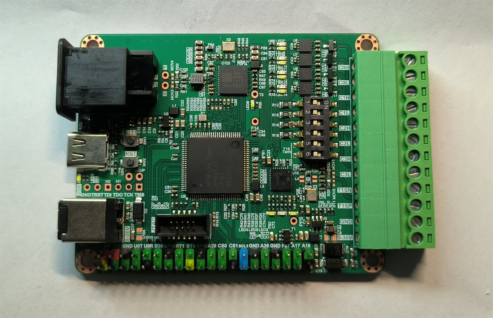
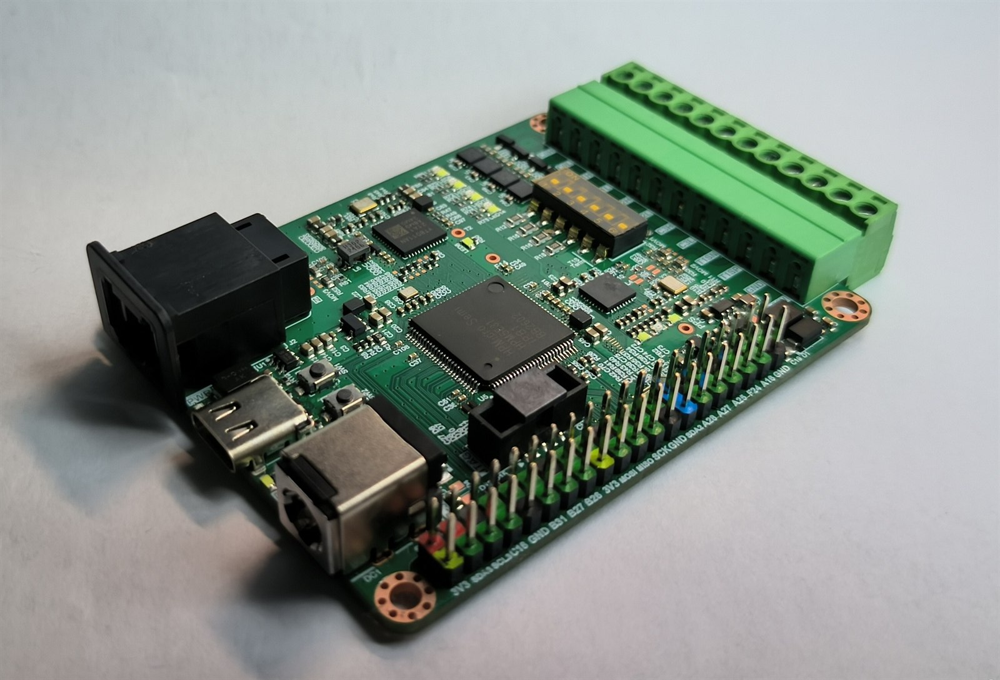
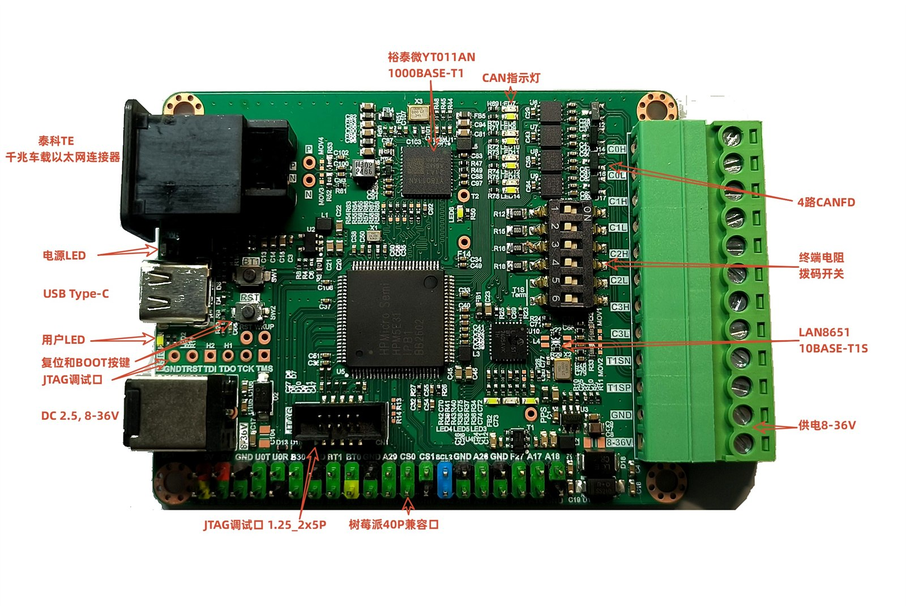

# hpm5e31_1 —— HPM5E31 最小系统板：例程 · 上板实测 · 技术手册

本目录是 **HPM5E31（先楫半导体 HPM5E00 系列，RV32-IMAFDCBP @480 MHz）最小系统板 hpm5e31_1**
的完整工程，随《HPM5E31 实战手册》一起发布：

- **例程**：按外设分类，每个例程都能编译、烧写、串口自证（附实测日志）；
- **MCAL**：AUTOSAR CP MCAL 子集（**15 个模块**，`mcal/` 目录），34 个模块例程 + 集成 demo + 第 42~50 章；
- **应用层**：21 个应用层协议例程（UDS/ISO-TP/J1939/CANopen/XCP/SOME-IP/XRCE-DDS+ROS2/PTP/gPTP/DLT/VSS/cannelloni 网关），含 Python/C++/Rust 上位机；
- **实测**：频率/吞吐/延迟/误差都有 `logs/` 里的串口日志作为证据；
- **文档**：书稿 Markdown（`docs/chapters/`），由脚本合成带版本号的 PDF，可离线阅读；
- **脚本**：一条龙构建/烧写/抓串口；多 agent 共享一块板时用 `scripts/hwlock.sh`（PID 自愈锁）串行化。



## 0. 源码仓库与许可

- **仓库**：<https://github.com/weifengdq/embedded>，本板内容在 `hpm5e31_1/` 子目录；
- **书稿 PDF**：按版本单独分发（v1.7.0，2026-11-25），**不入仓库**，用 `bash tools/build_pdf.sh` 可重新合成；
- **许可**：本目录代码遵循仓库根目录的 `LICENSE`（GPL-3.0）；引用的第三方组件（HPM SDK、letter-shell、
  lwIP、CherryUSB、vsomeip、CANopenNode、can-utils、linuxptp 等）版权与许可归各自上游，出处见第 27 章表 27-10/27-11。

> 本目录按公开仓库标准做过整理：正文与脚本里不出现内网地址/个人路径（统一用 `<host>`、`<proxy>`、`$HOME` 占位）；
> 插图统一压到宽度 ≤1920 px、256 色调色板（40 MB → 9.2 MB）；`logs/` 只保留书中直接引用的关键日志（约 470 条，
> 开发期全量 1500+ 条不随仓库分发）。处理方式见 `docs/写作规范.md` §10。

## 1. 快速开始（Ubuntu 主机）

```bash
git clone https://github.com/weifengdq/embedded && cd embedded/hpm5e31_1

# 1) 装 HPM SDK v1.13.0 与 RISC-V GCC 11.1（第 2 章有完整步骤），然后：
source scripts/env.sh                        # 导出 SDK/GCC/串口/工具路径（可用环境变量覆盖）

# 2) 编译 + 烧写 + 抓串口（一条龙）
bash scripts/build.sh shell/letter_shell_basic
bash scripts/hwrun.sh shell/letter_shell_basic --secs 5 --send "ver;clk"

# 3) 纯抓串口 / 只烧写 / 复用当前固件长测
python3 scripts/serial_cap.py --secs 5 --send "help"
bash scripts/hwrun.sh app/can_gateway --secs 10 --send "gw on;pass"
bash scripts/hwrun.sh shell/letter_shell_basic --secs 30 --send "help" --no-flash

# 4) 文档：质量检查 + 合成 PDF + 插图压缩
python3 tools/check_docs.py
bash tools/build_pdf.sh                      # 输出 docs/build/HPM5E31-Practical-Guide-v<版本>.pdf
python3 tools/compress_figs.py               # 插图入库前压缩（约 40 MB → 9 MB）
```

## 2. 硬件

| 项 | 规格 |
|---|---|
| MCU | HPM5E31IPB1（eLQFP100，RV32-IMAFDCBP 480 MHz，片内 1 MB Flash / 544 KB SRAM / 72 GPIO） |
| 板卡 | hpm5e31_1 最小系统板，24 MHz 无源晶振，外部无 NOR（用片内 Flash） |
| 调试 | J-Link JTAG（4 MHz）；串口 CH343 → `/dev/ttyACM0` 921600 8N1 |
| CAN | 4× CAN FD（TCAN1044AV）；CAN0↔CAN1、CAN2↔CAN3 终端电阻两两相连（可做双节点测试） |
| 10BASE-T1S | LAN8651（SPI2：SCLK PA20 / MISO PA22 / MOSI PA23 / CS PA21 / RST PA19 / INT PA24） |
| 千兆以太网 | YT8011AN（RGMII：PF02~PF13，MDC PA31 / MDIO PA30，RST PB29 / INT PB28） |
| USB | USB0（Pin67/68，HS OTG，设备模式） |
| 人机 | USR LED PA02（高亮，兼 BOOT_MODE0）、USR BTN PA03（按下高，兼 BOOT_MODE1）、8 颗 CAN 状态灯 |
| 供电 | DC 2.5 mm 座 / 接线端子 8~36 V，兼容树莓派 40P 排针 |





- **原理图**：[hardware/hpm5e31_1_refsch.pdf](hardware/hpm5e31_1_refsch.pdf)
- **顶层丝印图**：[hardware/hpm5e31_1_topsilk.pdf](hardware/hpm5e31_1_topsilk.pdf)
- **BOM**：[hardware/hpm5e31_1_bom.xlsx](hardware/hpm5e31_1_bom.xlsx)

> ⚠️ 复位时按住 USR BTN（PA03=1）会进入串行 ISP 模式，程序不运行——调试时注意。

## 3. 目录结构

```text
boards/hpm5e31_1/    板级支持包：board.c/clock.c/pinmux.c + bsp/(letter-shell 移植+通用命令) + pins/ + ext/
samples/             例程：gpio uart i2c spi can lan8651 enet pwm gptmr qei plb sdm adc dma usb flash power bench reliability shell（56 个）
samples/app/         应用层协议例程：can_gateway isotp_echo uds_ecu uds_flash j1939_* canopen_* xcp_* someip_* xrce_* ptp_* gptp_demo can_logger vss_signals dlt_log multiproto_coexist gs_usb_candle
mcal/                AUTOSAR MCAL 子集：common/ + 13 模块（include/src/cfg）+ mcal.cmake
samples/mcal/        MCAL 例程：26 个模块例程 + mcal_hello + ecu_integration
components/          可复用组件：app_can / app_lwip / app_can_gw / app_isotp / app_uds / app_j1939 / canopen_node / app_xcp / app_someip / app_xrce / app_ptp / app_dlt / gs_usb
host/                上位机工具：can_bridge canlog canopen dlt gs_usb j1939 ptp rust someip uds vss xcp xrce lan8651（Python / C++ / Rust）
docs/                书稿：chapters/（章节）、figures/（脚本生成的图）、generated/（自动生成表）
tools/               文档工具链：check_docs / build_pdf / gen_soc_tables / gen_appendix_tables / gen_status / compress_figs / figs/
scripts/             env.sh / build.sh / flash.sh / serial_cap.py / hwrun.sh（--no-flash/--post）/ hwlock.sh / board_lease.sh / new_sample.sh
hardware/            原理图、丝印图（PDF）与 BOM（xlsx）
logs/                书中引用的实测串口日志（证据，只保留关键条目）
README.assets/       板卡实物照片（正视图 / 斜视图 / 资源标注图）
```

## 4. 内容规模与实测状态

截至 v1.7.0：**52 章书稿（第 0~51 章，含第 42~50 章 AUTOSAR MCAL，其中第 49 章为 Eth/EthTrcv 与 lwIP/FreeRTOS 集成）/
183 张脚本生成的图 / 122 个可编译例程（15 个 MCAL 模块的 34 个例程 + 28 个应用层例程）/ 书中引用 480 条实测日志**。

自动生成的清单见 [docs/generated/status.md](docs/generated/status.md)（`tools/gen_status.py` 刷新）。
每个例程目录下有自己的 `README.md`：功能、接线、命令、实测现象、日志路径、易错点。

## 5. 技术手册（书稿）

### 5.1 v1.7.0 更新说明（2026-11-25）

**第九轮（R9）：千兆链路 15 h 耐久测试 + TCP pcb 池泄漏**

- 新增 `host/soak/` 耐久测试工具链（runner / 守护 / 报告 / 看板 / 外部看门狗），15 h 连续跑才发现“长时间多会话后监听还在、新连接静默超时”；
- 根因：TCP pcb 到 ABORTED 终态没有清会话指针（脱链的 pcb 不可回收），池又只有 10 个。修法：报告回调对所有终态清指针，`MEMP_NUM_TCP_PCB` 10→24；板端加 `tcppcb` / `lwipstat` 命令，可现场看池占用；
- 证据：`logs/soak-20261123-1942/summary.md`；第 49 章 §49.7.7、§49.9.17。

**第十轮（R10）：板→主机 CRC 误码闭环（PHY RGMII TXC 延迟 1→4）**

- 根因：YT8011AN 的 RGMII TXC 延迟档位 1（EXT 0x9001[7:4]）采样余量不足，扫 0~15 档后固定为 4（2~15 档 478 万帧 0 误码）；
- 新增 `host/soak/crc_probe.py`（ack/data/udp/ping，按秒 ppm 分布 + JSON）；`eth phy` / `eth txdly <0..15>` 运行时读写 EXT，扫档不用重烧；
- 证据：`logs/crc-r10-20261124/`、`logs/soak-val2-20261124/summary.md`；第 12 章 §12.7.5、第 49 章 §49.9.16；
- 顺带：`scripts/env.sh` 的串口默认值改为 `/dev/ttyACM1`（板载 CH343 是 ACM1，ACM0 是 J-Link 的 VCOM）。

**第十轮（R10.1）：15 h 重跑暴露的残余 pcb 泄漏**

- 现象：重跑数据面全绿（145 个阶段、CRC 0 ppm、212 M 发帧），但第 14 个周期因 pcb 池耗尽挂死；
- 根因：R9 的“任何终态清会话指针”把 iperf server 的监听句柄也清了，下个周期重复 `tcp_bind(5001)` 失败，SDK 的 bind 失败路径不释放 state/pcb（每 25 min 漏 1 个）；
- 修法：iperf 句柄拆成 client / TCP server / UDP server 三个，监听常驻、重复 arm 返回“已监听”、`istop` 统一 abort，报告回调只清客户端；12 周期压缩耐久 PASS（0 复位 / 0 失败阶段、TCP 248.9 Mbit/s、CRC 0）；
- 证据：`logs/soak-20261124-1540/summary.md`、`logs/soak-val3-20261125/summary.md`；第 49 章 §49.7.8、§49.9.18。

**公开发布版的整理（v1.6.0 起保持）**

- **脱敏**：内网仓库地址、内网主机/IP、代理与个人目录全部替换为 `<host>`/`<proxy>`/`$HOME` 或仓库相对路径；
- **体积**：`docs/figures` 40 MB → 9.2 MB（PNG 调色板量化 + 宽度上限 1920 px，脚本 `tools/compress_figs.py`）；`logs/` 只保留书中引用的关键日志（索引见第 51 章 §51.6）；
- **增补**：硬件资料（原理图/丝印/BOM/板卡照片）、先楫官方资料与社群入口（第 27 章表 27-12）、GitHub 仓库地址（封面、版权页、前言、附录）；
- **lwIP 发布配置**：`LWIP_DEBUG` 与 `LWIP_STATS`/`MEM_STATS`/`MEMP_STATS`/`LWIP_STATS_DISPLAY` 默认全关——这些是排查资源泄漏用的诊断开关，打开会占 RAM 并拉低 iperf 吞吐；复现耐久测试时再临时打开（板端 `lwipstat` 命令会提示未开启）；
- **PDF**：v1.7.0 重新合成（三级书签校验通过），单独分发，不入仓库。

### 5.2 更早版本要点

**第八轮（v1.5.0）：lwIP TCP 根因闭环、gs_usb 5M、全书编号统一**

- **lwIP TCP 收发闭环（根因不在 lwIP）**：主机侧 tcpdump 抓到"ping 请求 6 µs 内喷出 8 帧、seq 乱序且重复、随后 31 s 静默"，
  根因是 `Eth_ProvideTxBuffer` 按"下标最小空闲"发放 TX 缓冲，把新帧塞到 **TX DMA 游标身后**，发送 DMA 只能沿链前进 →
  帧全部积压到整环填满才一次性喷出。改为 SDK 同款 **TxNext 游标按序发放**（拿不到就 `BUSY`）+ 在 `linkoutput` 环满时就地回收
  ACK 缓冲后：ping 2/5→**5/5**、主机→板 TCP 0.084→**251~252 Mbit/s**、UDP 上行 92→**375.10 Mbit/s**（主机实收 365、丢 0.087%）、
  `eth_raw_echo` TX burst 219 370→**242 924 fps**。四组 A/B、10 轮矩阵、五个易错点见第 49 章 §49.8.10 / §49.9.12~16（图 49-8/49-9）。
- **eth_irq 中断模式量化（第 49 章 §49.7.5）**：空闲时"找帧"CPU 8.06%→**0.03%**、1000 帧/s 8.28%→**0.32%**；
  全速灌包两种模式吞吐同量级（中位 156.8k vs 154.8k 帧/s），每帧一次中断无合并。顺带修了 R7 例程两处 bug
  （窗口单位写成 ms、magic 判在帧头而不是整帧偏移）；并记录"中断切回轮询会整机卡死"的安全切换顺序（表 49-31/33/34、图 49-10/11）。
- **gs_usb 5 Mbit/s 复测通过（第 41 章 §41.7.8）**：1 Mbit/s 仲裁 + 5 Mbit/s 数据段、64 B FD+BRS 双向各 4000/4000 帧 **0 丢帧**、
  25 万帧满速长测 0 丢、dmesg 0 oops；同时修掉一个固件缺陷（满速 TX 丢帧不回 echo → TX URB 泄漏 → netdev 队列永久停）。
- **纠正 R7 的"省 37 KB Flash"误判（第 48/49 章）**：SDK 链接脚本里 `.noncacheable` 本身就是 NOLOAD，A/B 实测改前改后
  `demo.bin` 都是 97 264 B、LOAD 段 FileSiz=0——那 37 632 B 从来只在 RAM 里。
- **全书编号统一（第 0~51 章连续）**：消除第 27→29 章的空号，小节统一为 `<章>.<节>`；交付 `tools/renumber.py` 与
  `tools/check_numbering.py`（章号/小节号/§ 引用/图表号/占位符五类门禁）。

**第七轮（v1.4.0）：MCAL Eth、DoIP/XCP-UDP/MQTT、两处硬件级修复**

- **MCAL 补 Eth / EthTrcv（第 49 章，模块数 13 → 15）**：Eth 走 ENET0 DMA 描述符环与零拷贝收发，EthTrcv 经 MDIO 管 YT8011AN；
  在它之上移植 lwIP netif（`components/app_lwip_eth/`）与自写 FreeRTOS `sys_arch`（`components/freertos_lwip_port/`），
  `eth_lwip` / `eth_freertos_lwip` 上板跑通 ping（2/5，RTT 136~383 µs）与 lwIP UDP iperf（上行 92 Mbit/s）；
  TCP 收发与裸帧回显的两个已定位问题在第八轮闭环。
- **应用篇补三个方向**：**DoIP**（ISO 13400-2，第 31 章）、**MQTT 3.1.1 车云遥测**（第 37 章）、**XCP on UDP**（第 34 章），
  都配板端例程 + 上位机工具 + 实测数据。
- **修通 I2C 400k/1M 读**：目标（从机）侧 `SETUP.T_SUDAT` 被 SDK 算成 0，`mcal/I2c` 增加 `i2c_target_timing_fixup()`
  抬到 250 ns 下限；100k/400k/1M 各 1000 次"写 24 B + 读 24 B" 0 误码。
- **修通 CAN FD 5 Mbit/s 数据段**：TDC 的 SSP 偏移（`TDCR.TDCO=20`）越出 16 tq 数据位 → TEC 累加到 248 → bus-off；
  改为 `TDCO=12` 并加配置期校验；500k/5M 与 1M/5M 各 50/50、3000 帧长测 0 丢。

**第六轮（v1.3.0）：AUTOSAR MCAL**

从零实现 15 个 AUTOSAR CP MCAL 模块（Mcu/Port/Dio/Gpt/Pwm/Icu/Adc/Spi/I2c/Can/Wdg/Mem/Crc/Eth/EthTrcv）：
每个模块含 `include/<Mod>.h`（AUTOSAR API）、`src/<Mod>.c`（寄存器级实现）、`cfg/<Mod>_Cfg.h` +
`cfg/<Mod>_PBcfg.c`（预编译 + post-build 配置）；板级引脚/实例/时钟集中在 `*_PBcfg.c`，换板只改配置。
实测：CPU 480 MHz 实测 479,997,500 Hz（-5 ppm）；GPTMR 100.0004 MHz；Mem 擦除 2.04 MB/s / 编程 261.7 KB/s；
CRC32 硬件 60.2 MB/s（软件 20.8 MB/s，2.9x）；`ecu_integration` 13 模块同固件 25 s 无 Det 错误、无复位。
合规对比与量产差距清单见第 50 章。

**第五轮（v1.2.0）**：全书待确认项逐条复核（已实测/已定位/已知限制三态）；附录移到末尾改为第 51 章；
SPI1↔SPI3、I2C2↔I2C3 双控制器互测、4 路 CAN 并发满载、ISO-TP 6000 B、UDS 64 KB 刷写、LAN8651 lwIP、lwIP 双向 652 Mbit/s 等。

### 5.3 PDF 与书签（强制）

所有 PDF 必须带三级书签（封面/版权/目录 + 各章 + 章内小节），合成脚本内置校验：
`python3 tools/pdf_outline.py --check docs/build/<pdf> --min-entries 1340 --require-level 3`。
v1.7.0：**797 页 / 1349 条三级书签 / 52 章**（v1.6.0 791 页、v1.5.0 787 页、v1.4.0 768 页、v1.3.0 684 页、v1.2.0 564 页、v1.1.0 499 页）。

### 5.4 应用层协议篇（第 28~41 章）速查

| 章 | 主题 | 例程 | 上位机 |
|---|---|---|---|
| 28 | 测试台与 cannelloni CAN 网关 | `app/can_gateway` | can-utils + cannelloni |
| 29 | ISO-TP（ISO 15765-2） | `app/isotp_echo` | Python（can-isotp） |
| 30 | UDS（ISO 14229）诊断与刷写 | `app/uds_ecu`、`app/uds_flash` | Python（udsoncan） |
| 31 | DoIP（ISO 13400-2） | `app/doip_server` | Python（`host/doip`，自写 socket） |
| 32 | SAE J1939 | `app/j1939_ecu/tp/dm` | Python + Linux can-j1939 |
| 33 | CANopen（CiA 301） | `app/canopen_node/pdo/sdo_seg` | Python（canopen） |
| 34 | XCP 标定测量 + A2L（含 XCP on UDP） | `app/xcp_can_daq`、`app/xcp_can_cal`、`app/xcp_eth` | Python + Rust（a2ltool）+ pyxcp |
| 35 | SOME/IP + vsomeip | `app/someip_rpc/event/tp` | C++（vsomeip）+ Python |
| 36 | Micro-XRCE-DDS 与 ROS 2 | `app/xrce_pubsub`、`app/xrce_ros2_bridge` | C++ Agent + ROS 2 Python |
| 37 | MQTT 车云消息与遥测 | `app/mqtt_telemetry` | mosquitto + paho-mqtt |
| 38 | IEEE 1588 PTP / gPTP | `app/ptp_slave/master`、`app/gptp_demo` | linuxptp（ptp4l/pmc） |
| 39 | 日志与信号（DLT/VSS/candump） | `app/can_logger`、`app/vss_signals`、`app/dlt_log` | Python + dlt-viewer/canplayer |
| 40 | 应用层综合评测与选型 | —（汇总全篇实测） | — |
| 41 | gs_usb / candleLight：USB↔4 路 CAN FD 适配器 | `app/gs_usb_candle` | 内核 gs_usb + python-can/candump |

> 应用层开发约定（目录/接线/bench/组件 API/CAN ID/端口/上位机规范）见
> [docs/应用层开发约定.md](docs/应用层开发约定.md)；例程证据矩阵由 `tools/gen_app_matrix.py` 生成到
> [docs/generated/app-matrix.md](docs/generated/app-matrix.md)。

## 6. 约定

- 例程统一 `#include "bsp.h"` → `bsp_init()` → 主循环 `bsp_shell_poll()`，并注册 letter-shell 命令；
- 所有上板测试走 `scripts/hwrun.sh`（内部 PID 自愈锁串行化；`--post` 持锁跑上位机联调；`--no-flash` 复用当前固件）；
- gs_usb 等"设备必须持续在线"的测试先用 `scripts/board_lease.sh <秒> <名字>` 持租约，避免被并行的烧写复位（否则 USB 掉线会被误判为固件崩溃）；
- 主机侧 USB autosuspend 会挂起 HPM USB0 设备：测试前 `echo -1 > /sys/module/usbcore/parameters/autosuspend` + 端口 `power/control=on`
  （固件已加 suspend 处理后默认配置也可稳定）；
- 文档引用格式：`DS §x (p.N)` / `RM §x (p.N)` / `Errata E000xx` / SDK 路径:行 / `logs/...`；
- 不编造数据：没测到的写"待确认（需实测）"并给验证方法；
- 提交格式：`feat|fix|docs|test(<scope>): <说明>`，少量多次。

### 6.1 双机主从例程（杜邦线互连）

| 例程 | 接线 | 状态 |
|---|---|---|
| `samples/i2c/i2c2_i2c3_master_slave` | I2C2 SCL/SDA(PD02/PD03) ↔ I2C3 SCL/SDA(PD07/PD06) | **PASS**：100k/400k/1M 双向；1 MHz 连续 1 万次 24 B 写+读 = 480 000 B / 0 错误。易错点：I2C 引脚必须开 IOC LOOP_BACK |
| `samples/spi/spi1_spi3_master_slave` | SPI1(PC10-13) ↔ SPI3(PA26-29) | **PASS**：1/5/10 MHz 双向 0 错误（10 MHz 连续 1 MB 0 错误、873 KB/s）；20 MHz 每次传输固定 1 字节错；可配频率只有源时钟的偶数分频 |

## 7. 环境（可复现）

| 组件 | 版本 |
|---|---|
| HPM SDK | v1.13.0 |
| RISC-V GCC | riscv32-unknown-elf 11.1.0（newlib multilib） |
| CMake / Ninja | 4.2.3 / 1.13.2 |
| J-Link | Commander V9.72 |
| 文档链 | pandoc 3.7 + XeTeX 2025 + Noto CJK + graphviz |

详细搭建步骤见 [docs/chapters/02-toolchain-build-flash.md](docs/chapters/02-toolchain-build-flash.md)。

## 8. 全量上板冒烟回归

`bash scripts/smoke_all.sh` 遍历全部例程（79 个）：应用层 23 例 **23/23 PASS**（`docs/generated/app-smoke.md`），
全量报告 `docs/generated/smoke-report.md`（个别例程偶发 J-Link 瞬时故障，单独复跑即 PASS；SKIP 为 blinky_btn，
无 shell 命令仅 LED 闪烁，需人工观察）。

## 9. 实测结果精选与硬件建议

### 9.1 关键实测结果（详见各章与 `logs/`）

| 项目 | 实测结果 | 条件/说明 |
|---|---|---|
| CPU / 总线 | 480 MHz / AXI-AHB 200 MHz / XPI 100 MHz | 24 MHz 晶振，PLL0 960 MHz |
| CoreMark | **1898 分 = 3.954 CoreMark/MHz**（-O3，XIP，数据 DLM） | GCC 11.1.0；-O2 为 3.767 |
| Dhrystone | **676 DMIPS = 1.409 DMIPS/MHz**（-O3，-fno-inline） | verify PASS |
| 内存带宽 | libc memcpy 95.9 MB/s → 手写内核 **922.9 MB/s**；memset 959.6 MB/s | 非 cacheable 慢 11.5 倍 |
| 中断延迟 | **210 ns（XIP）/ 220 ns（ILM）**，抖动 <1 tick | n=10000，GPTMR 自计时 |
| GPIO | 翻转 65 ns（7.7 MHz 方波）；FGPIO 单次 14.6 ns（快 4.5×） | |
| UART | 921600 实际 909090（-1.36%）；控制台吞吐 **85.79 KB/s（93.1%）** | 源时钟 80 MHz |
| SPI | 单机 DMA 2490 KB/s @20 MHz（99%）；双机主从 1/5/10 MHz 双向 0 错误 | 回环需外接线 |
| CAN FD | 经典 500k 单向 4305 frame/s；FD 1M/2M 64B ping-pong 1580 往返/s；FD 1M/8M 64B 单向 9058 frame/s | CAN0↔CAN1 双节点，0 丢帧 |
| 以太网（YT8011AN） | **TCP 下行 935 Mbit/s（CPU 24.7%）；TCP 上行 466 Mbit/s；UDP 下行 944 / 上行 641** | 1000M Slave，iperf2 2.2.1，lwIP 2.1.2 |
| 10BASE-T1S（LAN8651） | 硬件 SPI2 已修复：数据通道 **1518B 帧 9.08 Mbit/s（贴 10 Mbps 线速）**、20 MHz/60B 18489 帧/s | PLCA 主从 PST=1 均通过 |
| USB | CDC ACM 枚举 + 回显 **3/3 PASS**（34b7:ffff HPMicro CDC DEMO） | high-speed 480 Mbps |
| 片内 Flash | 擦 4 KB 2.1 MB/s、写 4 KB 280 KB/s、读 30 MB/s、XIP 直读 40~46 MB/s | ROM API |
| DMA | XDMA 峰值 407 MB/s、链式 485 MB/s、HDMA 327 MB/s | non-cacheable AXI SRAM |
| ADC16 | 轮询 605~607 kHz；软件过采样 7.9→11.8 bit | 16 bit，conv clk 50 MHz |
| PWM | 10 kHz：9999.5 Hz / 50.04%；GPTMR 1 kHz 抖动 σ=0.194 µs | |
| ISO-TP | 经典 500k **29.2 KB/s**；CAN FD **189.6 KB/s**（6.5×） | 第 29 章 |
| UDS | 13/13 服务 PASS，单服务 RTT **0.47~3.09 ms**；32 KB 刷写 10/10 PASS | 第 30 章 |
| J1939 | 地址声明 251 ms；BAM 140.8 B/s vs RTS/CTS **6867.9 B/s**（49×） | 第 32 章 |
| CANopen | PDO 延迟 **341 µs**（σ8 µs）；分段 SDO 14 KB/s | 第 33 章 |
| XCP | DAQ **1000 Hz / 0 丢失**、时间戳 sd 12.9 µs；A2L 经 a2ltool 校验 PASS | 第 34 章 |
| SOME/IP | RPC avg **0.105 ms** / p99 0.125 ms | 第 35 章 |
| XRCE-DDS / ROS 2 | ROS 2 侧 **100 Hz**、σ0.29 ms、命令 RTT 2.5~3.5 ms、0 次 malloc | 第 36 章 |
| PTP / gPTP | 从钟 **−15.5 ns**（σ363 ns）；主钟 +98.2 ns；gPTP +54.1 ns | 第 38 章 |
| gs_usb | 枚举 1209:2323、4 通道；FD 1M/5M 双向 4000/4000 帧 0 丢、25 万帧长测 0 丢 | 第 41 章 |
| MCAL | CPU 479,997,500 Hz（-5 ppm）、Mem 擦 2.04 MB/s、CRC32 硬件 60.2 MB/s | 第 42~50 章 |

### 9.2 硬件建议（如需进一步闭环测量）

| 建议 | 引脚 | 收益 |
|---|---|---|
| SPI 回环短接线 1 根 | PC12(MISO) ↔ PC13(MOSI) | 可验证 SPI 真回环（当前用 SCLK 反推） |
| QEI 输入飞线 2 根 | PD07→PC07、PD06→PC06 | QEI/QEO 位置/速度实测 |
| QEO→QEI 回环 3 根 | QEO0_A/B/Z ↔ QEI0_A/B/Z | 编码器接口完整闭环 |
| 示波器/逻辑分析仪 | LAN8651 SPI2 SCLK/MOSI（PA20/PA23） | 定位硬件 SPI2 读回异常（位翻转正常） |

## 10. 先楫官方资料与社群

| 类别 | 入口 |
|---|---|
| 公司官网 | <https://www.hpmicro.com/> |
| 软件开发资料汇总 | <https://www.hpmicro.com/design-resources/development-software/5> |
| SDK 在线文档 | <https://hpm-sdk.readthedocs.io/zh-cn/latest/> |
| 官方 GitHub（SDK/RTOS/APPS） | <https://github.com/hpmicro> |
| 百度网盘资料（提取码 hp11） | <https://pan.baidu.com/s/1XGChrZrARTMxA2kannQTgg?pwd=hp11> |
| 编程 IDE（SEGGER Embedded Studio） | <https://www.segger.com/downloads/embedded-studio/> |
| 引脚/时钟在线配置工具 | <https://tools.hpmicro.com/> |
| 开发者知识库 | <https://kb.hpmicro.com/> |
| 视频教程（B 站） | <https://space.bilibili.com/592932589> |
| EVK 快速上手 | <https://mp.weixin.qq.com/s/CJXdNpeDWIzatPawqtclWg> |

> 社群以技术交流为主，提问建议附芯片型号、SDK 版本、复现步骤与串口日志；资料以官网与 GitHub 为准。
> 完整表格与说明见第 27 章表 27-12。

## 11. 参考来源

- 先楫官网：<https://www.hpmicro.com/>；HPM SDK：<https://github.com/hpmicro/hpm_sdk>、文档 <https://hpm-sdk.readthedocs.io/zh-cn/latest/>
- letter-shell：<https://github.com/NevermindZZT/letter-shell>
- lwIP：<https://savannah.nongnu.org/projects/lwip/>
- CherryUSB：<https://github.com/cherry-embedded/CherryUSB>
- 各章协议/工具的上游仓库总表见第 27 章表 27-10、表 27-11
