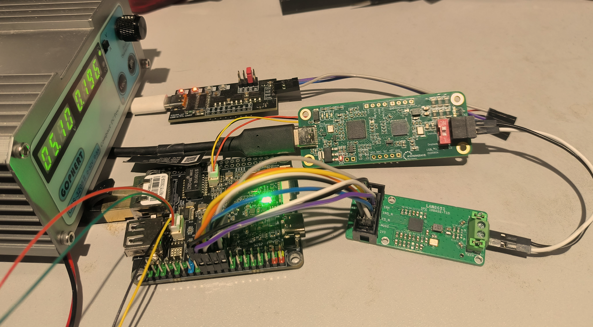
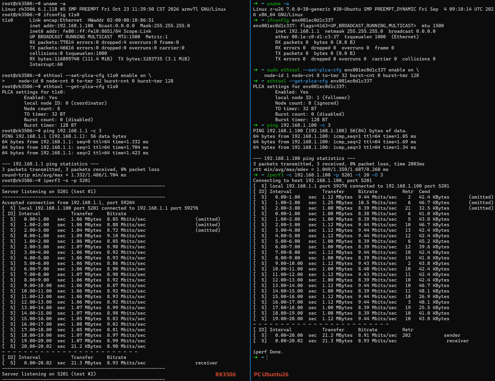

# RK3506 + LAN8651 (10BASE-T1S) 移植、调试与性能测试全记录





**RK3506 Kernel 6.1 SPI** <-> **LAN8651** <-> **USB-10T1S** <-> **PC Ubuntu 26.04**

> 目标板：**北京合众恒跃 HZ-RK3506G2_MiniEVM（RK3506G2，TF 卡版）**
> 扩展：**Microchip LAN8651 10BASE-T1S MAC-PHY（SPI / OPEN Alliance TC6）**
> 对端：**K2L / MCHP USB-10BASE-T1S（EVB-LAN8670-USB，`184f:0051`）**
> 内核：**Linux 6.1.118（RK 厂商 SDK）**
> 文档版本：2026-10-23，分支 `lan8651_10t1s`
>
> 本文既是一篇“从零可复现”的操作手册，也保留了本次调试的**完整证据链、踩坑过程与性能数据**。
> 小白可以按第 5、6 章直接照做；需要原理时可以看第 2、3、4 章。

---

## 0. 结论摘要（先看这里）

| 项目 | 状态 | 说明 |
| --- | --- | --- |
| J7 接线电平 | ✅ 合理 | 6 根信号全部在 **3.3 V** PMUIO 域；LAN8651 DevKit 也是 3.3 V I/O |
| ★ J7 SPI0 实际引脚 | ✅ **已定位** | J7 走 **RM_IO8-11 = GPIO0_B0-B3**，**不是**专用 SPI0 C0-C3 |
| ★ UART2/UART3 复用冲突 | ✅ 已解决 | RS485_1（UART2）占 B1/B2、北斗（UART3）占 B0；DTS 已禁用二者 |
| Linux 6.1 驱动 | ✅ 已回移并编译通过 | `oa_tc6` + `lan865x` + `microchip_t1s` + PLCA/ethtool netlink |
| 板端 LAN8651 | ✅ **link up** | `t1s0`，`10baseT1S_P2MP/Half`，10 Mbps，MAC `02:00:00:10:86:51` |
| PLCA Slave（板 Node1 / 主机 Node0） | ✅ **实测通过** | `Status: on`，ping 3/3，TCP **8.86 Mbps** |
| PLCA Master（板 Node0 / 主机 Node1） | ✅ **实测通过** | `Status: on`，主机也 `on`，TCP **8.93 Mbps**，UDP 9M 丢包 0.13% |
| PLCA 关闭（CSMA）对比 | ✅ | TCP **6.72 Mbps**（PLCA 提升约 32%） |
| 调优 | ✅ | `to-tmr=32/64`、`burst-cnt=2` 表现最好；`to-tmr=16` 明显变差 |
| 增量部署 | ✅ | SSH 写 `/dev/mmcblk0p3`（FIT）+ 替换 `/lib/modules/6.1.118`，无需读卡器 |
| 接口命名 | ✅ 已处理 | LAN8651 注册为 `t1s0`；RK GMAC 保持 `eth0`（S39 重命名脚本） |

**一句话总结**：软件回移 + DTS 修正 + 接口重命名后，LAN8651 在 RK3506 上跑通，PLCA 主/从、ping、TCP/UDP 全部实测通过；TCP 约 **8.9 Mbps**，接近 10BASE-T1S 半双工理论上限。

---

## 1. 背景与名词

### 1.1 为什么是 LAN8651 + 10BASE-T1S

- **10BASE-T1S**：IEEE 802.3cg 定义的 **10 Mbps、单对双绞线、多点（P2MP）** 车载/工业以太网。它与 100BASE-T1（车载点对点）和 10BASE-T1L（长距离点对点）不是一回事。
- **PLCA（Physical Layer Collision Avoidance）**：10BASE-T1S 的多点总线仲裁机制。节点按 **Node ID** 轮流获得发送机会（TO，Transmit Opportunity）：
  - **Node 0 = Coordinator（Master）**：周期性发送 **BEACON**，维护 `Node Count`、`TO Timer`；
  - **Node 1..254 = Follower（Slave）**：收到 BEACON 后按 ID 顺序发送；
  - 所有节点的 `TO Timer`、`Node Count` 必须一致。
- **LAN8651**：Microchip 的 10BASE-T1S **MAC-PHY**，主机侧是 **SPI**，使用 **OPEN Alliance TC6** 协议。它把 MAC 和 PHY 集成在芯片内，Linux 侧表现为一个普通 `net_device`，PHY 通过芯片内部 MDIO 总线访问。
- **OA TC6**：OPEN Alliance 10BASE-T1x MAC-PHY Serial Interface。控制事务读写寄存器；数据事务收发以太网帧。SPI **Mode 0（CPOL=0, CPHA=0）**，MSB first，最高 **25 MHz**。
- **USB-10BASE-T1S（EVB-LAN8670-USB）**：K2L/Microchip 的 USB 转 10BASE-T1S 适配器，内部 LAN8670 PHY + SMSC95xx USB 网卡。Linux 下用 `smsc95xx` + `microchip_t1s`，通过 `ethtool` 配置 PLCA。

### 1.2 本次用到的资料

| 资料 | 路径/链接 |
| --- | --- |
| 厂商资料（原理图/规格书/SDK） | `/mnt/sda3/rk3506/HZ-RK3506G2_MiniEVM` |
| 语雀在线文档 | <https://hzhydocs.yuque.com/org-wiki-hzhydocs-rg5tcg/dn05eo> |
| LAN8650/1 数据手册 | `/mnt/sda3/rk3506/ref/LAN8650-1-Data-Sheet-60001734.pdf` |
| LAN8650/1 Errata | `/mnt/sda3/rk3506/ref/LAN8650-1-Errata-80001075.pdf` |
| LAN865x Linux 驱动说明 | `/mnt/sda3/rk3506/ref/LAN865x-Linux-Driver-Install-Application-Note-00005990.pdf` |
| LAN867x Linux 驱动说明 | `/mnt/sda3/rk3506/ref/LAN867x-Linux-Driver-Install-Application-Note-00005992.pdf` |
| Microchip LAN865x 驱动包 v1.1 | `/mnt/sda3/rk3506/ref/lan865x-linux-driver-1v1.zip` |
| EVB-LAN8670-USB Linux 驱动 | `/mnt/sda3/rk3506/ref/EVB-LAN8670-USB_Linux_Driver_4v3.zip` |
| TC397/MCU 侧 LAN8651 调试记录 | `~/embedded/tc397/handover/` |
| LAN8651 DevKit 原理图 | `~/embedded/lan8651/LAN8651_DevKit_Sch.pdf` |
| 本仓库交接说明 | `handover/HANDOVER-LAN8651.md` |

---

## 2. 硬件连接与电平分析

### 2.1 实际接线（J7 树莓派兼容排针）

| J7 引脚 | 板卡网络名 | RK3506 实际引脚 | 方向 | 接到 LAN8651 |
| --- | --- | --- | --- | --- |
| 17 | VCC_3V3 | — | 电源 | 3V3 |
| 20 | GND | — | 电源 | GND |
| 18 | GPIO0_A2 | GPIO0_A2（RM_IO2） | 输出 | RESET_N（低有效） |
| 19 | SPI0_MOSI | **GPIO0_B1（RM_IO9）** | 输出 | SDI（芯片输入） |
| 21 | SPI0_MISO | **GPIO0_B2（RM_IO10）** | 输入 | SDO（芯片输出） |
| 22 | GPIO0_A6 | GPIO0_A6（RM_IO6） | 输入 | IRQ_N（低有效，电平） |
| 23 | SPI0_CLK | **GPIO0_B0（RM_IO8）** | 输出 | SCLK |
| 24 | SPI0_CSN0 | **GPIO0_B3（RM_IO11）** | 输出 | CS_N（低有效） |

> ⚠️ **本项目的最大坑**：J7 的 SPI0 信号**不是** RK3506 的专用 SPI0 引脚（GPIO0_C0-C3），而是通过 **RM_IO 矩阵**映射到 **GPIO0_B0-B3**。厂商原理图第 6 页的跨页网络标签明确写着：
> `SPI0_CLK -> RM_IO8/GPIO0_B0`、`SPI0_MOSI -> RM_IO9/GPIO0_B1`、`SPI0_MISO -> RM_IO10/GPIO0_B2`、`SPI0_CSN0 -> RM_IO11/GPIO0_B3`。
> 用 `spi0_clk_pins`/`spi0_csn0_pins`（C0-C3）会完全读不到数据（本次调试的前半程就卡在这里）。

### 2.2 电平是否都是 3V3？——是

厂商原理图《03-IO Power Domain Map》：

| IO 域 | GPIO 组 | 实际供电 | 电压 |
| --- | --- | --- | --- |
| PMUIO | GPIO0_ABC | VCC_3V3 | **3.3 V** |
| VCCIO1 | GPIO1_ABCD | VCC_3V3 | 3.3 V |
| VCCIO2 | GPIO2_A | VCCIO_FLASH | 1.8/3.3 V |
| VCCIO3 | GPIO2_BC | VCC_3V3 | 3.3 V |
| VCCIO4 | GPIO3_AB | VCC_1V8 | 1.8 V |

- 本次用到的 **GPIO0_A2 / A6 / B0 / B1 / B2 / B3 全部属于 PMUIO / GPIO0_ABC，供电 VCC_3V3 = 3.3 V**。
- LAN8651 DevKit 的 VDDP / VDDAU / SPI I/O 也是 3.3 V（P1 pin10 = 3V3；R4/R5/R8 均为 10 kΩ 上拉到 3V3）。
- 因此 **电平完全兼容，不需要电平转换**。
- 注意：GPIO0_C0-C3 是专用 SPI0 引脚，但 J7 没有走它们；它们经过 22R 串联电阻（R11/R7/R12/R69）去了别处，和本接线无关。

### 2.3 接线是否合理？——合理，但要先解决两个复用冲突

1. **SPI0 四线 + 复位 + 中断** 的选择合理：
   - SPI0 控制器 `ff120000.spi`，原生 CS0，支持 DMA；
   - GPIO0_A2/A6 是普通 GPIO，未被其它外设占用（音频 `hp-det` 在 GPIO1_A6）。
2. **必须禁用 UART2 / UART3**：
   - J7 的 SPI0 引脚与板载扩展接口复用：
     - `RM_IO8 (GPIO0_B0)` = **UART3_TX**（北斗/GPS）；
     - `RM_IO9 (GPIO0_B1)` = **UART2_TX**（RS485_1）；
     - `RM_IO10 (GPIO0_B2)` = **UART2_RX**（RS485_1）。
   - 如果不禁用 UART2/UART3，pinctrl 会报
     `could not request pin 8 (gpio0-8) from group rm-io8-spi0-clk`，SPI 无法工作。
   - 本仓库 DTS 已加：
     ```dts
     &uart2 { status = "disabled"; };
     &uart3 { status = "disabled"; };
     ```
   - 代价：**RS485_1 与北斗/GPS 不可同时使用**（这是板卡硬件复用决定的）。
3. **EXP_D1 LED 不是冲突源**：
   - `EXP_D1` 在 **GPIO0_C3**，不是 J7 的 CS0（B3）；DTS 保留原样即可。
   - 之前误判为冲突，已修正。
4. **中断是电平触发**：
   - LAN8651 IRQ_N 是 **active-low level**；驱动用 `IRQF_TRIGGER_LOW | IRQF_ONESHOT`，DT 写 `IRQ_TYPE_LEVEL_LOW`。
   - 不要改成 edge falling，否则高流量时丢中断（Microchip 驱动说明明确要求 level）。
5. **SPI 模式与速率**：
   - Mode 0（CPOL=0, CPHA=0），MSB first；
   - LAN8651 最高 25 MHz；本次用 **15 MHz** 已足够跑满 10 Mbps；
   - 15 MHz 下 20 秒 iperf 稳定无错，暂不需要 25 MHz。
6. **终端电阻**：
   - 10BASE-T1S 总线两端各 100 Ω（或按板卡说明的 120 Ω）终端；本次 USB 适配器与 LAN8651 板两端终端均已接入。

### 2.4 电源与电流

- LAN8651 数据手册：VDDA 典型 26 mA、VDDP 典型 5 mA，总功耗典型 137 mW。J7 的 3V3 完全够用。
- **不要用 J7 的 5V 给 DevKit 的 3V3 脚**；DevKit 没有板载稳压器（P1 pin10 直接是 3V3 网络）。

---

## 3. Linux 6.1 的现状与回移方案

### 3.1 厂商 6.1.118 缺什么

- 没有 `drivers/net/ethernet/microchip/lan865x/`；
- 没有 `drivers/net/ethernet/oa_tc6.c` / `include/linux/oa_tc6.h`；
- 没有 `drivers/net/phy/microchip_t1s.c`（LAN867x/LAN865x PHY 驱动）；
- 没有 PLCA 的 ethtool netlink 支持（`ETHTOOL_MSG_PLCA_*`、`genphy_c45_plca_*`）；
- UAPI 里没有 `10baseT1S_*` link mode（只有 `10baseT1L_Full`）。

### 3.2 回移内容（本仓库 `patches/0004`）

| 层 | 文件 | 内容 |
| --- | --- | --- |
| UAPI | `include/uapi/linux/ethtool.h` | 新增 `10baseT1S_Full/Half/P2MP_Half`（bit 93/94/95） |
| UAPI | `include/uapi/linux/ethtool_netlink.h` | 新增 PLCA 消息/属性；保留 RSS 占位以对齐 mainline 编号 |
| UAPI | `include/uapi/linux/mdio.h` | 新增 `MDIO_MMD_POWER_UNIT = 13` |
| PHY core | `include/linux/phy.h` | `phy_plca_cfg/status`、`phy_driver` 的 PLCA 回调、`PHY_BASIC_T1S_P2MP_FEATURES` |
| PHY core | `drivers/net/phy/phy-c45.c` | `genphy_c45_plca_get_cfg/set_cfg/get_status`（MMD31 0xCA00..0xCA05） |
| PHY core | `drivers/net/phy/phy.c` | `phy_ethtool_get/set_plca_cfg`、`phy_ethtool_get_plca_status` |
| PHY core | `drivers/net/phy/phy_device.c` | 注册 ethtool PHY ops + `phy_basic_t1s_p2mp_features` |
| PHY core | `drivers/net/phy/phy-core.c` | 10BASE-T1S speed/duplex 映射；`BUILD_BUG_ON` 93→96 |
| ethtool | `net/ethtool/plca.c` | 6.9 的 PLCA netlink 实现，适配 6.1 的 `ethnl_request_ops`（无 `->set`） |
| ethtool | `net/ethtool/netlink.c/.h/Makefile` | 注册 GET/SET/GET_STATUS |
| ethtool | `net/ethtool/common.c` | link mode 名字/参数表补 3 项 |
| 驱动 | `drivers/net/ethernet/oa_tc6.c` | Microchip v1.1 的 TC6 框架（含错误恢复、硬件 reset、PLCA 保持） |
| 驱动 | `drivers/net/ethernet/microchip/lan865x/` | LAN865x MAC 驱动 |
| 驱动 | `drivers/net/phy/microchip_t1s.c` | LAN867x/LAN865x PHY 驱动（含 PLCA 回调） |
| 驱动 | `drivers/net/phy/mdio-open-alliance.h` | OPEN Alliance TC14 寄存器定义 |

### 3.3 针对 6.1 的关键适配点

1. **mii_bus 没有 `read_c45/write_c45`**（6.7+ 才有）：
   - 6.1 用 `regnum | MII_ADDR_C45` 编码 Clause 45 访问；
   - `oa_tc6_mdiobus_read/write()` 解析 `MII_ADDR_C45`、`MII_DEVADDR_C45_SHIFT`、`MII_REGADDR_C45_MASK`，再映射到 TC6 的 MMS 字段。
2. **ethtool request ops 没有 `->set` / `->set_ntf_cmd`**：
   - PLCA GET 走 `ethnl_default_doit`；
   - PLCA SET 单独注册为 small op，调用 `ethnl_set_plca()`（参考 6.1 的 `ethnl_set_pse`）。
3. **link mode 位不够**：
   - 6.1 最高到 bit 92；本回移用 93/94/95，mask 仍为 2 个 unsigned long（96 bit），ABI 大小不变。
4. **PLCA 寄存器**：
   - 全部在 **MDIO MMD 31 (VEND2)** 的 `0xCA00..0xCA05`；
   - `IDVER=0xCA00`、`CTRL0=0xCA01`、`CTRL1=0xCA02`、`STATUS=0xCA03`、`TOTMR=0xCA04`、`BURST=0xCA05`。

---

## 4. 设备树与驱动行为

### 4.1 最终 DTS 节点（`patches/0005`）

```dts
&spi0 {
    status = "okay";
    pinctrl-names = "default";
    /* ★ J7 的 SPI0 走 RM_IO8-11，不是专用 SPI0 C0-C3 */
    pinctrl-0 = <&rm_io8_spi0_clk &rm_io9_spi0_mosi
                 &rm_io10_spi0_miso &rm_io11_spi0_csn0>;
    num-cs = <1>;

    lan865x: ethernet@0 {
        compatible = "microchip,lan8651", "microchip,lan8650";
        reg = <0>;
        spi-max-frequency = <15000000>;
        interrupt-parent = <&gpio0>;
        interrupts = <6 IRQ_TYPE_LEVEL_LOW>;       /* GPIO0_A6 */
        reset-gpios = <&gpio0 2 GPIO_ACTIVE_LOW>;  /* GPIO0_A2 */
        local-mac-address = [02 00 00 10 86 51];
        status = "okay";
    };
};

/* J7 SPI0 与 RS485_1(UART2) / 北斗(UART3) 复用，必须禁用 */
&uart2 { status = "disabled"; };
&uart3 { status = "disabled"; };
```

### 4.2 驱动行为

- `lan865x_probe()`：
  - 申请 `reset-gpios`，硬复位（拉低 ≥500 µs，释放，等 10 ms）；
  - 轮询 OA `STATUS0.RESETC`（1 s 超时）；
  - 使能 ZARFE（零对齐接收帧，规避 Errata）；
  - 读 MAC、写 MAC 寄存器；注册 `net_device`。
- `oa_tc6` 线程：
  - 处理 SPI 数据面 chunk、控制面寄存器；
  - 支持 EMC/通信错误后的自动恢复（v1.1）；
  - 恢复后通过 `post_reset_cb` 重写 PHY fixup、PLCA、MAC、TX/RX enable。
- PHY：
  - `microchip_t1s` 匹配 LAN865x 内部 PHY，提供 `get_plca_cfg/set_plca_cfg/get_plca_status`；
  - v1.1 的 `lan865x_plca_set_cfg()` 会缓存完整有效配置，复位后恢复。

### 4.3 接口命名（重要）

LAN865x 是 **built-in**，probe 比 RK GMAC 早，因此它会抢到 `eth0`，而 RK GMAC 变成 `eth1`。这会导致：
- 原来的 `/etc/network/interfaces` 把 `eth0` 配成 DHCP → 实际给 T1S 配 DHCP，上行网口反而没 IP；
- SSH 失联。

本仓库用 **S39 重命名脚本**解决：
- `/etc/init.d/S39rename-t1s`：
  - 按 `/sys/class/net/*/device` 找到 `spi0.0` → 重命名为 `t1s0`；
  - 找到 `ff4c8000.ethernet` → 重命名为 `eth0`。
- `/etc/network/interfaces`：
  ```
  auto lo
  iface lo inet loopback
  
  auto eth0
  iface eth0 inet dhcp          # RK GMAC 上行
  
  auto t1s0
  iface t1s0 inet static
      address 192.168.1.100
      netmask 255.255.255.0
  ```
- 最终镜像可通过 `scripts/17-apply-lan8651-network.sh` 把这两个文件写进 buildroot overlay（见第 5 章）。

---

## 5. 从零复现（命令级）

> 假设 SDK 在 `/mnt/sda3/rk3506/work/HZ-RK3506_MiniEVM_LINUX_SDK`，工具链在
> `/mnt/sda3/rk3506/work/toolchain/gcc-arm-10.3-...`。所有脚本都在仓库 `scripts/`。

### 5.1 安装驱动、补丁、DTS

```bash
cd /mnt/sda3/rk3506/rk3506_1
source scripts/04-setup-env.sh          # 带 GCC15 host 兼容
bash   scripts/15-install-lan865x.sh    # 幂等：0004/0005 + 驱动源码 + config fragment
```

### 5.2 编译内核 / DTB / 模块

```bash
source scripts/04-setup-env.sh
cd "$SDK_DIR"
./build.sh kernel
# 只更新模块到 rootfs target（可选）：
./build.sh kernel-modules:"$SDK_DIR/buildroot/output/rockchip_rk3506/target"
# 生成 boot FIT + 模块包，并通过 SSH 增量部署（无需读卡器）：
bash /mnt/sda3/rk3506/rk3506_1/scripts/31-deploy-kernel-ssh.sh <board-ip>
```

`31-deploy-kernel-ssh.sh`：
1. 用 `device/rockchip/rk3506/thunderboot.its` + `rkbin/tools/mkimage` 生成 `kernel/zboot-lan8651.img`；
2. `make modules_install` 到临时目录并打 tar；
3. SSH 到板端：备份旧 `/lib/modules/6.1.118` 到 `/userdata`，替换模块，`dd` 写入 `/dev/mmcblk0p3`，重启。

> **为什么不用重刷 TF 卡**：p3 就是 boot 分区，裸放 FIT；在运行中的系统里 `dd` 覆盖 p3 是安全的（p3 未挂载）。旧 p3 镜像备份在
> `/mnt/sda3/rk3506/work/boot-p3-backup-2026-10-23.img`。

### 5.3 交叉编译 ethtool 6.11（板端 6.6 不支持 PLCA）

```bash
cd /mnt/sda3/rk3506/rk3506_1
bash scripts/16-build-ethtool.sh
# 产物：/mnt/sda3/rk3506/work/ethtool-6.11/ethtool (arm32, 动态链接 libmnl)
scp /mnt/sda3/rk3506/work/ethtool-6.11/ethtool root@<board-ip>:/userdata/
ssh root@<board-ip> 'chmod +x /userdata/ethtool'
```

> 板端 buildroot 已有 `libmnl.so.0`（1.0.5），动态链接可直接运行。
> 板端原 `ethtool 6.6` 不支持 `--get-plca-cfg`；必须用 6.11 版。

### 5.4 安装接口重命名与网络配置（最终镜像）

```bash
bash scripts/17-apply-lan8651-network.sh   # 写入 buildroot overlay（S39 + interfaces）
# 然后重编 rootfs/firmware 才会进镜像；当前板卡可手工部署同样的文件
```

板端即时生效（不重编）：
```bash
# 把 S39rename-t1s 放到 /etc/init.d/ 并 chmod +x
# 在 /etc/network/interfaces 里加 t1s0 静态 IP
reboot
```

### 5.5 串口与网络

```bash
# 调试串口：1500000 8N1
picocom -b 1500000 /dev/ttyACM0
# 或脚本化：
python3 /mnt/sda3/rk3506/work/serial-cmd.py "dmesg | tail -50"
```

登录：`root/rockchip`。重命名后：
- `eth0` = RK GMAC（DHCP，SSH 走上行）；
- `t1s0` = LAN8651（静态 192.168.1.100/24）。

---

## 6. 测试方法（完整清单）

### 6.1 启动与驱动加载

```bash
dmesg | grep -i -E 'lan865|oa_tc6|spi0|microchip'
ls /sys/bus/spi/devices              # 期望 spi0.0
ls /sys/class/net                    # 期望 eth0(GMAC) + t1s0(LAN8651)
ethtool t1s0                         # 期望 10baseT1S_P2MP/Half
ip -d link show t1s0
```

正常日志：
```
rockchip-spi ff120000.spi: probed, poll=0, rsd=0, cs-inactive=0, ready=0
LAN865X Rev.B0/B1 Internal Phy spi0.0:00: attached PHY driver (mii_bus:phy_addr=spi0.0:00, irq=61)
lan8650 spi0.0 t1s0: Link is Up - 10Mbps/Half - flow control off
```

### 6.2 SPI 链路自检（本次定位问题的关键）

1. **复位/中断**（证明芯片供电、RESET_N、IRQ_N）：
   ```bash
   echo 2 > /sys/class/gpio/export; echo out > /sys/class/gpio/gpio2/direction
   echo 6 > /sys/class/gpio/export; echo in  > /sys/class/gpio/gpio6/direction
   echo 0 > /sys/class/gpio/gpio2/value; sleep 1; cat /sys/class/gpio/gpio6/value  # 期望 1
   echo 1 > /sys/class/gpio/gpio2/value; sleep 1; cat /sys/class/gpio/gpio6/value  # 期望 0
   ```
2. **位翻转 + 回环**（绕开 SPI 控制器，确认引脚/排针）：
   ```bash
   echo ff120000.spi > /sys/bus/platform/drivers/rockchip-spi/unbind
   for g in 8 9 10 11; do echo $g > /sys/class/gpio/export; done
   echo out > /sys/class/gpio/gpio8/direction   # CLK  (GPIO0_B0)
   echo out > /sys/class/gpio/gpio9/direction   # MOSI (GPIO0_B1)
   echo in  > /sys/class/gpio/gpio10/direction  # MISO (GPIO0_B2)
   echo out > /sys/class/gpio/gpio11/direction  # CS   (GPIO0_B3)
   # 短接 J7-19(MOSI) 与 J7-21(MISO)：
   /userdata/bitbang_spi_gpio 8 9 10 11 0
   # 期望：RX: 00 00 08 00 00 00 00 00
   ```
   > 本次回环通过，证明 **B0-B3 / J7 排针 / GPIO 路径正常**；之前的全 0 是因为用了 C0-C3。
3. **判断 CS/MISO 外部上拉**：
   - 无内部上拉读 0、加内部上拉读 1，说明外部上拉很弱/未贴；但回环通过后这不是阻塞点。
4. **pinctrl 冲突检查**：
   ```bash
   cat /sys/kernel/debug/pinctrl/*/pinmux-pins | grep -E 'pin (8|9|10|11) '
   # 期望：ff120000.spi function rm_io8/9/10/11 group rm-io*-spi0-*
   ```
   如果看到 `ff0d0000.serial`（UART3）或 `ff0c0000.serial`（UART2），说明 UART2/3 没禁用。

### 6.3 点对点连通性（PLCA 关闭，CSMA）

```bash
# 板端
ip link set t1s0 up
ip addr add 192.168.1.100/24 dev t1s0

# 主机 USB 适配器
sudo ip addr add 192.168.1.1/24 dev enx001ec0d1c337
sudo ip link set enx001ec0d1c337 up

# 关闭 PLCA（对比基线）
sudo ethtool --set-plca-cfg enx001ec0d1c337 enable off
/userdata/ethtool --set-plca-cfg t1s0 enable off

ping -c 5 192.168.1.100
iperf3 -c 192.168.1.100 -p 5201 -t 20 -O 3
```

### 6.4 PLCA 从节点（板端 Node 1，主机 Node 0）

```bash
# 主机：Coordinator
sudo ethtool --set-plca-cfg enx001ec0d1c337 enable on \
    node-id 0 node-cnt 8 to-tmr 32 burst-cnt 0 burst-tmr 128
sudo ethtool --get-plca-status enx001ec0d1c337     # 期望 on

# 板端：Follower
/userdata/ethtool --set-plca-cfg t1s0 enable on \
    node-id 1 node-cnt 8 to-tmr 32 burst-cnt 0 burst-tmr 128
/userdata/ethtool --get-plca-cfg t1s0
/userdata/ethtool --get-plca-status t1s0           # 期望 on
ping -c 5 192.168.1.1
```

### 6.5 PLCA 主节点（板端 Node 0，主机 Node 1）

```bash
# 主机：Follower
sudo ethtool --set-plca-cfg enx001ec0d1c337 enable on \
    node-id 1 node-cnt 8 to-tmr 32 burst-cnt 0 burst-tmr 128

# 板端：Coordinator
/userdata/ethtool --set-plca-cfg t1s0 enable on \
    node-id 0 node-cnt 8 to-tmr 32 burst-cnt 0 burst-tmr 128
/userdata/ethtool --get-plca-status t1s0           # 期望 on
```

> K2L USB 适配器有时 **不发 BEACON**（MCU 侧记录：`BCNCNT=0`）。此时从节点 PST 可能为 0，但业务仍可通；以 ping/iperf 为准。

### 6.6 吞吐测试

```bash
# 板端 server
iperf3 -s -p 5201

# 主机
iperf3 -c 192.168.1.100 -p 5201 -t 20 -O 3          # 主机→板
iperf3 -c 192.168.1.100 -p 5201 -t 20 -O 3 -R       # 板→主机
iperf3 -c 192.168.1.100 -p 5201 -u -b 9M -t 10 -O 2 # UDP
```

记录：
- 单向/反向 TCP、UDP；
- 不同 `to-tmr`（16/32/64）和 `burst-cnt`（0/1/2）；
- CPU governor（本板 cpufreq 可能未完全配置）。

### 6.7 寄存器/诊断

- `ethtool -d t1s0`（若驱动实现）；
- `ethtool --get-plca-cfg/status`；
- `cat /sys/kernel/debug/gpio` 看 reset/IRQ/CS 申请状态；
- `cat /sys/kernel/debug/pinctrl/*/pinmux-pins | grep -E 'pin (8|9|10|11)'`；
- `devmem 0xff12000c 32` 看 SPI0 SER（CS 使能）寄存器。

---

## 7. 实测结果（2026-10-23）

### 7.1 功能

| 项目 | 结果 |
| --- | --- |
| 内核 6.1.118 + PLCA/OA-TC6/LAN865x 编译 | ✅ `zImage` 6,879,408 B，无错误 |
| DTB 编译 | ✅ 39,020 B |
| FIT + 增量部署 | ✅ 写入 p3，重启进入新内核 |
| `spi0.0` 枚举 | ✅ `lan8650 spi0.0` |
| PHY 识别 | ✅ `LAN865X Rev.B0/B1 Internal Phy` |
| netdev | ✅ `t1s0`，MAC `02:00:00:10:86:51` |
| Link | ✅ `10Mbps/Half`，`10baseT1S_P2MP/Half` |
| PLCA Slave（板 Node1 / 主机 Node0） | ✅ `Status: on`，ping 3/3，TCP 8.86 Mbps |
| PLCA Master（板 Node0 / 主机 Node1） | ✅ `Status: on`，主机 `on`，TCP 8.93 Mbps |
| PLCA 关闭（CSMA） | ✅ TCP 6.72 Mbps |
| UDP 9 Mbps | ✅ 丢包 0.13%，jitter 0.093 ms |

### 7.2 关键日志

```
[    3.186214] spi_master spi0: will run message pump with realtime priority
[    3.200864] lan8650 spi0.0 (unnamed net_device) (uninitialized): Hard reset performed
[    3.225765] LAN865X Rev.B0/B1 Internal Phy spi0.0:00: attached PHY driver (mii_bus:phy_addr=spi0.0:00, irq=61)
[   11.027094] lan8650 spi0.0 t1s0: Link is Up - 10Mbps/Half - flow control off
```

### 7.3 PLCA 状态

板端 Master：
```
PLCA settings for t1s0:
    Enabled: Yes
    local node ID: 0 (coordinator)
    Node count: 8
    TO timer: 32 BT
    Burst count: 0 (disabled)
    Burst timer: 128 BT
PLCA status of t1s0:
    Status: on
```

板端 Slave：
```
PLCA settings for t1s0:
    Enabled: Yes
    local node ID: 1 (follower)
    Node count: 8 (ignored)
    TO timer: 32 BT
    Burst count: 0 (disabled)
    Burst timer: 128 BT
PLCA status of t1s0:
    Status: on
```

### 7.4 iperf3 数据

| 场景 | 方向 | 时长 | 速率 | Retr |
| --- | --- | --- | --- | --- |
| PLCA Master（板 Node0） | 主机→板 | 20 s | **8.87 Mbps** | 198 |
| PLCA Master（板 Node0） | 板→主机 | 20 s | **8.44 Mbps** | 6 |
| PLCA Master（板 Node0, TO=32, Burst=2） | 主机→板 | 15 s | **8.94 Mbps** | 101 |
| PLCA Master（板 Node0, TO=64） | 主机→板 | 15 s | **8.76 Mbps** | 115 |
| PLCA Master（板 Node0, TO=16） | 主机→板 | 15 s | **5.74 Mbps** | 477 |
| PLCA Slave（板 Node1） | 主机→板 | 15 s | **8.86 Mbps** | 180 |
| PLCA Master（板 Node0） | 主机→板 | **60 s soak** | **8.86 Mbps** | 649 |
| PLCA 关闭（CSMA） | 主机→板 | 20 s | **6.72 Mbps** | 69 |
| UDP 9 Mbps | 主机→板 | 10 s | 8.99 Mbps | 0.13% loss |

**结论**：
- PLCA 相比纯 CSMA 提升约 **32%**（8.9 vs 6.7 Mbps）；
- `to-tmr=32` 或 `64` 都很好；**`to-tmr=16` 明显变差**（冲突/重传增多）；
- `burst-cnt=2` 略优（重传更少），可作为小包/多节点场景的调优项；
- 15 MHz SPI 足够跑满 10 Mbps，不需要 25 MHz。

### 7.5 调试过程中的关键证据（保留给后来者）

1. **错误 pinctrl（C0-C3）**：
   - 驱动报 `RESETC timeout, STATUS0=0x00000000`；
   - `ctrl read reply mismatch ... rx=00000000`；
   - 位翻转（GPIO16-19）四种模式全 0；
   - 回环（短接 19/21）也全 0 → 说明 C0-C3 根本没到 J7。
2. **正确 pinctrl（B0-B3）**：
   - 回环 `bitbang_spi_gpio 8 9 10 11 0` → `RX: 00 00 08 00 ...` ✅
   - 重新绑定 SPI 后，PHY 立即识别，link up。
3. **UART2/UART3 冲突**：
   - 用 B0-B3 但没禁 UART2/3 时，pinctrl 报
     `could not request pin 8 (gpio0-8) from group rm-io8-spi0-clk`；
   - 禁用后 pinctrl 显示 `ff120000.spi ... rm_io8/9/10/11`，SPI 正常。
4. **复位/IRQ 始终正常**：
   - GPIO0_A2 拉低 → IRQ=1；释放 → IRQ=0；
   - 证明芯片供电/复位/中断线没问题，问题只在 SPI 引脚映射。

---

## 8. 故障排查（FAQ）

### 8.1 `t1s0` 不存在

- `dmesg | grep lan865` 看 probe 是否失败；
- 检查 DTS 是否生效：`cat /proc/device-tree/spi@ff120000/status` 应为 `okay`；
- 检查 `CONFIG_LAN865X=y`、`CONFIG_OA_TC6=y`、`CONFIG_MICROCHIP_T1S_PHY=y`；
- 检查 `spi0.0` 是否在 `/sys/bus/spi/devices`。

### 8.2 `RESETC timeout` / `ctrl read reply mismatch`（全 0）

按以下顺序：
1. **先确认 J7 SPI0 走的是 RM_IO8-11（B0-B3）**，不是 C0-C3！这是本项目最大的坑。
2. **确认 UART2/UART3 已禁用**（否则 pinctrl 申请不到 B0/B1/B2）。
3. 位翻转 + 回环（6.2 节）：短接 J7-19/21，`bitbang_spi_gpio 8 9 10 11 0` 应回 `00 00 08 00`。
4. 确认 RESET/IRQ：IRQ 随复位翻转。
5. 以上都通过后，重新绑定 SPI 控制器，驱动应能识别 PHY。

### 8.3 Link 不 up / ping 不通

- 10BASE-T1S 是**总线**，两端终端电阻、P/N 极性、共地都要对；
- USB 适配器偶发 **wedged**（MCU 侧记录）：表现为板端 TX 计数增加但 PC 收不到；复位适配器（USB authorized 0/1 或重新插拔）后恢复；
- PLCA 参数两端必须一致；Node ID 不能冲突；
- 先关闭 PLCA（`enable off`）用 CSMA 验证物理层，再开 PLCA；
- 确认 `t1s0` 已 `ip link set up`，IP 在同一网段。

### 8.4 `ethtool --get-plca-cfg` 报 `Operation not supported`

- 板端 ethtool 版本太旧（6.6 不支持 PLCA）→ 用 `scripts/16-build-ethtool.sh` 编 6.11；
- 内核没有 PLCA 回移 → 确认 `0004` 已应用、`net/ethtool/plca.c` 已编译；
- netdev 没有 `phydev` → 只有 `lan865x` 这类带内部 PHY 的网卡才支持。

### 8.5 接口名变成 `eth0` 而不是 `t1s0`

- 说明 S39 重命名脚本没生效；
- 检查 `/etc/init.d/S39rename-t1s` 是否可执行、是否在 `S40network` 之前；
- 检查 `/sys/class/net/*/device` 是否指向 `spi0.0`；
- 手工测试：
  ```bash
  ip link set eth0 down; ip link set eth0 name t1s0
  ip link set eth1 down; ip link set eth1 name eth0
  ```

### 8.6 性能偏低

- 确认 PLCA 已开启且两端参数一致（CSMA 只有 ~6.7 Mbps，PLCA ~8.9 Mbps）；
- `to-tmr` 不要小于 32（16 会掉到 5.7 Mbps）；
- `burst-cnt=2` 可略优；
- 确认没有同时跑其他流量；SSH/DHCP 走上行 `eth0`，不影响 `t1s0`；
- SPI 15 MHz 已足够；若改 25 MHz 需重新验证误码/重传。

---

## 9. 性能调优建议

| 参数 | 建议值 | 说明 |
| --- | --- | --- |
| SPI clock | 15 MHz | 已足够跑满 10 Mbps；25 MHz 可选但收益有限 |
| PLCA `node-cnt` | 实际节点数（测试 8） | 必须 ≥ 最大 Node ID+1；两端一致 |
| PLCA `to-tmr` | **32**（默认）或 64 | 16 明显变差；64 与 32 接近 |
| PLCA `burst-cnt` | 0（默认）或 **2** | 2 略优、重传更少；小包多可试 |
| PLCA `burst-tmr` | 128 BT | 需大于 MAC IPG（96 BT） |
| CPU governor | performance（若支持） | RK3506 的 cpufreq 可能未完全配置 |
| TCP | `iperf3 -O 3 -t 20` | 跳过慢启动；记录重传 |
| UDP | `-b 9M` | 观察丢包/jitter |

---

## 10. 文件与命令速查

### 10.1 仓库内

```
rk3506_1/
├── README_LAN8651.md                 # 本文
├── drivers/lan865x/                  # 适配 6.1 的 LAN865x/OA-TC6/PHY/PLCA 源码
├── patches/0004-rk3506-6.1-lan865x-plca-core.patch
├── patches/0005-dts-rk3506-lan8651-t1s.patch
├── scripts/15-install-lan865x.sh
├── scripts/16-build-ethtool.sh
├── scripts/17-apply-lan8651-network.sh
├── scripts/31-deploy-kernel-ssh.sh
├── logs/board-test-lan8651-2026-10-23.md
└── handover/HANDOVER-LAN8651.md
```

### 10.2 关键绝对路径

| 内容 | 路径 |
| --- | --- |
| SDK | `/mnt/sda3/rk3506/work/HZ-RK3506_MiniEVM_LINUX_SDK` |
| 内核 | `$SDK/kernel`（`kernel-6.1`） |
| 新 FIT | `$SDK/kernel/zboot-lan8651.img` |
| DTB | `$SDK/kernel/arch/arm/boot/dts/HZ-RK3506G2_MiniEVM_TF.dtb` |
| 板端 boot 分区 | `/dev/mmcblk0p3`（FIT 裸镜像） |
| 板端模块 | `/lib/modules/6.1.118` |
| 旧 p3 备份 | `/mnt/sda3/rk3506/work/boot-p3-backup-2026-10-23.img` |
| 新模块包 | `/mnt/sda3/rk3506/work/modules-6.1.118-new.tar.gz` |
| ethtool 6.11 | `/mnt/sda3/rk3506/work/ethtool-6.11/ethtool` |

### 10.3 常用命令

```bash
# 串口
picocom -b 1500000 /dev/ttyACM0

# 板端
ip -br link; ip -4 addr
ethtool t1s0
/userdata/ethtool --get-plca-cfg t1s0
/userdata/ethtool --set-plca-cfg t1s0 enable on node-id 0 node-cnt 8 \
    to-tmr 32 burst-cnt 0 burst-tmr 128
/userdata/ethtool --get-plca-status t1s0
ping -c 5 192.168.1.1
iperf3 -s -p 5201

# 主机 USB 适配器
sudo ip addr add 192.168.1.1/24 dev enx001ec0d1c337
sudo ethtool --set-plca-cfg enx001ec0d1c337 enable on node-id 0 node-cnt 8 \
    to-tmr 32 burst-cnt 0 burst-tmr 128
sudo ethtool --get-plca-status enx001ec0d1c337
iperf3 -c 192.168.1.100 -p 5201 -t 20 -O 3

# 抓包
tcpdump -i t1s0 -n -e
tcpdump -i enx001ec0d1c337 -n -e
```

---

## 11. 风险、假设与待确认项

### 11.1 风险

- **内核结构体 ABI 变化**：回移在 `struct phy_driver` 中间插入了 PLCA 回调，所有 PHY 模块必须用新内核头文件重编。`31-deploy-kernel-ssh.sh` 会替换整个 `/lib/modules/6.1.118`。
- **UART2/UART3 被禁用**：RS485_1 与北斗/GPS 不能与 LAN8651 同时使用（硬件复用）。
- **接口命名依赖 S39 脚本**：如果脚本未执行，LAN8651 会抢 `eth0`，导致上行 DHCP/SSH 异常。
- **USB 适配器 wedge**：已知问题，ping 突然不通先复位适配器。
- **PLCA 参数不一致**：两端 `node-cnt/to-tmr` 必须一致；Node ID 不能冲突。
- **15 MHz SPI**：已稳定；若改 25 MHz 需重新做误码/重传测试。

### 11.2 假设

- LAN8651 板是 Microchip **LAN8651 DevKit**（P1 2×5：1=RST_N, 2=IRQ_N, 3=MISO, 4=CS_N, 5=SCK, 6=MOSI, 9=GND, 10=3V3）。
- J7 引脚序号与厂商规格书表 3-3 一致（本次 18/22/19/21/23/24 全部实测）。
- 3V3 能提供 ≥100 mA；两端终端电阻已接。
- 主机 `ethtool` 6.19 / 板端 6.11 的 PLCA 命令编号与内核一致（已实测）。

### 11.3 待确认/后续

1. **最终镜像固化**：把 `S39rename-t1s` + `interfaces` 写进 buildroot overlay，重编 `rootfs/firmware` 并烧卡，得到开箱即用的固件。
2. **25 MHz SPI 压测**（可选）。
3. **多节点 PLCA**（>2 节点）测试（需要更多 LAN8651 板/适配器）。
4. **长稳/soak**：连续 iperf 1 小时，观察 adapter wedge/重传。
5. **RS485_1/北斗的替代方案**：如果项目需要同时使用，需改板或改引脚（硬件复用限制）。

---

## 12. 参考与致谢

- Microchip LAN8650/1 Data Sheet DS60001734F，Errata DS80001075。
- Microchip LAN865x Linux Driver v1.1（`lan865x-linux-driver-1v1.zip`）。
- Linux mainline v6.9/v6.12：`net/ethtool/plca.c`、`drivers/net/phy/phy-c45.c`、`drivers/net/ethernet/oa_tc6.c`、`drivers/net/ethernet/microchip/lan865x/`。
- 合众恒跃 HZ-RK3506G2_MiniEVM 技术规格说明书 / 原理图（第 6 页 SoC、第 14 页 J7）。
- TC397 侧 LAN8651 调试记录（PLCA Master/Slave、USB 适配器 wedge、iperf 数据）。