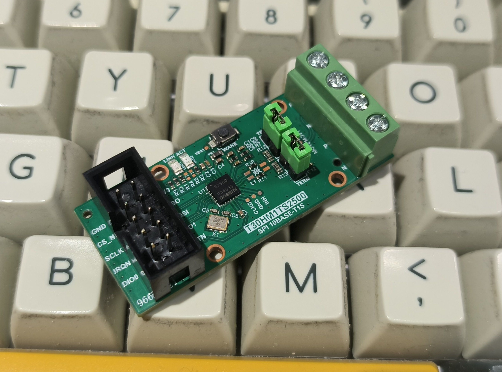
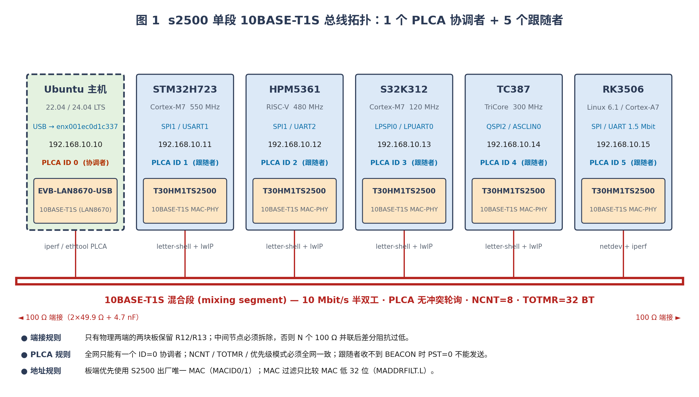
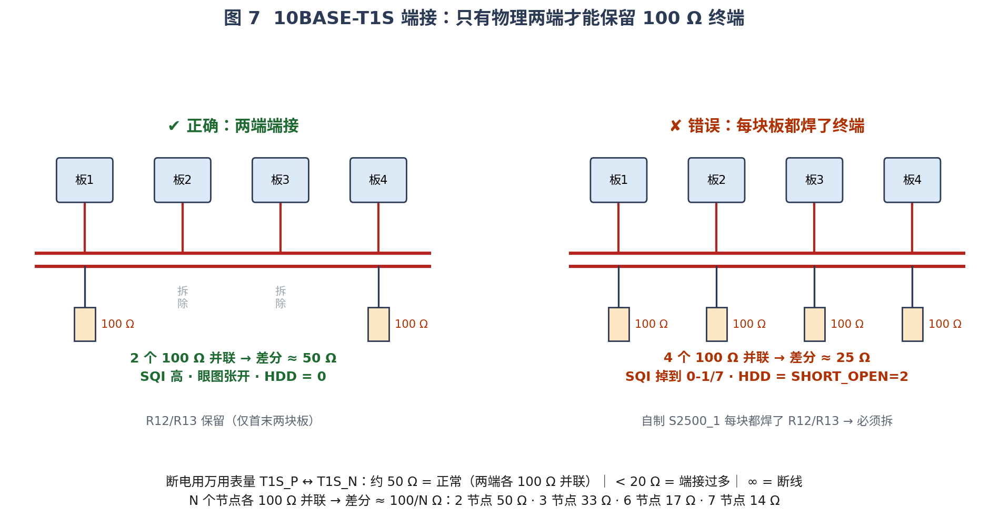
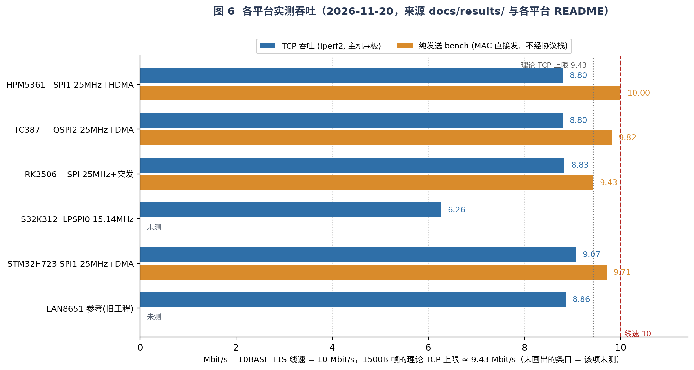
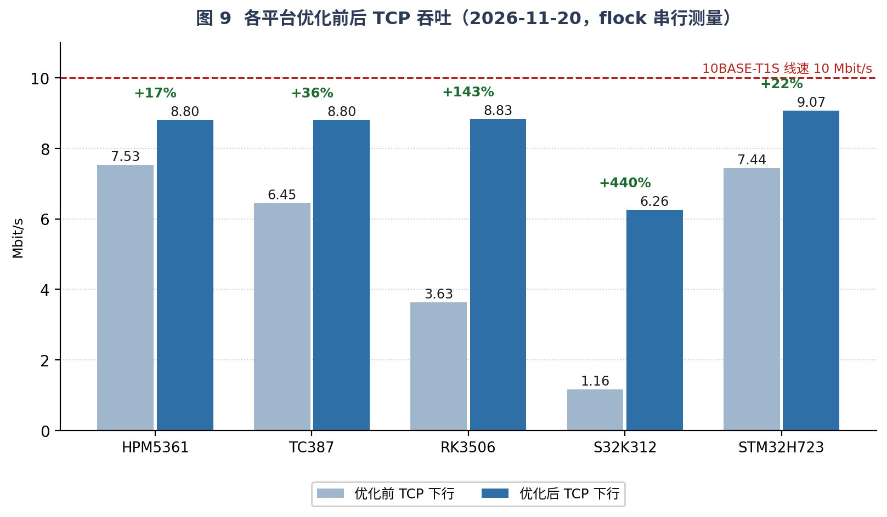

# T30HM1TS2500 — 10BASE-T1S MAC-PHY 五平台适配与实测



> **onsemi T30HM1TS2500**（下称 **S2500**）是 IEEE 802.3cg **10BASE-T1S** 的 MAC-PHY 二合一芯片，
> 通过 **OPEN Alliance OA-SPI**（TC6）与主控相连。本目录把同一颗芯片接到
> **STM32H723 / HPM5361 / S32K312 / TC387 / RK3506** 五个平台，全部挂到同一条 10BASE-T1S 总线上互通，
> 并提供可移植驱动、五个完整工程、主机侧工具、测试矩阵与实测数据。

仓库：<https://github.com/weifengdq/embedded> · 本目录：[t30hm1ts2500](.)


---

## 目录

| 章节 | 内容 |
| --- | --- |
| [1](#1-硬件s2500_1-最小系统板) | 硬件：S2500_1 最小系统板、排针、LED、端接 |
| [2](#2-拓扑与总线规划) | 拓扑图、IP / PLCA ID 规划、总线三条铁律 |
| [3](#3-平台状态2026-11-20-实测) | 五个平台的实测吞吐、时延、协调者验证 |
| [4](#4-快速开始3-步) | 烧 hex → 接线 → 主机配 USB-10T1S → ping / iperf |
| [5](#5-目录导航) | 每个子目录一句话 |
| [6](#6-特性清单) | OA-SPI / PLCA / SQI / HDD / TC14 / TC10 / TC6 / DIO / 看门狗 / lwIP / shell |
| [7](#7-实测与结论) | 引用 docs/06、docs/07 的关键结论 |
| [8](#8-已知限制) | 端接过量、TC10 未测、S32K RX-DMA、F407 停用 |
| [9](#9-文档与延伸阅读) | 14 篇文档的阅读路线 |
| [10](#10-许可) | 代码 / 第三方 / 数据手册 |

---

## 1. 硬件：S2500_1 最小系统板

为了让一颗 QFNW20（4×4 mm）的 MAC-PHY 能直接插排线做实验，本项目自制了 **S2500_1 最小系统板**：

| 项 | 设计 |
| --- | --- |
| MAC-PHY | T30HM1TS2500MWTWG（10BASE-T1S + MAC，OA-SPI，QFNW20） |
| 晶振 | **25 MHz**（X322525MOB4SI，C6/C7 = 18 pF） |
| 总线接口 | J1 `c50126v-4p0g56`，T1S_P / T1S_N，100 nF 隔直 + 共模扼流圈（可选贴装） |
| 终端 | **R12 / R13 = 49.9 Ω ×2**（仅总线两端的板子保留） |
| 指示灯 | **DIO0 = 黄色 ACT**（收发包活动）、**DIO1 = 绿色 LINK**（PLCA 链路），**高电平点亮** |
| 调试排针 | P1，2×5 / 2.54 mm，3.3 V 供电 |
| 供电 | 3.3 V（VCC 经 FB1 + 4.7 µF + 100 nF 滤波） |

### 1.1 P1 排针（2×5，从丝印 1 脚开始）

| Pin | 信号 | Pin | 信号 |
| --- | --- | --- | --- |
| 1 | CS_N | 2 | MISO |
| 3 | 3V3 | 4 | SCLK |
| 5 | IRQ_N | 6 | DIO1（绿 LINK） |
| 7 | DIO0（黄 ACT） | 8 | RST_N |
| 9 | GND | 10 | MOSI |

> MOSI / SCLK 在 P1 上是 10 / 4 脚，与部分“标准 SPI 排针”顺序不同，接线前请对照丝印。

### 1.2 资料

* 原理图：[docs/datasheet/S2500_1_refsch.pdf](docs/datasheet/S2500_1_refsch.pdf)
* 芯片数据手册：[docs/datasheet/T30HM1TS2500-D.PDF](docs/datasheet/T30HM1TS2500-D.PDF)（附文本版便于搜索）
* 产品页：<https://www.onsemi.com/products/interfaces/ethernet-controllers/t30hm1ts2500>
* 数据手册在线版：<https://www.onsemi.com/download/data-sheet/pdf/t30hm1ts2500-d.pdf>
* OPEN Alliance 10BASE-T1x MAC-PHY Serial Interface：<https://opensig.org/automotive-ethernet-specifications/>

> 数据手册与原理图版权归 onsemi / 原设计者所有，此处仅用于学习与评估，请勿用于商业再分发。

---

## 2. 拓扑与总线规划



### 2.1 节点与地址

| 节点 | IPv4 | PLCA ID | SPI 接口 | 调试串口 |
| --- | --- | --- | --- | --- |
| Ubuntu 主机（USB-10T1S） | 192.168.10.10 | **0（协调者）** | —（USB） | — |
| STM32H723 | 192.168.10.11 | 1 | SPI1 | USART1 115200 |
| HPM5361 | 192.168.10.12 | 2 | SPI1 | UART2 115200 |
| S32K312 | 192.168.10.13 | 3 | LPSPI0 15.137 MHz | LPUART0 115200 |
| TC387 | 192.168.10.14 | 4 | QSPI2 | ASCLIN0 115200 |
| RK3506 | 192.168.10.15 | 5 | Linux SPI | UART 1.5 Mbit/s |

全网统一：**NCNT = 8**、**TOTMR = 32 BT**，全网同一时刻**只有一个 PLCA 协调者（ID=0）**。

### 2.2 总线三条铁律

| # | 规则 | 违反的后果 |
| --- | --- | --- |
| 1 | 只有**物理两端**保留 100 Ω 终端（每端 2×49.9 Ω），中间节点拆掉 R12/R13 | 差分阻抗过低（6 节点约 17 Ω），SQI 掉到 0–1，误码 / 丢包 |
| 2 | 全网**只能有一个协调者（ID=0）** | `UNEXPB` 置位，轮询混乱 |
| 3 | **NCNT / TOTMR 全网一致** | `BCNBFTO` 置位，跟随者轮询错位 |



---

## 3. 平台状态（2026-11-20 实测）

| 平台 | 内核 / 主频 | SPI 配置 | TCP 下行 / 上行 (Mbit/s) | ping 平均 | 纯发送 bench |
| --- | --- | --- | --- | --- | --- |
| **STM32H723** | Cortex-M7 550 MHz | SPI1 25 MHz + DMA | **9.07 / 8.87** | **0.56 ms** | 9.71 Mbit/s（826 fps @1470 B） |
| **HPM5361** | RISC-V 480 MHz | SPI1 25 MHz + HDMA | **8.80 / 8.02** | 0.70 ms | **10.0 Mbit/s**（833 fps @1500 B） |
| **S32K312** | Cortex-M7 | **LPSPI0 15.137 MHz** | **6.26 / 7.75** | 0.82 ms | 未测 |
| **TC387** | TriCore 300 MHz | QSPI2 25 MHz + DMA | **8.80 / 8.80** | 0.609 ms | 9.72–9.85 Mbit/s |
| **RK3506** | 3×Cortex-A7 / Linux 6.1 | SPI 25 MHz + 批量突发 | **8.83 / 8.96** | 1.09 ms | UDP 9.43（丢包 0%） |

* 五平台 ping **丢包 0%**，iperf2 TCP 均为实测值；
* **PLCA 协调者（ID=0）5/5 通过**：被测板当协调者、主机降为跟随者（ID 7）后，双向 ping 20/20、丢包 0%；
* 理论上限：10 Mbit/s 线速、1500 B 帧效率 96.9%，IPv4/TCP 有效载荷约 **9.43 Mbit/s** —— H723 / HPM / TC387 / RK3506 已到线速的 90% 以上。



---

## 4. 快速开始（3 步）

> 需要：一块已焊好的 S2500_1 板 + 对应调试器 + USB-10T1S 适配器（EVB-LAN8670-USB-D 或同类）+ Ubuntu 主机。

### 第 1 步：烧固件

`hex/` 下是五个平台的可烧录固件，平台与文件一一对应：

| 平台 | 固件 | 烧写方式 |
| --- | --- | --- |
| STM32H723 | `hex/stm32h723_s2500.hex` / `.bin` | STM32CubeProgrammer、OpenOCD、STLINK-V3 |
| HPM5361 | `hex/hpm5361_s2500.hex` / `.bin` | OpenOCD（需 `hpm_xpi` flash 驱动） |
| S32K312 | `hex/s32k312_s2500.hex` | J-Link Commander `loadfile` |
| TC387 | `hex/tc387_s2500.hex` | DAS / AURIX Flasher（DAP MiniWiggler） |
| RK3506 | 无需烧 hex | `insmod rk3506/prebuilt/s2500.ko` |

详见 [hex/README.md](hex/README.md)（含各平台 IP、PLCA ID 与注意事项）。

### 第 2 步：接线

1. S2500_1 的 P1 按 §1.1 接到主控 SPI（CS / MISO / SCLK / MOSI / IRQ / RST），3V3 与 GND 共地；
2. T1S_P / T1S_N 并入 10BASE-T1S 双绞线，注意**只有总线两端保留终端电阻**；
3. 板子调试串口接主机（115200，RK3506 为 1.5 Mbit/s），上电。

### 第 3 步：主机侧配置 USB-10T1S，然后 ping / iperf

```bash
# 1) 配好网卡与 PLCA（协调者 ID=0）
sudo ./host/setup_usb10t1s.sh
ethtool --get-plca-status enx001ec0d1c337     # 期望 Status: on

# 2) 串口确认板子在线（按 VID:PID 自动识别）
./tools/s25.py --auto hpm -c "s2500 info"

# 3) ping
ping -c 3 192.168.10.12

# 4) 吞吐（板端 iperf2 服务端 + 主机 iperf2 客户端）
./tools/s25.py --auto hpm -c "iperf -s" &
iperf -c 192.168.10.12 -t 10 -i 5 -f m
```

> **注意**：板端是 lwiperf，**只兼容 iperf2**，且**不支持 `-R` 反向模式**；测上行请让板子当客户端、主机当服务端。
> 板子默认是 PLCA 跟随者（`plca_en=1`，ID 见 §2.1），主机作协调者即可直接通信。

---

## 5. 目录导航

| 目录 | 内容 |
| --- | --- |
| [README.md](README.md) | 本文件（总入口） |
| [README.assets/](README.assets/) | 板子照片、拓扑图、性能图、端接对比图 |
| [hex/](hex/) | 五个平台的可烧录固件 + 烧写说明 |
| [docs/](docs/) | 14 篇技术文档、实测记录、配图、数据手册与原理图 |
| [common/s2500/](common/s2500/) | **平台无关驱动**：OA-SPI 事务、chunk 重组、FCS、PLCA、SQI、HDD、TC14/TC10/TC6、DIO、统计 |
| [common/lwip/](common/lwip/) | lwIP 2.2.0 源码（裁剪版，保留 `src/` 与许可文件） |
| [common/lwip-port/](common/lwip-port/) | lwIP 配置（`lwipopts.h`）与 netif 适配 |
| [common/letter-shell/](common/letter-shell/) | letter-shell 3.2.4 源码 |
| [common/letter-shell-port/](common/letter-shell-port/) | letter-shell 配置 |
| [stm32h723/](stm32h723/) | STM32H723ZGT6（Cortex-M7 550 MHz）+ SPI1 + USART1，CMake + HAL H7 |
| [hpm5361/](hpm5361/) | HPM5361（RISC-V 480 MHz）+ SPI1 + UART2 |
| [s32k312/](s32k312/) | S32K312（Cortex-M7）+ LPSPI0 + LPUART0，含 NXP RTD |
| [tc387/](tc387/) | TC387（TriCore 300 MHz）+ QSPI2 + ASCLIN0，含 iLLD |
| [rk3506/](rk3506/) | RK3506（Linux 6.1）out-of-tree 驱动、DTS 补丁、预编译 `s2500.ko` |
| [host/](host/) | 主机侧脚本：USB-10T1S 配置、PLCA、总线测试、协调者测试、一键验收 |
| [tools/](tools/) | `s25.py` 串口助手、`sim/` 协议模拟器单元测试 |

---

## 6. 特性清单

| 特性 | 说明 |
| --- | --- |
| **OA-SPI** | 12 B 控制事务（奇校验 + 重试）、68 B 数据块事务、多块重组、FCS 校验与剥离、最小帧填充 |
| **PLCA** | 跟随者 / **协调者（ID=0）/ CR / 优先级 / Burst**，NCNT、TOTMR、ID 全部可配 |
| **SQI / SQI+** | 链路质量评估，可边跑流量边看 |
| **HDD** | 线束诊断，可检出开路 / 短路 / 终端偏多（`SHORT_OPEN=2`） |
| **TC14** | 拓扑发现（需静默总线，手动写 `TD_CTRL`） |
| **TC10** | 睡眠 / 唤醒（寄存器与接口已实现，**未上板实测**） |
| **TC6** | 设备时间 / 发送时间戳（设备时间正常，发送时间戳落 `TTSCC`，位域待确认） |
| **DIO** | DIO0 黄 ACT、DIO1 绿 LINK，功能码可运行时切换，高电平点亮 |
| **自愈看门狗** | 每 2 s 检查 `PLCA_CTL1 / IDVER`，芯片偶发复位后自动重初始化，ping 中断 0.4–1.4 s 恢复 |
| **lwIP 2.2** | NO_SYS 模式，ARP / ICMP / UDP / TCP / iperf / udpecho / bench |
| **letter-shell 3.2.4** | 统一命令集：`s2500 info/reg/plca/status/counters/led/wd/selftest` 等 |
| **可移植** | 驱动与平台之间只隔一个 `s2500_hal_t`（`spi_xfer / delay_us / millis`，可选 `log / irq_level`） |

---

## 7. 实测与结论

完整数据见 [docs/06_test_matrix.md](docs/06_test_matrix.md)、[docs/07_performance.md](docs/07_performance.md)
与 [docs/results/](docs/results/)。八条关键结论：

1. **五个平台全部跑通**：H723 9.07/8.87、HPM 8.80/8.02、TC387 8.80/8.80、RK3506 8.83/8.96、S32K312 6.26/7.75 Mbit/s（TCP 下行/上行），ping 丢包均为 0%。
2. **硬件 SPI 已接近线速**：H723 9.71 Mbit/s 纯发送（826 fps @1470 B）、HPM 10.0 Mbit/s（833 fps @1500 B）；S32K312 从软件 SPI 的 1.17/1.40 提升到 LPSPI0 的 6.26/7.75。
3. **PLCA 协调者 5/5 通过**：H723 / HPM / TC387 / RK3506 / S32K312 都能当 ID=0 发 BEACON，主机降为跟随者后双向 20/20、丢包 0%，TCP 7.4–9.1 Mbit/s。
4. **CSMA 与 PLCA 混跑是吞吐与抖动的头号杀手**：TC387 在 CSMA 下累计 9278 次碰撞、TCP 抖动 7.1–8.0；改成 PLCA 跟随者后碰撞 5 次、TCP 稳定 8.80。**所有节点必须统一开 PLCA**。
5. **SPI 提频收益有限，减少事务次数才是关键**：RK3506 15 MHz + 批量突发已到 8.70，升到 25 MHz 只多 1%；HPM 的 68 B 事务里约 69% 时间在等。
6. **MAC 硬件计数器不可信**：RK3506 灌 5200 帧只报 53。判断吞吐 / 丢包请用主机 `ip -s link`（netdev）或 iperf；`s2500 selftest` 的环回结果只能参考。
7. **HDD 会报“终端偏多”（`SHORT_OPEN=2`）**：每块自制板都焊了 49.9 Ω×2，多板并联后差分阻抗过低，只应保留总线两端。
8. **芯片偶发自发复位，但可以自愈**：运行中偶发回到上电默认态（SYNC=0、id=255），驱动看门狗检出后自动重初始化，ping 中断 0.40–1.44 s 后恢复；正常 60 s 0 误判。



---

## 8. 已知限制

| # | 类别 | 内容 | 建议 |
| --- | --- | --- | --- |
| 1 | 硬件 | 每块 S2500_1 都焊了 49.9 Ω×2 终端，多板并联后阻抗过低 | 只保留总线两端，中间拆 R12/R13；测两端差分直流电阻应约 100 Ω |
| 2 | 特性 | **TC10 睡眠 / 唤醒未上板实测** | 需要时按数据手册单独验证 |
| 3 | 性能 | S32K312 的 **TX eDMA 已打通，RX 方向受 DMAMUX 语义限制**，当前无 RX-DMA，高速率下靠 FIFO + 中断 | 高负载场景优先用 6.26/7.75 的现有配置；需要更高时再评估 RX-DMA |
| 4 | 平台 | **STM32F407 板子已物理损坏停用**，工程与历史数据不再随本目录发布，文档中仅保留说明 | 统一使用 STM32H723（IP .11 / PLCA ID 1） |
| 5 | 硬件 | S2500 偶发自发复位（SYNC=0、id=255） | 驱动看门狗已自动恢复；长期运行建议开启 |
| 6 | 观测 | MAC 硬件计数器不可信、环回自检可能 FAIL 但真实收发正常 | 以 ping / iperf / netdev 统计为准 |
| 7 | 运维 | RK3506 管理口 eth0 是 DHCP，地址会变 | 先串口 `ip -br addr` 确认；业务口 t1s0 固定 192.168.10.15 |

---

## 9. 文档与延伸阅读

| 文档 | 一句话 |
| --- | --- |
| [00 移植指南](docs/00_porting_guide.md) | 接缝、模板、踩坑表、移植新平台的调试顺序 |
| [01 硬件说明](docs/01_hardware.md) | S2500_1 器件、排针、LED、上电时序 |
| [02 总线规划](docs/02_bus_plan.md) | 端接、地址、PLCA 参数、测试顺序 |
| [03 SPI 协议](docs/03_spi_protocol.md) | 12 B 控制事务 / 68 B 数据事务时序 |
| [04 寄存器速查](docs/04_register_map.md) | 常用寄存器一览 |
| [05 与 LAN8651 对比](docs/05_lan8651_vs_s2500.md) | 两者差异与迁移要点 |
| [06 测试矩阵](docs/06_test_matrix.md) | 逐项测试方法与结果 |
| [07 性能](docs/07_performance.md) | 理论带宽、调优项、瓶颈分析 |
| [08 命令手册](docs/08_shell_commands.md) | 所有 shell 命令与示例输出 |
| [09 调试环境](docs/09_debug_env.md) | USB / 串口 / 工具链映射 |
| [10 硬件排障](docs/10_hardware_troubleshooting.md) | 总线不通 / 串口无输出怎么查 |
| [11 测试例子](docs/11_test_examples.md) | 可直接复制的测试例子集 |
| [12 开发环境搭建](docs/12_dev_env_setup.md) | 从裸 Ubuntu 到点亮板子的完整步骤 |
| [13 10BASE-T1S 入门](docs/13_10baset1s_primer.md) | T1S / PLCA / MAC-PHY 概念与时序 |
| [14 交付清单](docs/14_delivery_checklist.md) | 交付物清单与验收步骤 |

建议阅读顺序：本 README → [13 入门](docs/13_10baset1s_primer.md) → [12 环境](docs/12_dev_env_setup.md) →
[01 硬件](docs/01_hardware.md) → [03 协议](docs/03_spi_protocol.md) → [00 移植](docs/00_porting_guide.md)。

---

## 10. 许可

* 本目录随本仓库 <https://github.com/weifengdq/embedded> 发布，驱动/工程/脚本代码遵循仓库根 [LICENSE](../LICENSE)（GPL-3.0）；
* [common/lwip](common/lwip/) 为 lwIP 2.2.0，遵循其 **BSD-like** 许可（见 [COPYING](common/lwip/COPYING)）；
* [common/letter-shell](common/letter-shell/) 为 letter-shell 3.2.4，遵循其 **MIT** 许可（见 [LICENSE](common/letter-shell/LICENSE)）；
* 数据手册与原理图版权归 **onsemi** 及原设计者，仅用于学习与评估，请勿商业再分发。

---

*文档与实测数据版本：2026-11-20 · 固件构建时间：2026-11-20 · 仓库：<https://github.com/weifengdq/embedded>*
