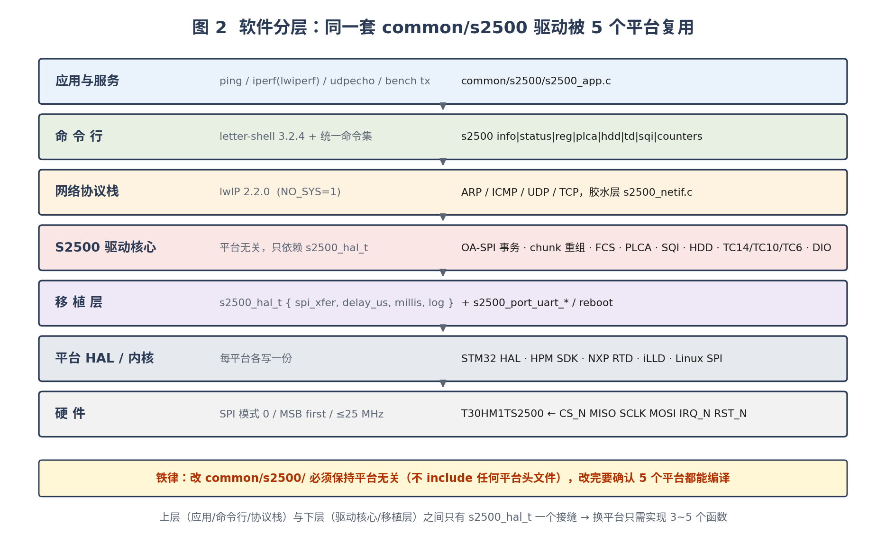

# 移植指南（把 S2500 驱动接到新平台）

> **目标读者**：已经会写 SPI 驱动、要把 S2500 接到自己板子上的嵌入式工程师。
> **读完能做到**：半天内把一个新平台的 SPI/延时/时基接好，跑通 `s2500 reg 0 0` 与 `s2500 selftest`。

整个移植只有 **一个接缝**：驱动核心不碰任何平台头文件，只通过 `s2500_hal_t` 调用平台的
SPI、延时、时基。下图是分层关系：

> 仓库：<https://github.com/weifengdq/embedded> · 本目录：`t30hm1ts2500`



## 本篇目录

| 章节 | 内容要点 |
| --- | --- |
| 1 | 需要实现的移植层（3 个函数 + 一个 hal 结构体） |
| 2 | 主程序模板（可直接编译的最小 main） |
| 3 | 需要加入编译的文件与 include 路径 |
| 4 | lwIP 配置要点 |
| 5 | 常见问题（现象 → 排查） |
| 6 | 踩坑记录（9 条实测） |
| 7 | 调试顺序建议（7 步） |
| 8 | 移植检查清单（逐项打勾） |
| 9 | 常见错误与排查（按报错信息查） |
| 10 | 移植后必须跑的命令 |

---

## 1. 需要实现的移植层

`common/s2500/s2500_port.h`：

```c
int  s2500_port_uart_getc(void);                       /* 调试串口读, 无数据返回 -1 */
void s2500_port_uart_write(const char *data, unsigned int len);
void s2500_port_reboot(void);
```

以及一个 `s2500_hal_t`（`common/s2500/s2500.h`）：

```c
static int  spi_xfer(void *ctx, const uint8_t *tx, uint8_t *rx, uint32_t len);
static void delay_us(void *ctx, uint32_t us);
static uint32_t millis(void *ctx);

static const s2500_hal_t hal = {
    .ctx = NULL,
    .spi_xfer = spi_xfer,
    .delay_us = delay_us,
    .millis   = millis,
    .log      = my_logf,        /* 可选 */
    .irq_level= NULL,           /* 可选: 读 IRQ_N 电平 */
};
```

### spi_xfer 要求

* 全双工，**CS_N 在整个 len 内保持低电平**；SPI 模式 0，MSB first。
* `len` = 12（控制事务）或 68（数据块事务）；驱动内部缓冲区已按 8 字节对齐，
  平台若使用 DMA 需保证缓冲区可 DMA 访问（多数 Cortex-M 的 DTCM 不可 DMA）。
* 25 MHz 以下；20 MHz 已验证可用。

## 2. 主程序模板

```c
#include "s2500_app.h"

static const s2500_app_cfg_t cfg = {
    .hal        = &hal,
    .mac        = NULL,              /* 用芯片出厂 MAC */
    .plca_id    = 1,                 /* 本板 PLCA ID */
    .plca_ncnt  = 8,
    .plca_totmr = 32,
    .plca_en    = 1,                 /* 默认 PLCA 跟随者（全网统一开） */
    .ip = 0xC0A80A0B, .mask = 0xFFFFFF00, .gw = 0xC0A80A0A,
    .board_name = "STM32H723",
};

int main(void)
{
    board_init();                    /* 时钟/SPI/GPIO/UART */
    s2500_app_init(&cfg);
    for (;;) {
        s2500_app_poll();
    }
}
```

## 3. 需要加入编译的文件

| 文件 | 说明 |
| --- | --- |
| `common/s2500/s2500.c` | 驱动核心 |
| `common/s2500/s2500_netif.c` | lwIP 接口 |
| `common/s2500/s2500_shell.c` | shell 命令 |
| `common/s2500/s2500_app.c` | 应用/网络服务/命令注册 |
| `common/lwip/src/**` | lwIP 核心（含 apps/lwiperf） |
| `common/letter-shell/src/shell.c`, `shell_ext.c`, `shell_cmd_list.c` | 命令行 |
| 平台自身的 startup/时钟/串口/SPI 驱动 | — |

include 路径：

```
common/s2500
common/lwip/src/include
common/lwip-port
common/letter-shell/src
common/letter-shell-port
```

## 4. lwIP 配置要点

* `NO_SYS=1`，裸机主循环；`sys_now()` 由 `s2500_app.c` 提供（millis）。
* 需要 `LWIP_RAW`（ping）、`LWIP_TCP`（iperf）、`LWIP_UDP`（echo）。
* `PBUF_POOL_BUFSIZE=1536`：一个 pbuf 容纳整帧，避免链式拷贝。
* 若 RAM 紧张，可减小 `MEM_SIZE`/`PBUF_POOL_SIZE`。

## 5. 常见问题

| 现象 | 排查 |
| --- | --- |
| `s2500_init` 返回 -6 | SPI 模式/CS 时序；先读 `IDVER`（应为 0x00000011）；用 `s2500 reg 0 0` 验证 |
| IDVER=0xFFFFFFFF | MISO 未接/上拉，或 CS 未拉低；检查 VIO 3.3 V |
| 控制读偶发校验错 | SCLK 过高（>25 MHz）或 CS 建立时间不足（t_fc ≥ 20 ns） |
| 能收不能发 | `MCONTROL0.TXEN`、`CONFIG0.SYNC`；PLCA 跟随者无 BEACON 时不能发送（PST=0） |
| ping 不通但对端能收到 ARP | 检查 FCS：本驱动接收时校验并剥离 4 字节 FCS；若芯片实际不转发 FCS，长度会差 4 |
| 吞吐只有 ~2 Mbit/s | SPI 时钟太低或每帧等待 credit；见 `docs/07_performance.md` |

## 6. 踩坑记录（实测，按发现顺序）

| # | 现象 | 根因 | 修复 |
| --- | --- | --- | --- |
| 1 | `s2500 info` 读不到 / 全 0xFF | SPI 模式/CS 时序；或 `PHY CONTROL.LCTL=0`（默认 PHY 收发关闭） | 模式 0、CS 覆盖整事务；init 时置 LCTL=1 |
| 2 | 能收不能发 | 同上 LCTL；或 PLCA 跟随者无 BEACON | 置 LCTL=1；PLCA 下确认 PST=1 |
| 3 | lwIP 起不来 / netif 为 NULL | `netif_add(NULL, ...)` 在 lwIP 2.2 直接返回 NULL | 传入静态 `struct netif` |
| 4 | ARP 收不到（ping 不通） | 初始化时误置 `MCONTROL0.BCSF/MCSF` 过滤了广播/组播 | 不要置这两位 |
| 5 | 串口提示 `Please input password:` | 默认用户名 "s2500" 与命令名 "s2500" 重名，shell 把命令项当用户项 | 默认用户改名 "root" |
| 6 | `s2500 reg 0 0` 参数错位、`ping` 说 bad ip | letter-shell 的 `SHELL_TYPE_CMD_FUNC` 用于"带类型参数"的函数；`int f(int,char**)` 必须用 `SHELL_TYPE_CMD_MAIN` | 改用 CMD_MAIN |
| 7 | 发送一帧后收到截断帧 | 接收中 `FD`（FCS 错）时应丢弃已重组的半帧 | 清 `rx->len` 并继续 |
| 8 | 初始化失败后重试导致 lwIP/shell 重复初始化 | `lwip_init()`/`shellInit()` 非幂等 | 用静态标志只初始化一次 |
| 9 | S32K312 LPSPI0 读回"每 4 字节重复首字" | FIFO 只有 2 字深，`TXWATER=3` 使 TDF 恒 1，第 3 个字起写 TDR 被静默丢弃 | 按 PARAM 现读深度，`TXWATER=depth-1`，写前查 `TXCOUNT<depth`（详见 s32k312/README.md §9） |

## 7. 调试顺序建议

1. `s2500 reg 0 0` → 0x11：证明 SPI 通路。
2. `s2500 selftest` → PCS/PHY 环回 PASS：证明 MAC/PHY 收发通路（不需总线）。
3. `s2500 info` → MAC 有效、link=UP。
4. 主机 ping：证明总线与 ARP。
5. `iperf`：证明吞吐。
6. PLCA / 诊断 / HDD / TD：功能验证。

---

## 8. 移植检查清单

按顺序打勾，每一步都要有可验证的输出，**不要跳步**：

| # | 检查项 | 怎么验证 | 期望 |
| --- | --- | --- | --- |
| 1 | 时钟频率正确 | 串口打印 `SystemCoreClock` / `millis()` 走 1 s | 误差 < 5% |
| 2 | `delay_us(1000)` 真的约 1000 µs | 用 GPIO 翻转 + 示波器/逻辑分析仪 | 1 ms ± 5% |
| 3 | SPI 模式 0、MSB first | 逻辑分析仪看 SCLK 空闲低、第 1 个边沿采样 | CPOL=0 CPHA=0 |
| 4 | CS_N 覆盖整次事务 | 逻辑分析仪：CS 低电平期间正好 68 个字节 | 不多不少 |
| 5 | `s2500 reg 0 0` | 串口 | `0x00000011` |
| 6 | `s2500 info` | 串口 | MAC 非全 0/全 F，PHY STATUS 合理 |
| 7 | `s2500 selftest` | 串口 | PCS / PHY 环回 PASS |
| 8 | 中断或轮询能收到帧 | 主机 ping | 收包计数增长 |
| 9 | 「5 个平台仍能编译」 | 改完 `common/s2500` 后逐个 `./build.sh` | 全部通过 |

> **铁律**：改 `common/s2500/` 必须保持平台无关。
> 不允许出现 `#include "stm32f4xx_hal.h"` 之类的平台头文件；需要平台能力就往
> `s2500_hal_t` 里加函数指针（并同步 5 个平台）。

## 9. 常见错误与排查（按报错信息查）

| 报错 / 现象 | 根本原因 | 解决 |
| --- | --- | --- |
| `s2500 reg 0 0` 返回 0xFFFFFFFF | MISO 悬空/被上拉；CS_N 没拉低 | 量 MISO 到 MCU 的通断；用逻辑分析仪看 CS |
| 返回 0x00000000 | MOSI 没接；SCLK 没动 | 量 MOSI；确认 SPI 外设真的使能 |
| 返回 0x00000011 但 `info` 的 MAC 为 0 | 没等 `STATUS0.RESETC=1` 就读 MAC | init 里轮询 RESETC，或加 ≥ 6 ms 上电延时 |
| 控制事务偶发校验错 | SCLK 超过 25 MHz，或 CS 建立时间不足 | 降到 20 MHz；保证 t_fc ≥ 20 ns |
| `s2500_init` 返回 -6 | 头校验/重试都失败 | 先确认第 1 条；再查 `CONFIG0.PROTE` 是否为 0 |
| 能收不能发 | `PHY CONTROL.LCTL=0` 或 `MCONTROL0.TXEN=0` | 两处都要置 1 |
| 能发不能收 | `MCONTROL0.RXEN=0`，或 `BCSF/MCSF` 把广播过滤了 | RXEN=1；这两个位保持 0 |
| ping 不通但能看到 ARP 请求 | 接收长度差 4 字节（FCS 没处理） | 驱动里做 CRC32 校验后剥离 |
| 收到半截帧（104B 只出 41B） | 非结束块（EV=0）的 EBO 无效，误用了 ebo+1 | 非结束块整块 64B 拷贝 |
| 吞吐只有 1–2 Mbit/s | SPI 时钟太低，或每帧都等 credit | 提高 SCLK；一次查足 credit 再连发 |
| `undefined reference to s2500_port_uart_write` | 忘了实现 `s2500_port_*` 三个函数 | 见 §1 |
| lwIP 起来后 netif 为 NULL | `netif_add(NULL, ...)` 在 lwIP 2.2 返回 NULL | 传静态 `struct netif` |
| 初始化失败后 shell/lwIP 重复初始化 | `lwip_init()` / `shellInit()` 非幂等 | 用静态标志只初始化一次 |

## 10. 移植后必须跑的命令

```bash
# 1) SPI 通路
./tools/s25.py --auto <board> -c "s2500 reg 0 0"

# 2) 芯片信息
./tools/s25.py --auto <board> -c "s2500 info"

# 3) 不依赖总线的自检
./tools/s25.py --auto <board> -c "s2500 selftest"

# 4) 统计清零，便于观察后续收发
./tools/s25.py --auto <board> -c "s2500 counters clear"

# 5) 加入 PLCA（ID 按 docs/02_bus_plan.md 的规划表）
./tools/s25.py --auto <board> -c "s2500 plca id 2 ncnt 8 totmr 32 en 1"
./tools/s25.py --auto <board> -c "s2500 status"

# 6) 主机侧连通性
ping -c 20 -i 0.05 192.168.10.12

# 7) 吞吐（板端起 iperf，主机用 iperf2）
./tools/s25.py --auto <board> -c "iperf -s" &
iperf -c 192.168.10.12 -t 10 -i 5 -f m
```

## 11. 相关章节

| 想看什么 | 去哪里 |
| --- | --- |
| 驱动核心与平台的分层图 | 本篇 §1 与 [`README.md` 第 7 节](../README.md) |
| SPI 事务的确切字节格式 | [`docs/03_spi_protocol.md`](03_spi_protocol.md) |
| 寄存器地址速查 | [`docs/04_register_map.md`](04_register_map.md) |
| 总线/PLCA 配置 | [`docs/02_bus_plan.md`](02_bus_plan.md) |
| 命令手册 | [`docs/08_shell_commands.md`](08_shell_commands.md) |
| 开发环境（工具链） | [`docs/12_dev_env_setup.md`](12_dev_env_setup.md) |
