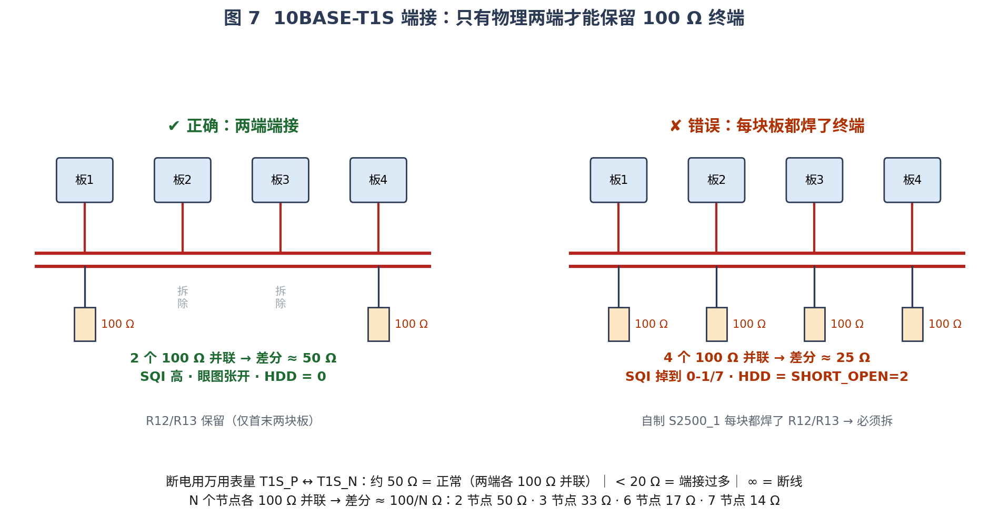

# 总线规划与 PLCA 配置

> **目标读者**：要把多块板挂上同一条总线的人。
> **读完能做到**：正确端接、正确分配 PLCA ID、用 5 个命令验证总线健康。

## 本篇目录

| 章节 | 内容要点 |
| --- | --- |
| 1 | 物理层（单段、端接、速率） |
| 2 | 地址与 PLCA 规划表 |
| 3 | 为什么用 PLCA（CSMA/CD 对比） |
| 4 | 固件默认配置与开关命令 |
| 5 | 测试顺序建议 |
| 6 | 端接自查与阻抗实测 |
| 7 | 总线健康检查命令 |
| 8 | 常见错误与排查 |

---

## 1. 物理层

* 拓扑: **单段混合总线 (mixing segment)**，所有节点 UTP/同轴背板并接。
* 终端: 段两端各 **100 Ω**（每端 2×49.9 Ω + 4.7 nF 共模端接，见 S2500 数据手册 Figure 1）。
* 速率: 10 Mbit/s，半双工，Manchester/DME 编码，支持 PLCA。

> ⚠️ **注意（必须确认）**：自制 S2500_1 最小系统板已焊接 `R12/R13 = 49.9 Ω` 终端电阻。
> 如果多块板都挂到同一总线上，**只有处于总线两端的板子保留终端电阻**，
> 中间节点的 R12/R13 应拆除（或用 0 Ω 跳线断开）。否则 N 块板并联后
> 差分阻抗过低（6 块板 ≈ 8.3 Ω），信号幅度与眼图会明显恶化，SQI 下降、
> 误码率升高。详见 `docs/06_test_matrix.md` 中的 SQI 对比测试。
>
> 若无法拆焊，可先测量：上电后两端差分直流电阻应约 **100 Ω**；
> 若测得 ~8 Ω，说明终端过多。

## 2. 地址与 PLCA 规划

| 节点 | IPv4 | PLCA ID | 说明 |
| --- | --- | --- | --- |
| Ubuntu 主机 (USB-10T1S) | 192.168.10.10 | **0** | PLCA 协调者 (BEACON) |
| STM32H723 | 192.168.10.11 | 1 | 跟随者（接替损坏的 F407） |
| HPM5361 | 192.168.10.12 | 2 | 跟随者 |
| S32K312 | 192.168.10.13 | 3 | 跟随者 |
| TC387 | 192.168.10.14 | 4 | 跟随者 |
| RK3506 | 192.168.10.15 | 5 | 跟随者 |
| （备用/冗余协调者） | — | 6 | 可启用 CR 测试冗余 |

* `NCNT = 8`（全网一致，允许 ID 0..7）
* `TOTMR = 32 BT`（3.2 µs，标准值；长线可增大）
* 广播/组播：MAC 默认放行（`MCSF=0, BCSF=0`）
* MAC 地址：优先使用 S2500 出厂唯一 MAC（`MACID0/MACID1`），
  读不到时用本地管理地址 `02:53:32:35:30:<板号>`。

> **管理网段提醒（2026-11-20）**：上表是 10BASE-T1S 业务网段 `192.168.10.0/24`，走 `t1s0`，
> 地址固定。**RK3506 的 `eth0` 是另一个网段且为 DHCP**（地址由现场网络分配，历史记录中的旧地址已失效），
> SSH/部署前先在串口执行 `ip -br addr` 确认，不要照旧 IP 直连。
>
> **平台变更**：STM32F407 板子已损坏停用，H723 接替其 IP `.11` 与 PLCA ID `1`。F407 仅作历史记录。

## 3. 为什么用 PLCA

| 项目 | CSMA/CD | PLCA |
| --- | --- | --- |
| 冲突 | 有，随节点数上升 | 物理层规避，无冲突 |
| 10 Mbit/s 有效吞吐 | ~50-70% | 接近 100% |
| 最坏时延 | 不确定（指数退避） | 有界（每轮一个 TO） |
| "babbling idiot" | 可能 | 单节点只能在自己的 TO 发送 |

协调者每轮发 BEACON，随后各节点按 ID 顺序获得发送机会（TO）；
TO 内无数据则通过 `TOTMR` 超时让给下一个节点。

## 4. 固件默认配置

> **2026-11-20 变更**：为消除 CSMA/PLCA 混跑造成的碰撞与抖动（TC387 实测碰撞 9278 → 5），
> **各平台固件默认值已改为 PLCA 跟随者并打开 PLCA**（`plca_en=1`）。
> 单板离线调试时可临时关掉：`s2500 plca id 255 en 0`。

| 平台 | 默认 PLCA ID | 默认状态 | 改回协调者/关闭的方法 |
| --- | --- | --- | --- |
| STM32H723 | 1 | 跟随者，en=1 | `s2500 plca id 1 en 1` / `s2500 plca id 255 en 0` |
| HPM5361 | 2 | 跟随者，en=1 | 同上（把 1 换成 2） |
| S32K312 | 3 | 跟随者，en=1 | 同上 |
| TC387 | 4 | 跟随者，en=1 | 同上 |
| RK3506 | 5 | 跟随者，en=1 | sysfs：`plca_id` / `plca_enable` |

* `NCNT = 8`、`TOTMR = 32 BT` 全网一致（固件写死默认值）。
* 协调者由主机（USB-10T1S，ID 0）担任；**要验证板子当协调者**，用 `./host/coord_test.sh <board>`
  （会自动把主机降为 ID 7，测完恢复）。
* 广播/组播：MAC 默认放行（`MCSF=0, BCSF=0`）。
* MAC 地址：优先使用 S2500 出厂唯一 MAC（`MACID0/MACID1`），读不到时用本地管理地址
  `02:53:32:35:30:<板号>`。

## 5. 测试顺序建议

1. 单板 + 主机（主机 CSMA 或 PLCA 协调者）→ 验证 ARP/ping/iperf。
2. 主机 PLCA 协调者 + 单板跟随者 → 验证 PLCA 基本收发、PST、SQI。
3. 多板同时在线 → 验证轮询公平性、吞吐、时延。
4. 关闭主机 BEACON（`plca off`）→ 验证跟随者 PST=0 停发、协调者冗余接管。
5. HDD / 拓扑发现需总线静默，测试时暂停其他节点发送。

---

## 6. 端接自查与阻抗实测



### 6.1 30 秒判定

```
① 断电
② 万用表打到 200 Ω 档，量 T1S_P ↔ T1S_N
③ 读数对照：

   约 50 Ω        → 两端各 100 Ω，正确
   约 33 Ω        → 3 个节点带终端，勉强
   < 20 Ω         → 端接过多（本项目最常见），拆中间节点的 R12/R13
   ∞ (开路)       → 线断 / 没接上 / 少一端终端
   约 0 Ω         → P/N 短路
```

### 6.2 并联数量对照

| 带终端的节点数 | 差分阻抗 | 结论 |
| --- | --- | --- |
| 2 | 50 Ω | ✅ 正确 |
| 3 | 33 Ω | ⚠️ 勉强可用 |
| 4 | 25 Ω | ❌ SQI 明显下降 |
| 6 | ≈ 17 Ω | ❌ 误码/丢包 |
| 7 | ≈ 14 Ω | ❌ 基本不通 |

### 6.3 本项目实测记录

| 现象 | 数值 | 来源 |
| --- | --- | --- |
| HDD 报 "短路 / 多余终端" | `SHORT_OPEN=2` | [`docs/results/2026-11-19_hpm5361.md`](results/2026-11-19_hpm5361.md) |
| 多板在线时 SQI | 0–1 / 7（正常应 7/7） | 同上 |
| 三节点并发 ping | 0% 丢包（说明仍可工作，但余量不足） | [`docs/results/2026-11-19_plca_multi.md`](results/2026-11-19_plca_multi.md) |

## 7. 总线健康检查命令

按顺序跑，**全绿再开始压测**：

```bash
# 1) 主机网卡状态
ethtool enx001ec0d1c337 | grep -E "Speed|Duplex|Link detected"
#    期望: 10Mb/s / Half / yes

# 2) 主机是不是协调者
ethtool --get-plca-status enx001ec0d1c337
#    期望: Status: on

# 3) 主机 IP
ip -br addr show enx001ec0d1c337
#    期望: 192.168.10.10/24

# 4) 板子是否同步进轮询
./tools/s25.py --auto hpm -c "s2500 status"
#    期望: plca : ON id=N ncnt=8 PST=1，plca diag : 0x0

# 5) 链路质量与线束
./tools/s25.py --auto hpm -c "s2500 sqi"     # 正常 7/7
./tools/s25.py --auto hpm -c "s2500 hdd"     # 正常 SHORT_OPEN=0

# 6) 连通性
ping -c 20 -i 0.05 192.168.10.12
```

## 8. 常见错误与排查

| 现象 | 原因 | 处置 |
| --- | --- | --- |
| 主机 `RX: packets 0` 一直不长 | 物理层断 / 端接过多 / P/N 接错 | 量 50 Ω；换线；只留两端终端 |
| 板端 `PST=0` | 收不到 BEACON | 主机 `plca.sh on`；NCNT 一致；ID < NCNT |
| `UNEXPB` 置位 | 两个协调者 | 只保留一个 `ID=0` |
| `RXINTO` 置位 | 两个节点同 ID | ID 全网唯一 |
| `BCNBFTO` 置位 | NCNT 与协调者不一致，或协调者掉线 | 统一 NCNT=8；确认主机在线 |
| 能 ping 通但吞吐低 | 端接过量导致重传；或 SPI 慢 | 先修端接，再看 SPI 时钟 |
| USB 重插后全部失联 | PLCA 配置丢失 | 重跑 `sudo ./host/setup_usb10t1s.sh` |
| 加了第 6 块板后开始丢包 | 端接与线长都到极限 | 拆中间节点终端；缩短线长 |

## 9. 相关章节

| 想看什么 | 去哪里 |
| --- | --- |
| PLCA 原理与时序 | [`docs/13_10baset1s_primer.md`](13_10baset1s_primer.md) |
| 硬件（LED/排针/上电时序） | [`docs/01_hardware.md`](01_hardware.md) |
| 现场排障手册 | [`docs/10_hardware_troubleshooting.md`](10_hardware_troubleshooting.md) |
| 可复制的测试例子 | [`docs/11_test_examples.md`](11_test_examples.md) |
