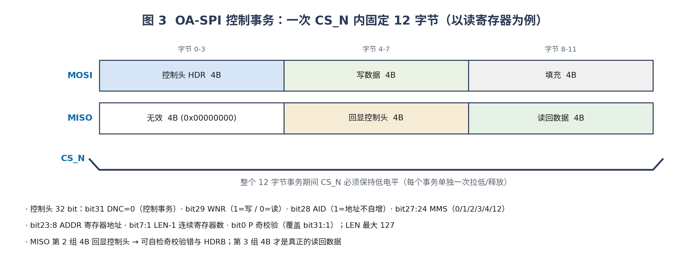
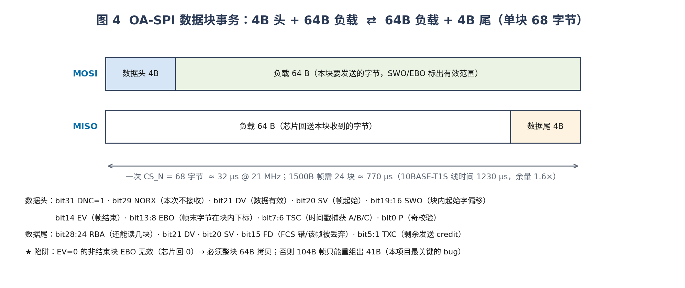

# OA-SPI 协议笔记（S2500 实现）

> 依据 T30HM1TS2500 数据手册 Rev.0 与 OPEN Alliance 10BASE-T1x MAC-PHY Serial
> Interface 规范；SPI 模式 0（CPOL=0, CPHA=0），MSB first，最大 25 MHz（VIO=3.3 V）。

> **目标读者**：要读懂/修改 `common/s2500/s2500.c` 里 SPI 事务的人。
> **读完能做到**：手工构造一次控制事务与数据事务，并看懂回显与错误位。





## 本篇目录

| 章节 | 内容要点 |
| --- | --- |
| 1 | 控制事务（12 字节，寄存器读写） |
| 2 | 数据事务（4B 头 + 64B 负载 + 4B 尾） |
| 3 | 缓冲区与流量控制（credit / chunk） |
| 4 | 帧完整性（FCS） |
| 5 | 时间戳 |
| 6 | 中断 |
| 7 | 实测时序 |
| 8 | 一个事务的完整走查（读 IDVER） |
| 9 | 常见错误与排查 |
| 10 | 协议层自检方法 |

---

## 1. 控制事务（寄存器读写）

CS_N 拉低后一次性传输 **12 字节**：

```
主机 MOSI : [ 控制头 4B ][ 数据 4B (写) 或 0 ][ 填充 0 ]
从机 MISO : [ 0 4B     ][ 回显控制头 4B    ][ 读数据 4B ]
```

控制头（32-bit，bit0 为**奇校验**，覆盖 bit31:1）：

| bit | 名称 | 说明 |
| --- | --- | --- |
| 31 | DNC | 0 = 控制事务 |
| 30 | HDRB | 头错误（主机写时忽略，回显时由芯片置位） |
| 29 | WNR | 1 = 写，0 = 读 |
| 28 | AID | 1 = 地址不自增（单寄存器访问） |
| 27:24 | MMS | 内存映射选择：0/1/2/3/4/12 |
| 23:8 | ADDR | 寄存器地址 |
| 7:1 | LEN | 连续寄存器数 - 1 |
| 0 | P | 奇校验位 |

* 回显头可用来自检：校验错 → 重试；`HDRB=1` → 芯片报告头损坏。
* 地址自增（AID=0）可一次读多个连续寄存器，LEN 最多 127。
* `CONFIG0.PROTE=1` 时，每个 32-bit 数据后跟其反码，用于 SPI 链路完整性校验（本仓库默认关闭）。

## 2. 数据事务（以太网帧）

每个数据块 = **4B 头 + 64B 负载**，同时从机返回 **64B 负载 + 4B 尾**：

```
主机 MOSI : [ 数据头 4B ][ 负载 64B ]
从机 MISO : [ 负载 64B  ][ 数据尾 4B ]
```

### 2.1 发送数据头

| bit | 名称 | 说明 |
| --- | --- | --- |
| 31 | DNC | 1 = 数据事务 |
| 30 | SEQ | 序列号（本芯片不支持，置 0） |
| 29 | NORX | 1 = 本次不接收数据（纯发送） |
| 21 | DV | 数据有效 |
| 20 | SV | 帧起始 |
| 19:16 | SWO | 起始字偏移（0 = 负载开头） |
| 14 | EV | 帧结束 |
| 13:8 | EBO | 结束字节偏移（0..63，帧最后一个字节在本块中的下标） |
| 7:6 | TSC | 发送时间戳捕获目标：1=A, 2=B, 3=C |
| 0 | P | 奇校验 |

### 2.2 接收数据尾

| bit | 名称 | 说明 |
| --- | --- | --- |
| 31 | EXST | 扩展状态：STATUS0/1 有未屏蔽事件 |
| 30 | HDRB | 头错误 |
| 29 | SYNC | CONFIG0.SYNC 的当前值 |
| 28:24 | RBA | 可读 chunk 数 |
| 21 | DV | 数据有效 |
| 20 | SV | 帧起始 |
| 19:16 | SWO | 起始字偏移 |
| 15 | FD | 帧被丢弃（FCS 错误等） |
| 14 | EV | 帧结束 |
| 13:8 | EBO | 结束字节偏移 |
| 7 | RTSA | 本帧前插入了接收时间戳 |
| 6 | RTSP | 时间戳类型 |
| 5:1 | TXC | 剩余发送 credit |
| 0 | P | 奇校验 |

## 3. 缓冲区与流量控制

| 项目 | 值 |
| --- | --- |
| TX 缓冲 | 4 KB = 64 chunks |
| RX 缓冲 | 8 KB = 128 chunks |
| chunk 负载 | 8/16/32/64 B（`CONFIG0.CPS`），默认 64 |
| TX credit 阈值 | `CONFIG0.TXCTHRESH` 可选 ≥1/4/8/16 |
| 空闲查询 | `BUFSTS.TXC[15:8]`、`BUFSTS.RCA[7:0]` |

发送一帧需要 `ceil(len/64)` 个 credit；每写一个 chunk 前查询 credit 可避免 `TXBOE`。
接收时读 `RCA`，读空会得到 `DV=0` 的块。

## 4. 帧完整性

* **发送**：`MCONTROL0.FCSA=1` 由 MAC 计算并追加 FCS；主机只送以太网帧（不含 FCS）。
  若要防御 SPI 位翻转，可置 `TXFCSVE=1`（主机算 FCS）并 `FCSA=0`。
* **接收**：MAC 校验 FCS 后转发给主机，**不剥离 FCS**（LAN8650/1 同）。
  主机需自行校验；本仓库驱动校验后剥离 4 字节，并兼容芯片已剥离的情况。

## 5. 时间戳

* `CONFIG0.FTSE=1` 打开帧时间戳；`FTSS=0` 32-bit（2-bit 秒 + 30-bit 纳秒），`FTSS=1` 64-bit。
* 发送：数据头 `TSC` 非 0 时，把 egress 时间戳写入 TTSCA/B/C（`STATUS0.TTSCAA/AB/AC` 置位）。
* 接收：`RTSA=1` 表示时间戳前插在负载开头（32-bit 时 4 字节）。

## 6. 中断

`IRQ_N`（低有效）在以下情况置位：

1. `STATUS0.EXST` 出现未屏蔽事件（`IMSK0/IMSK1` 控制）；
2. 有新的 RX chunk 可读；
3. 有新的 TX credit 可用。

读取第一个数据块（或清除对应 STATUS0 位）后中断释放。本仓库默认**轮询**，
`IMSK0=0x1FBF` 屏蔽全部；中断模式只需把 `IMSK0` 对应位置 0 并接好 IRQ 引脚。

## 7. 实测时序（21 MHz SPI, 64B chunk）

| 操作 | 时间 |
| --- | --- |
| 控制读/写（12B） | ~5.7 µs |
| 数据块（68B） | ~32 µs |
| 1500B 帧发送（24 chunk） | ~770 µs |
| 10BASE-T1S 1500B 线时间 | ~1230 µs |

→ SPI 侧有约 1.6× 余量，满足 10 Mbit/s 线速；提高到 25 MHz 余量约 1.9×。

---

## 8. 一个事务的完整走查（读 IDVER）

目标：读 MMS0 地址 0x0000 的 IDVER，期望 0x00000011。

### 8.1 构造控制头

| 位 | 取值 | 说明 |
| --- | --- | --- |
| bit31 DNC | 0 | 控制事务 |
| bit30 HDRB | 0 | 主机写 0 |
| bit29 WNR | 0 | 读 |
| bit28 AID | 1 | 单寄存器（地址不自增） |
| bit27:24 MMS | 0 | 标准寄存器区 |
| bit23:8 ADDR | 0x0000 | IDVER 地址 |
| bit7:1 LEN | 0 | 1 个寄存器（LEN = 数量-1） |
| bit0 P | 计算 | 覆盖 bit31:1 的奇校验 |

算出来的 32-bit 头（不含校验位）是 `0x10000000`，bit31:1 中共有 1 个 1 → 奇校验位 P=0，
最终头 = **`0x10000000`**。

### 8.2 12 字节的组成

```
字节 0..3   : 控制头        0x10 0x00 0x00 0x00
字节 4..7   : 写数据（读操作填 0）
字节 8..11  : 填充（读操作填 0）
```

### 8.3 校验回显

MISO 的第 5..8 字节应回显同样的控制头；若 bit30（HDRB）=1，说明芯片认为头损坏
（通常是位翻转或时序问题），驱动会重试。

### 8.4 对应的 shell 命令

```bash
s2500 reg 0 0            # 期望 R mms0[0x0000] = 0x00000011 (17)
s2500 reg 1 0            # 读 MCONTROL0
s2500 reg 12 4096        # 读 ONICVER（MMS12 地址 0x1000）
```

## 9. 常见错误与排查

| 现象 | 根本原因 | 处置 |
| --- | --- | --- |
| 回显头与发送头不一致 | 位翻转 / SCLK 过快 / CS 抖动 | 降 SCLK；检查 CS 走线与上拉 |
| `STATUS0.HDRE=1` | 芯片报告头损坏 | 同上一行；驱动会自动重试 |
| 读回全 0 / 全 F | MISO 未接、SPI 模式错、CS 未拉低 | 见 [`docs/00_porting_guide.md`](00_porting_guide.md) §9 |
| 连续读多寄存器时后面的值不对 | AID=1（不自增）却当成自增用 | 多寄存器要 AID=0 且 LEN=数量-1 |
| 写寄存器没生效 | 写了但没等 `STATUS0.RESETC` / 事务被 CS 提前释放 | 写入后回读确认 |
| 发送帧后线上没有包 | `TXEN=0`；`DV=0`；PLCA 下 `PST=0` | 逐项确认；先关闭 PLCA 单机验证 |
| 接收帧长度比预期多 4 字节 | 芯片不剥离 FCS，驱动未处理 | CRC32 校验后剥离 |
| 接收帧长度比预期少 | 非结束块误用 EBO 截断 | 非结束块整块拷贝 |
| `TXBOE`（发送缓冲溢出） | 没查 credit 就连发 | 每块前查 `BUFSTS.TXC` |
| `RXBOE`（接收缓冲溢出） | 主循环阻塞 > 1.2 ms | 缩短主循环；提高轮询频率 |
| 时间戳读出来是 0 | `FTSE=0`；或发送头 `TSC=0` | 打开 FTSE，发送时指定 TSC=A/B/C |

## 10. 协议层自检方法（不需要硬件）

驱动自带软件模拟器，可以在没有板子的情况下验证重组/FCS/填充逻辑：

```bash
gcc -std=c11 -Icommon/s2500 tools/sim/s2500_sim.c common/s2500/s2500.c \
    -o /tmp/sim && /tmp/sim
# 期望: ALL TESTS PASSED
```

它模拟的行为包括：控制头奇校验、回显与 HDRB、chunk credit、多块重组、
非结束块 EBO 无效、FCS 校验与剥离、最小帧填充。

## 11. 相关章节

| 想看什么 | 去哪里 |
| --- | --- |
| 寄存器地址与位定义 | [`docs/04_register_map.md`](04_register_map.md) |
| 驱动结构与时序实测 | [`docs/07_performance.md`](07_performance.md) |
| 与 LAN8651 的差异 | [`docs/05_lan8651_vs_s2500.md`](05_lan8651_vs_s2500.md) |
| 移植到新平台 | [`docs/00_porting_guide.md`](00_porting_guide.md) |
