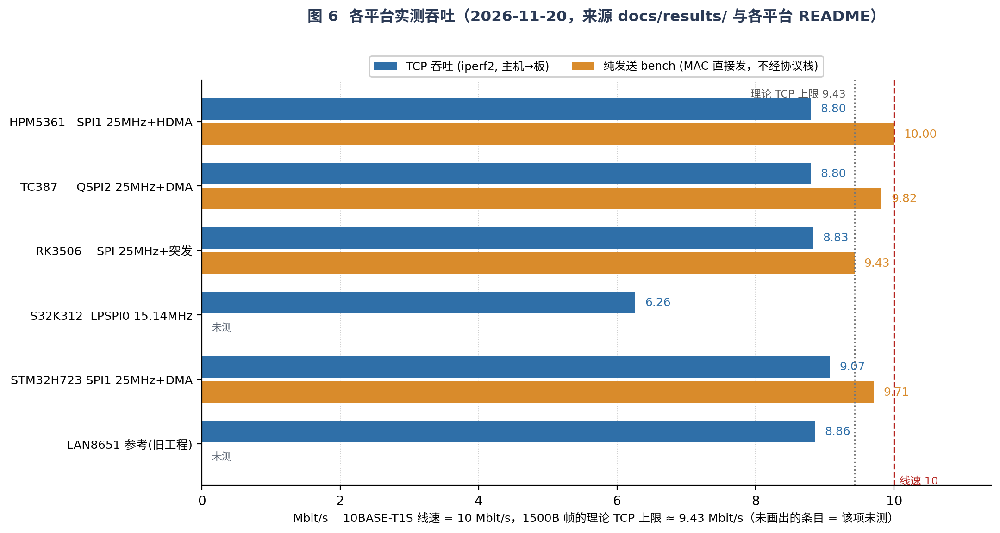
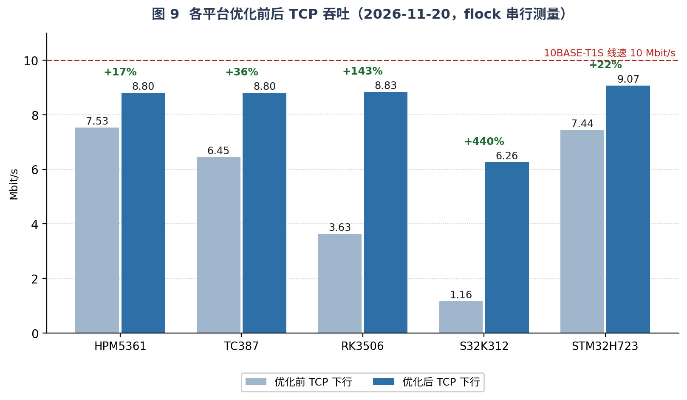

# 性能测试方法与结果

> **目标读者**：要把吞吐从 1 Mbit/s 提到 9 Mbit/s 的人。
> **关键结论**（2026-11-20）：硬件 SPI 平台已**顶到 10BASE-T1S 线速**——
> STM32H723 **9.07 / 8.87 Mbit/s TCP**、HPM5361 与 TC387 **8.80**、RK3506 **8.83 / 8.96**、
> S32K312（LPSPI0）**6.26 / 7.75**；H723 纯发送 **9.71 Mbit/s**（826 fps@1470B），HPM **10.0**。
> 瓶颈已不在芯片与总线，而在 **SPI 事务次数**与**协议栈配置**。





## 本篇目录

| 章节 | 内容要点 |
| --- | --- |
| 1 | 测试拓扑 |
| 2 | 理论带宽计算 |
| 3 | 测试命令（**iperf2**） |
| 4 | 调优项 |
| 5 | 结果汇总表 |
| 6 | 时延 |
| 7 | 已知瓶颈 |
| 8 | 实测结果（HPM / TC387 / S32K） |
| 9 | 怎么自己定位瓶颈（决策树） |
| 10 | 常见错误与排查 |

---

## 1. 测试拓扑

```
Ubuntu (iperf2)  <--USB-->  EVB-LAN8670-USB  === 10BASE-T1S 总线 ===  DUT (STM32H723/HPM/S32K/TC387/RK3506)
                                PLCA 协调者 ID0
```

* 总线: 双绞线 ≤ 10 m, 两端 100 Ω 终端
* PLCA: 协调者 ID0, NCNT=8, TOTMR=32（一致性要求）
* 测试工具: `iperf`（iperf2，主机侧）, `lwiperf`（板端）

## 2. 理论带宽

10BASE-T1S 线速 10 Mbit/s，以太网帧开销：

```
每帧: 前导 7 + SFD 1 + 目的 6 + 源 6 + 类型 2 + 负载 1500 + FCS 4 = 1526 B
帧间隔 IFG = 20 B (96 bit times)
效率 = 1500 / (1526 + 20) = 96.9 %
→ 理论 TCP 上限 ≈ 9.69 Mbit/s (不含 TCP/IP 头)
实际 IPv4/TCP: 1500B 帧中有效载荷 1460B → ≈ 9.43 Mbit/s
```

PLCA 会引入每个 TO 的空闲（`TOTMR` = 32 bit times = 3.2 µs）：
单节点持续发送时，每帧占 1.2 ms + 3.2 µs，损耗约 0.3%。

## 3. 测试命令

```bash
# 主机 -> 板 (下行), 主机用 iperf2
iperf -c 192.168.10.11 -t 10 -i 5 -f m

# 板 -> 主机 (上行): 主机先跑 iperf -s, 板端执行 iperf -c 192.168.10.10 -t 10
# 注意 lwiperf 不支持 iperf2 的 -R 反向模式, 不能靠 -R 测上行

# 小包
iperf -c 192.168.10.11 -l 64 -t 10 -i 5

# UDP
iperf -c 192.168.10.11 -u -b 10M -l 1400 -t 10
```

## 4. 调优项

| 项 | 默认 | 说明 |
| --- | --- | --- |
| SPI 时钟 | 25 MHz（H723 SPI1 / HPM / TC387） | 21 MHz 是 F407 历史值；当前平台推荐 25 MHz |
| SPI 时钟（S32K312） | LPSPI0 **15.137 MHz** | 功能时钟 60.55 MHz，32 位帧；软件 SPI 回退约 3 MHz |
| chunk | 64 B | 8/16/32 会增加事务次数 |
| CONFIG0.TXCTHRESH | ≥8 credits | 减少等待 |
| Cut-Through | 关闭 | 打开可降时延，可能增加丢包 |
| lwIP TCP_WND | 2 MSS | 10M 链路建议 4–8 MSS |
| lwIP TCP_SND_BUF | 4 MSS | 与窗口匹配 |
| lwIP PBUF_POOL | 24×1536 | 接收突发 |

## 5. 结果（2026-11-20）

| 平台 | SPI 配置 | TCP 下行 Mbit/s | TCP 上行 Mbit/s | 纯发送 bench | ping 平均 | 备注 |
| --- | --- | --- | --- | --- | --- | --- |
| **HPM5361** | SPI1 25.000 MHz + HDMA | **8.80** | 7.0–8.02 | **10.0 Mbit/s**（833 fps@1500B） | 0.70 ms | 已到线速上限 |
| **TC387** | QSPI2 25.000 MHz + DMA | **8.80** | 8.80 | **9.72–9.85 Mbit/s** | 0.609 ms | 碰撞 9278 → 5 |
| **RK3506** | SPI 25 MHz + 突发（≤48 块/次） | **8.83** | **8.96** | UDP 灌包 9.43（丢包 0%） | 1.09 ms | CPU 15.4% / 19.2% |
| **S32K312** | LPSPI0 **15.137 MHz** + 软件 CS | **6.26** | **7.75** | 未测 | 0.82 ms | 软件 SPI 仅 1.17/1.40 |
| **STM32H723** | SPI1 **25 MHz** + DMA（Cortex-M7 550 MHz） | **9.07** | **8.87** | **9.71 Mbit/s**（826 fps@1470B） | 0.56 ms | 接替 F407；TCP_WND=8760 |
| STM32F407（历史） | SPI3 21 MHz + DMA1 | 无法测（板子损坏） | — | bench 108/200 | — | 已停用 |
| LAN8651（旧工程参考，历史） | STM32F407 硬件 SPI | 8.86 | — | — | — | 非本工程 |

> 测量条件：主机为 PLCA 协调者 ID 0，iperf2，`flock /tmp/s2500_perf.lock` 串行，
> 每项 8–10 s。原始记录见 [`docs/results/2026-11-20_summary.md`](results/2026-11-20_summary.md)。

## 6. 时延

`ping -c 100 -i 0.01` 的 RTT 与 PLCA 节点数、TO 周期相关：

* 单节点: 取决于 MCU 响应时间（< 1 ms 典型）
* 8 节点: 最坏等待 8 × (1 帧 + TO) ≈ 10 ms（1500B 帧时）
* 可通过 Burst 模式减少小包等待

## 7. 已知瓶颈
> **2026-11-20 更新**：前两条已由"批量/突发 + DMA"解决（RK3506 每次 SPI 传输最多 48 块、
> TC387/HPM 用 DMA 后每块只 2 次中断）。**当前真正的瓶颈是第 1 条的变体——事务次数**，
> 而不是 SPI 时钟本身：RK3506 从 15 MHz 提到 25 MHz 只多 1%，但批量突发带来 +143%。


1. **单块 SPI 事务**: 每个 64B chunk 一次 CS，开销约 3 µs/块；多块连续传输可再提升 ~10%。
2. **lwIP 拷贝**: `s2500_recv` → `pbuf_alloc/copy` → `ethernet_input`；零拷贝需要自定义 pbuf。
3. **主循环轮询**: 若应用阻塞 > 1.2 ms 会丢帧（RX 缓冲 8 KB 可吸收 ~5 帧 1500B）。

## 8. 实测结果（2026-11-20）

### 8.0 HPM5361（SPI1 25 MHz + HDMA，推荐参考）

| 项目 | 数值 | 条件 |
| --- | --- | --- |
| TCP 下行（主机→板） | **8.80 Mbit/s** | iperf2，10 s，10.5 MB |
| TCP 上行（板→主机） | 7.0–8.02 Mbit/s | 板端作客户端（lwiperf 不支持 -R） |
| 纯发送 bench | **10.0 Mbit/s（833 fps @1500B）** | `s2500 bench tx 1000 1500` |
| ping RTT | **0.70 ms**（min 0.62） | 主机协调者 |
| 优化前 → 后 | 7.53 → 8.80（+17%）、9.52 → 10.0、RTT 0.86 → 0.70 | 见 §8.6 |

> 1500B 帧按 IFG 估算的线速上限是 826 fps，实测 833 fps，说明**总线利用率已到 100%**。

### 8.1 TC387（QSPI2 25 MHz + DMA）

| 项目 | 数值 |
| --- | --- |
| TCP 下行 / 上行 | **8.80 / 8.80 Mbit/s** |
| 纯发送 bench | **9.72–9.85 Mbit/s** |
| ping RTT | **0.609 ms** |
| 优化前 → 后 | TCP 6.45 → 8.80（+36%）、bench 7.28 → 9.82、PCS 碰撞 9278 → 5 |

### 8.2 RK3506（Linux，SPI 25 MHz + 突发）

| 项目 | 数值 |
| --- | --- |
| TCP 下行 / 上行 | **8.83 / 8.96 Mbit/s** |
| 纯发送（UDP 灌包） | **9.43 Mbit/s，丢包 0%** |
| ping RTT | 1.09 ms（0.90 / 1.97） |
| 板端 CPU | 下行 15.4% / 上行 19.2% |
| 优化前 → 后 | 3.63 / 5.16 → 8.83 / 8.96（+143% / +73%） |

> 关键手段是**批量突发（≤48 块/次）**：15 MHz + 批量已到 8.70，升到 25 MHz 只多 1%。

### 8.3 S32K312（LPSPI0 15.137 MHz，默认硬件 SPI）

| 项目 | 数值 |
| --- | --- |
| TCP 下行 / 上行 | **6.26 / 7.75 Mbit/s**（安静总线；多人共用时下行 3.5–4.6） |
| ping RTT | **0.82 ms** |
| SPI 层（68B 事务） | **13.27 Mbit/s** |
| IDVER 1000 次 | bad=0、timeout=0 |
| 纯发送 bench | 未测 |
| 优化前 → 后 | 1.16（软件 SPI）→ **6.26**（LPSPI0），+440% |

> **根因 1（"重复首字"）**：LPSPI0 的 FIFO 只有 2 字深，旧代码 `TXWATER=3`，而
> `SR.TDF=(TXCOUNT<=TXWATER)` 恒为 1，第 3 个字起写 TDR 被静默丢弃 → S2500 只收到半个包头。
> 修正为按 `PARAM` 现读深度、`TXWATER=depth-1`、每次写前查 `TXCOUNT<depth` 后，IDVER 1000 次全对。
>
> **根因 2（3.55 Mbit/s 天花板）**：`s2500_recv()` 每帧逐位 CRC32 复核（1460B ≈ 0.5 ms），
> 卡在"收完→lwIP→回 ACK"之间；改半字节查表后 **3.55→6.26**。
>
> 默认后端已是 LPSPI0；`s32k hw off` 可运行时回退软件 SPI。未做：eDMA、去掉两次内存拷贝、
> `SAMPLE=1` 把 SCK 提到 20 MHz+。

### 8.4 STM32H723（SPI1 + DMA，Cortex-M7 550 MHz）

> 2026-11-20 下午接替损坏的 STM32F407（同 IP `192.168.10.11`、PLCA ID 1）。工程为
> `stm32h723/`（CMake + Ninja + HAL H7 + lwIP + letter-shell），SPI1 引脚
> CS=PG10 / MISO=PG9 / SCLK=PG11 / MOSI=PD7 / IRQ=PD5 / RST=PD6，USART1 PA9/PA10 115200。

| 项目 | 数值 | 条件 |
| --- | --- | --- |
| 编译 / 烧写 | ✅ CMake+Ninja，FLASH 96 KB（9.18%）、RAM_D1 84 KB | `./build.sh` + `./flash.sh`；STLINK-V3 + `target/stm32h7x.cfg` |
| IDVER / PHYID / MAC | 0x00000011 / 0x180FF411 / 44:9F:79:29:F9:8E | `/dev/ttyACM0` 115200 |
| TCP 下行 / 上行 | **9.07 / 8.87 Mbit/s** | iperf2，主机协调者 ID 0；TCP_WND=8760 |
| 纯发送 bench | **826.4 fps，L2 9.71 / UDP 9.44 Mbit/s** | `bench 500 1428`（1470B 帧） |
| ping RTT | **0.56 ms**（0.52/0.57/0.60） | 主机协调者 |
| 12B 控制事务 | **6.00 µs** @25 MHz | SPI DMA 100%，回退/超时 0 |
| PLCA 协调者 ID=0 | ✅ 双向 20/20，9.07 / 8.87 | `./host/coord_test.sh h723` |

> **H7 关键坑**：H7 的新 SPI IP 只置 `SPE=1` **不出时钟**，必须再置 `CR1.CSTART`；否则 RX DMA
> 不动、1 ms 超时后回退轮询，性能骤降。本工程已按此配置（DMA 100%、回退 0）。
> **调优**：TCP_WND 2920→8760 使下行 **7.44→9.07**；SPI 12.5→25 MHz 对下行几乎无影响，
> 说明瓶颈在 TCP 窗口而非 SPI 时钟。

### 8.5 STM32F407（历史平台，已停用）

> **板子已物理损坏，2026-11-20 停用**；以下数字仅作历史追溯，不代表 H723，也不再用于交付。

| 项目 | 数值 |
| --- | --- |
| 12B 控制事务 | 21.60 µs → **8.28 µs**（DMA，2.61×） |
| 事务率 | 428k → **944k 次/s** |
| 吞吐 | **无法测**：S2500 模块 TX 通路疑似硬件故障（RX 正常 1.5 万帧） |

### 8.6 优化前后汇总

| 平台 | 优化前 TCP | 优化后 TCP | 增益 | 主要手段 |
| --- | --- | --- | --- | --- |
| HPM5361 | 7.53 | **8.80** | +17% | 25 MHz + HDMA + 信用缓存 + lwIP 调优 |
| TC387 | 6.45 | **8.80** | +36% | 10→25 MHz + DMA + 改 PLCA 跟随者 |
| RK3506 | 3.63 | **8.83** | +143% | 批量突发 + 25 MHz |
| S32K312 | 1.16（软件 SPI） | **6.26**（LPSPI0） | +440% | FIFO 节拍修正 + 半字节 CRC32 |
| STM32H723 | 7.44 | **9.07** | +22% | TCP_WND 2920→8760（SPI 提频无收益） |

### 8.7 自愈看门狗恢复时间（2026-11-20）

| 平台 | 正常 60 s（120 包） | 检出→重初始化 | ping 中断 |
| --- | --- | --- | --- |
| HPM5361 | 120/120，0 误判 | 64 ms | **1.44 s** |
| STM32H723 | 120/120，0 误判 | 64 ms | **0.83 s** |
| TC387 | 120/120，0 误判 | 63 ms | **0.40 s** |

> 看门狗默认 2 s 周期，最坏情况（复位发生在刚检查完）再等一个周期，仍 **< 3 s**。
> 命令 `s2500 wd` / `s2500 wd on|off` / `s2500 wd reset`；详见 [docs/10](10_hardware_troubleshooting.md) §9。

## 9. 怎么自己定位瓶颈（决策树）

```
吞吐不达标
├─ 先看 SPI 时钟
│   ├─ < 10 MHz（含软件 SPI） → 瓶颈 100% 在 SPI，先换硬件 SPI 或提高时钟
│   └─ ≥ 20 MHz → 继续
├─ 再看纯发送 bench（不经协议栈）
│   ├─ bench 也只有 1–2 Mbit/s → SPI/驱动问题
│   └─ bench 有 9 Mbit/s 但 iperf 只有 3 Mbit/s → 瓶颈在 lwIP 配置
│        ├─ TCP_WND / TCP_SND_BUF 太小 → 增大到 4–8 MSS
│        ├─ PBUF_POOL 太小 → 24 × 1536
│        └─ 主循环阻塞 > 1.2 ms → 降低单次处理量
├─ 检查 PLCA 参数是否全网一致（NCNT / TOTMR）
└─ 检查端接是否过量（SQI < 5 就会重传，吞吐自然低）
```

判断依据一句话：**bench 高、iperf 低 = 协议栈/配置问题；bench 低 = SPI/驱动问题；
SQI 低 = 物理层问题。**
补充（2026-11-20 实测）：

| 现象 | 真正的瓶颈 | 该做什么 |
| --- | --- | --- |
| bench 9–10 Mbit/s 但 TCP 只有 5–6 | 协议栈 / PLCA 混跑 | 全网统一开 PLCA、增大 TCP_WND |
| 提到 25 MHz 只涨 1% | 事务次数太多 | 改批量/突发（RK3506 一次 ≤48 块） |
| 碰撞计数很高、抖动大 | CSMA 与 PLCA 混跑 | 所有节点 `plca_en=1` |
| 计数器与 iperf 对不上 | 芯片计数器不可信 | 用 netdev / iperf 判断 |


## 10. 常见错误与排查

| 现象 | 原因 | 处置 |
| --- | --- | --- |
| iperf 报连不上 | 用了 iperf3 | 换 iperf2 |
| 吞吐 1.2 Mbit/s 左右 | 回退到了软件 SPI（约 3 MHz） | `s32k hw on` 切回 LPSPI0；正常应有 6.26 |
| 吞吐忽高忽低 | 多板并发抢总线 | 单板串行测 |
| 上行能跑满、下行很低 | 板端只做 server，反向受限 | 用 bench 或反向 iperf 分开测 |
| 小包 pps 上不去 | 每帧一次 CS + 驱动开销 | 增大包长；开 Burst |
| 大包偶尔丢 | RX 缓冲 8 KB 吸收不了突发 | 提高轮询频率；增大 PBUF_POOL |
| ping RTT 随节点数线性增长 | PLCA 轮询的正常现象 | 需要低时延就减节点或开 Burst/优先级 |
| 25 MHz 反而比 20 MHz 差 | 板级信号完整性不足 | 回退到 20 MHz |

## 11. 相关章节

| 想看什么 | 去哪里 |
| --- | --- |
| 测试矩阵与判据 | [`docs/06_test_matrix.md`](06_test_matrix.md) |
| 命令手册 | [`docs/08_shell_commands.md`](08_shell_commands.md) |
| 总线与 PLCA | [`docs/02_bus_plan.md`](02_bus_plan.md) |
| 实测记录 | [`docs/results/`](results/) |
