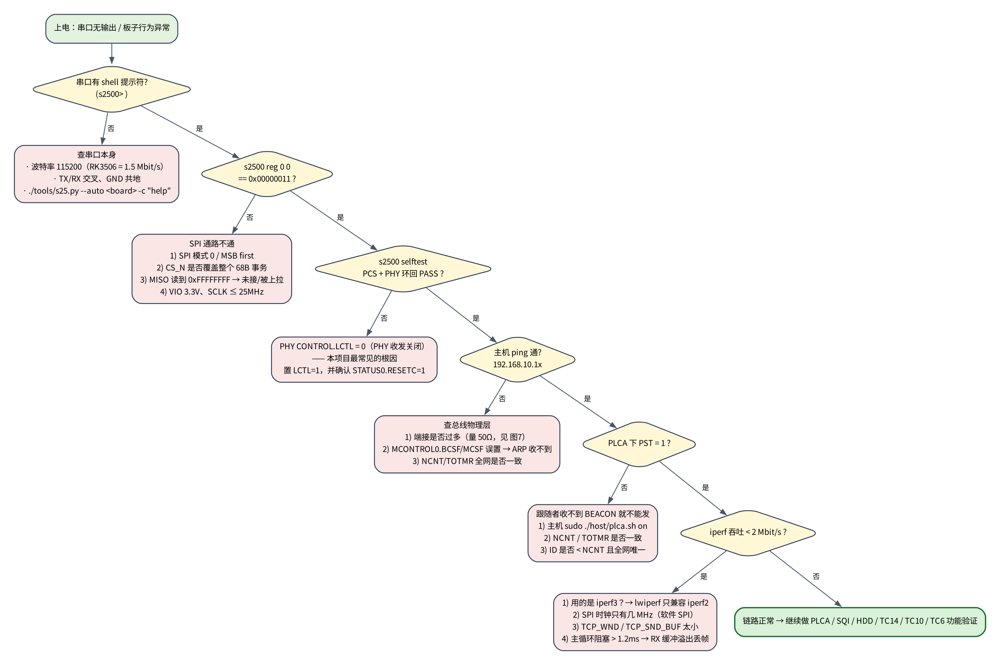

# 硬件排障手册（现场实测）

> **2026-11-19 20:05 更新（重要结论修正）**：经过 MCU 板与 RK3506 的实测，
> 最初判断的"总线不通疑似终端过多"**并非根因**。真正的原因是：
> **S2500 的 PHY CONTROL.LCTL 默认 0（PHY 收发关闭），且 MCONTROL0.TXEN/RXEN 未使能**，
> 导致板端既不发送也不接收；RK3506 上此前运行的是 LAN8651 驱动，它只写 LAN8651 私有寄存器，
> 从未打开 S2500 的 MAC/PHY。修正驱动后 S2500 的 IDVER/PHYID/出厂 MAC 全部正常。
> 终端电阻仍是需要现场确认的风险（见下），但不是本次"RX=0"的原因。

> 本文件记录 2026-11-19 上板时遇到的两个硬件问题及排查方法，供现场快速定位。

> **怎么用**：从"现象"出发，照着下面这张决策树走，每一步都有明确判据。



## 本篇目录

| 章节 | 内容要点 |
| --- | --- |
| 1 | 总线完全不通信（主机 RX=0） |
| 2 | STLINK 连接（H723 当前 / F407 历史） |
| 3 | 串口无输出 |
| 4 | 供电与复位 |
| 5 | 快速判定表（RX/TX 组合） |
| 6 | 五类根因速查 |
| 7 | 现场 10 分钟排障脚本 |
| 8 | 常见错误与排查 |
| 9 | S2500 自发复位与自愈看门狗 |
| 10 | 相关章节 |

---

## 1. 10BASE-T1S 总线完全不通信（主机 RX=0）

### 现象

```bash
ip -s link show enx001ec0d1c337 | tail -4
# RX: bytes 0  packets 0        <-- 主机从未收到任何帧
# TX: bytes 108077 packets 663  <-- 主机在发 (ARP/Beacon)
```

板端（RK3506 + LAN8651）`t1s0` 的 RX 也为 0，双向都不通，但 `Link detected: yes`、
PLCA `Status: on`。

### 排查顺序

1. **确认两端在同一段铜缆上**
   * 10BASE-T1S 是单段总线（mixing segment），所有节点必须并联在同一对线上，
     中间不能有交换机/隔离器件。
   * 用万用表 **断电** 测 T1S_P 与 T1S_N 之间直流电阻：
     * 正常（两端各 100 Ω 终端）：约 **50 Ω**（两个 100 Ω 并联，通过线缆直连）
     * 实际板端是 2×49.9 Ω + 4.7 nF，直流下约 100 Ω/端 → 总线两端并联约 **50 Ω**
     * 若测得 **< 20 Ω**：终端电阻过多（每块 S2500_1 都有 R12/R13！）
     * 若测得 **∞**：线缆断了或没接上
2. **终端电阻数量**（本项目最大风险）
   * S2500_1 每块板都焊了 R12/R13 = 49.9 Ω ×2（差分 100 Ω）。
   * 6 块板 + 主机 = 7 个 100 Ω 并联 ≈ **14 Ω**，信号幅度会被压到无法识别。
   * 规则：**只有总线物理两端的两块板保留 R12/R13**，其余全部拆除（或用烙铁断开）。
   * 验证：断开所有板，只留两端，上电后主机 `ping` 对端应立刻恢复。
3. **极性/线序**
   * 10BASE-T1S PHY 对 P/N 极性不敏感，但要求 P/N 成对；
     如果误把 P 接到另一对的 N，则完全无信号。
4. **主机 USB 适配器**
   * `sudo ethtool enx001ec0d1c337 | grep -E "Speed|Link"` 应为 10Mb/s / Half / yes。
   * `sudo ethtool --get-plca-status enx001ec0d1c337` 应为 on（协调者）。
   * 若 RX 长期为 0 但 TX 增长：优先怀疑物理层，而不是驱动。
5. **PLCA 配置一致性**
   * 所有节点 `NCNT`、`TOTMR` 必须一致；协调者 ID=0，跟随者 1..254 且唯一。
   * 跟随者在没有 BEACON 时 **不能发送**（PST=0），此时表现为 "TX 计数在涨但线上没包"。

### 快速判定表

| 主机 RX | 板端 RX | 结论 |
| --- | --- | --- |
| 0 | 0 | 物理层断/终端过多/极性错 |
| 增长 | 0 | 板→主机方向断（或板端 PLCA 未同步） |
| 0 | 增长 | 主机→板方向断（检查主机 PHY/接线） |
| 增长 | 增长 | 链路正常，问题在协议/地址/PLCA 配置 |

## 2. STLINK-V3 连接（H723 当前 / F407 历史）

> **平台变更（2026-11-20）**：当前 STM32 平台是 **STM32H723ZGT6**，STLINK-V3 用
> `openocd -f interface/stlink.cfg -f target/stm32h7x.cfg`，SWD 正常，串口是 STLINK VCP
> （`/dev/ttyACM0`，115200）。下面"无法连接"的现象与排查是 **STM32F407 旧板**（板子已损坏停用）
> 的记录，**方法通用**，但命令里的 `stm32f4x.cfg` / `stm32f407_s2500.bin` 只适用于历史平台。

### 2.1 H7 平台特别注意（2026-11-20）

* **SPI 只置 `SPE=1` 不出时钟**：H7 的新 SPI IP 必须再置 `CR1.CSTART`。只开 SPE 时 RX DMA 不动，
  1 ms 超时后回退轮询，12B 事务会慢到 ~1010 µs（正常 6.00 µs）。
* **没有 F4 的 BSY**：H7 用 `SR.EOT/TXC` 判断传输结束；照抄 F4 的"抬 CS 前等 BSY"会每次白等 1 ms。
* **D-Cache 与 DMA**：先配 MPU 把 DMA 缓冲区设为 non-cacheable，再 `SCB_EnableDCache()`，最后 `HAL_Init()`。
* **LKST 不能单独当判据**：上电后 5–10 s 才 UP；bench 连续发送时可能瞬时 DOWN（终端过量），
  但 ping 0% 丢包、iperf 满速。判据用 **ping + `s2500 counters`**（fcserr/overflow/underflow 不增长）。

### F407 历史现象（已停用）

### 现象

```
$ st-info --probe
Failed to enter SWD mode
chipid: 0x000, dev-type: unknown

$ openocd -f interface/stlink.cfg -f target/stm32f4x.cfg -c "init; halt"
Info : Target voltage: 3.288830
Error: init mode failed (unable to connect to the target)

$ st-flash --connect-under-reset erase
WARN common.c: NRST is not connected
```

目标电压正常（3.29 V），说明目标板已供电，但 SWD 无应答。

### 排查

1. **NRST 必须接**：STLINK 的 NRST 没接到目标 NRST 时，无法 connect-under-reset。
   若旧固件把 PA13/PA14 复用为 GPIO 或进入低功耗，只能靠复位时连接救回。
2. 用万用表量 **NRST 是否被持续拉低**（被按住复位时既无 SWD 也无串口输出）。
3. 检查 SWDIO(PA13)/SWCLK(PA14)/GND 三根线是否真的连通（杜邦线断线最常见）。
4. 断电重新上电，排除 MCU 处于 Standby。
5. 备选方案：**BOOT0 拉高 + 复位** 进入 STM32 系统 bootloader，用 USART1（PA9/PA10，
   即 STLINK VCP）烧写：
   ```bash
   stm32flash -w build/stm32f407_s2500.bin -v -g 0x08000000 /dev/ttyACM0
   ```
   （本次实测 BOOT0=0，发 0x7F 无 ACK，说明未进入 bootloader。）
6. 若 RDP（读保护）被置为 2，只能 mass erase（也需要连接成功）。

## 3. 串口无输出

| 板 | 串口 | 检查 |
| --- | --- | --- |
| STM32H723 | `/dev/ttyACM0` | STLINK-V3 VCP，115200；USART1 PA9/PA10（PA9→VCP RX，PA10→VCP TX，交叉） |
| HPM5361 | `/dev/ttyUSB1` | FT2232H 通道 B，115200 |
| S32K312 | `/dev/ttyACM2` 或 `ACM3` | CH343P，115200；TX/RX 交叉 |
| TC387 | `/dev/ttyUSB2` | DAP JDS 的 FTDI 通道，115200 |
| RK3506 | `/dev/ttyACM3` | CH343P，**1500000** |

> 串口助手：`./tools/s25.py --auto <board> -c "help"`，按 VID:PID 自动选口。

## 4. 供电与复位

* S2500 的 VCC/VIO 均为 3.3 V；VBAT 板上经 R6=0 Ω 接 3V3。
* RST_N 有 10 kΩ 上拉，低有效；MCU 上电后建议给 ≥ 100 µs 低脉冲再释放。
* IRQ_N 有 10 kΩ 上拉，低有效，开漏。
---

## 5. 快速判定表（RX/TX 组合）

| 主机 RX | 板端 RX | 结论 | 先查什么 |
| --- | --- | --- | --- |
| 0 | 0 | 物理层断 / 端接过多 / 极性错 | 量 50 Ω、换线、只留两端终端 |
| 增长 | 0 | 板→主机方向断，或板端 PLCA 未同步 | 板端 `PST`、板端 TXEN |
| 0 | 增长 | 主机→板方向断 | 主机网卡、BEACON、接线 |
| 增长 | 增长 | 链路正常，问题在协议/地址 | MAC 过滤、IP、ARP、FCS |

## 6. 五类根因速查

| 类别 | 典型现象 | 一句话判据 |
| --- | --- | --- |
| 供电 / 复位 | 一切都不对，电流异常 | 量 3.3 V、量 RST_N 为高 |
| 端接 / 线束 | SQI 低、HDD 报错、时通时不通 | 量 T1S_P ↔ T1S_N ≈ 50 Ω |
| PHY 未开 | 能读 ID、收发全 0 | `PHY CONTROL.LCTL=1`？ |
| PLCA 未同步 | TX 计数涨但线上没包 | `PST=1`？`PLCADIAG=0`？ |
| 协议 / 配置 | 能收不能 ping、长度差 4 | FCS 处理？`BCSF/MCSF`？ |

> **最容易误判的一条**：本项目最初把"主机 RX=0"判为"端接过多"，
> 真实根因是 **`PHY CONTROL.LCTL` 默认 0（PHY 收发关闭）**，
> 且当时 RK3506 上跑的是 LAN8651 驱动、从未打开 S2500 的 MAC/PHY。
> 端接过多是**同时存在的第二个问题**，不是 "RX=0" 的原因。

## 7. 现场 10 分钟排障脚本

```bash
# ---- 主机侧 ----
lsusb | grep 184f                                   # 1 适配器在不在
ip -br addr show enx001ec0d1c337                    # 2 IP
ethtool enx001ec0d1c337 | grep -E "Speed|Link"      # 3 10M / Half / yes
ethtool --get-plca-status enx001ec0d1c337           # 4 Status: on
ip -s link show enx001ec0d1c337 | tail -4           # 5 RX / TX 是否在涨

# ---- 板端 ----
./tools/s25.py --auto <board> -c "s2500 reg 0 0"    # 6 0x00000011
./tools/s25.py --auto <board> -c "s2500 selftest"   # 7 PCS / PHY PASS
./tools/s25.py --auto <board> -c "s2500 status"     # 8 PST / 诊断位
./tools/s25.py --auto <board> -c "s2500 sqi"        # 9 信号质量
./tools/s25.py --auto <board> -c "s2500 hdd"        # 10 线束

# ---- 交叉验证 ----
ping -c 20 -i 0.05 192.168.10.NN                    # 11 连通性
```

第 5、6、8 步基本就能定位问题在哪一层。

## 8. 常见错误与排查

| 现象 | 原因 | 处置 |
| --- | --- | --- |
| 主机 RX 一直 0 | 物理层 / 端接 / P/N 接反 | 见 §1、§5 |
| 板端 RX 一直 0 | LCTL=0；RXEN=0；BCSF/MCSF=1 | 见 §6 |
| 两块板都设成 ID=0 | 双协调者 | 只留一个，看 `UNEXPB` |
| 板子能 ping 主机，主机 ping 不到板 | 板端 ARP 回复被 MAC 过滤 | 关掉 MADDRFILT 的严格模式 |
| 拔掉一端终端立刻好 | 端接过多被证实 | 拆中间节点 R12/R13 |
| 复位后要等一会才通 | 上电 Boot 需要约 5.3 ms | 正常现象 |
| 换了根 USB 线就全好了 | 线材只有充电芯 | 用带数据的线 |
| STLINK 一直连不上 | NRST 没接 / SWD 被复用 | 接 NRST；BOOT0 引导 |

## 9. S2500 自发复位与自愈看门狗

### 9.1 现象（实测 4~5 次）

某块板运行中 S2500 无故回到上电默认态，MCU 本身正常（shell 可用），但该板
ping 不通，只能 reboot MCU 恢复。异常时寄存器快照：

| 寄存器 | 异常值 | 正常值 |
| --- | --- | --- |
| CONFIG0 | `0x00000006`（SYNC=0） | `0x00009806`（SYNC=1, ZARFE=1, CPS=64） |
| PLCA_CTL0 | `0x0000`（PLCA en=0） | `0x8000`（en=1） |
| PLCA_CTL1 | `0x08FF`（id=255） | `0x0801` / `0x0802` …（驱动配置的 id） |
| DIOCFG0 | `0x0000C0C0`（LED 功能码归 0） | `0x0000CBDF`（DIO0=LED_TXRX, DIO1=LED_PLCASTS） |
| WS_STATUS1 | `0x0000`（无 POR_VCC/POR_VIO/RST_IN） | `0x0000` |

WS_STATUS1 没有任何上电/复位标志，说明不是正常的上电复位，更像芯片内部状态
异常。**软件不能阻止它发生，但可以自动发现并恢复。**

### 9.2 判据（每 2 s 一次，1 次 12 B 控制事务 ≈ 6 µs @25 MHz）

驱动在 `s2500_app_poll()` 里调用 `s2500_wd_poll()`，每 `S2500_WD_PERIOD_MS`
（默认 2000 ms，编译时 `-D` 可改）读一次 `PLCA_CTL1`：

1. `PLCA_CTL1.ID != dev->plca_id` → 判定复位（协调者 id=0 是正常值，不会误判）；
2. `PLCA_CTL1.NCNT != dev->plca_ncnt` → 判定复位；
3. PLCA 关闭（id=255）时 ID 恒为 255，改用 `CONFIG0.SYNC` 兜底；
4. 每 10 次检查再核对一次 `IDVER == 0x11`。

SPI 读失败（TC10 Sleep 期间芯片不响应 SPI）只累计 `spi_errors`，**不判定复位**。
`s2500 td` / `s2500 sleep` 执行期间命令内部先 `wd off`，结束后恢复，避免误判。

### 9.3 自愈动作与开关

检出后驱动调用应用注册的回调，**复用 `s2500_app_init()` 的初始化路径**：
`s2500_soft_reset()` → `s2500_init()` → `s2500_configure()` → `s2500_start()`，
重新应用 MAC 过滤 / PLCA / LED / 模拟参数；运行期的 `s2500 plca` / `s2500 mac`
设置会保留。整个过程不需要 reboot MCU，串口打印：

```
S2500 已复位, 自动重新初始化 (第 1 次)
S2500 自愈完成: PLCA id=2 ncnt=8, 重新初始化耗时 58 ms
```

开关与统计（默认 on，掉电恢复默认）：

```
s2500 wd            # 检查次数/检出次数/重初始化成功失败/spi_err/上次检出时刻与原因
s2500 wd on|off     # 运行期开关
s2500 wd reset      # 清统计
```

### 9.4 实测恢复时间（2026-11-20，故障注入 `s2500 reg 0 3 1`）

| 平台 | 正常 60 s（120 包） | 检出→重初始化 | ping 中断 | 恢复后配置 |
| --- | --- | --- | --- | --- |
| HPM5361 (192.168.10.12) | 120/120，检出 0 | 64 ms | **1.44 s** | CONFIG0=0x9806, id=2, DIOCFG0=0xCBDF |
| STM32H723 (192.168.10.11) | 120/120，检出 0 | 64 ms | **0.83 s** | CONFIG0=0x9806, id=1, DIOCFG0=0xCBDF |
| TC387 (192.168.10.14) | 120/120，检出 0 | 63 ms | **0.40 s** | CONFIG0=0x9806, id=4, DIOCFG0=0xCBDF |

恢复时间 = 最后一次成功 ping 到重新收到 ping；最坏情况是复位恰好发生在刚检查
完之后，再等一个 2 s 周期，仍 < 3 s。协调者模式回归
（`sudo host/coord_test.sh hpm`）整场无“已复位”日志（检出次数保持 1，即注入
测试那次），双向 ping 20/20、iperf 6.27/7.27 Mbit/s 通过。

> 看门狗只能恢复软件可恢复的芯片状态；若 SPI 完全无响应（供电/复位脚异常），
> 只会计 `spi_errors`，不会误判复位，仍需按 §4 查供电与复位。

## 10. 相关章节

| 想看什么 | 去哪里 |
| --- | --- |
| 总线规划与端接 | [`docs/02_bus_plan.md`](02_bus_plan.md) |
| 硬件说明 | [`docs/01_hardware.md`](01_hardware.md) |
| 调试环境与设备名 | [`docs/09_debug_env.md`](09_debug_env.md) |
| 从零搭环境 | [`docs/12_dev_env_setup.md`](12_dev_env_setup.md) |
