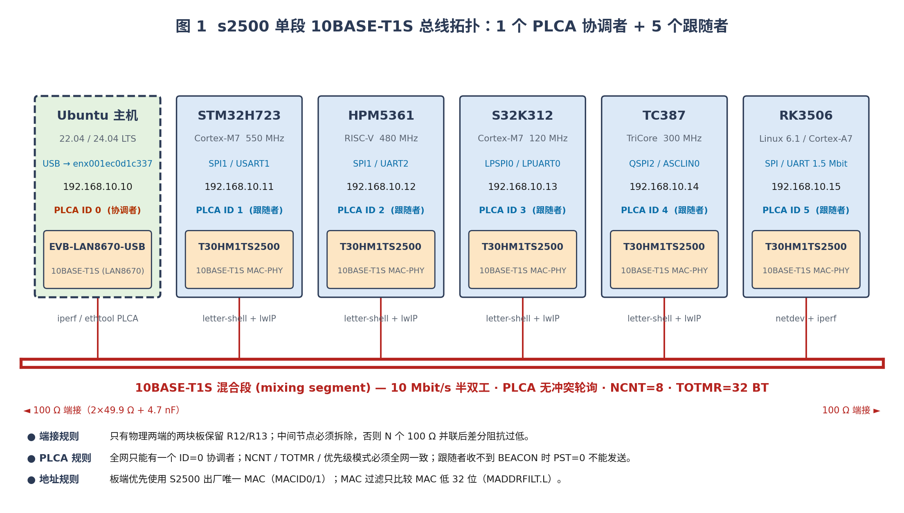
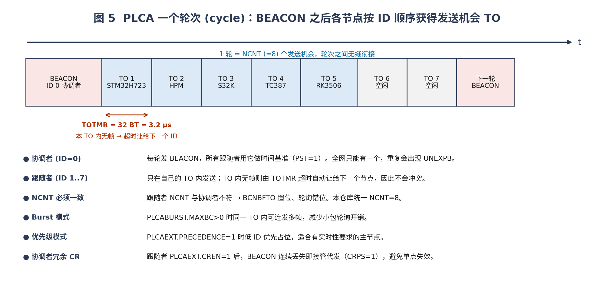

# 10BASE-T1S 与 PLCA 入门

本篇讲清"为什么这块芯片值得用"以及"总线上的规矩"。读完应该能回答：

* 10BASE-T1S 和 10BASE-T1L、CAN、RS-485 有什么区别？
* 一条总线上为什么最多 8 个节点？
* PLCA 协调者（ID 0）在干什么？跟随者为什么"没收到 BEACON 就发不出去"？
* S2500 这颗 MAC-PHY 相比普通以太网 PHY 多了什么？
* SQI / HDD / TC14 / TC10 / TC6 分别解决什么问题？

## 本篇目录

| 章节 | 内容要点 |
| --- | --- |
| 1 | 一分钟速览：10BASE-T1S 是什么 |
| 2 | 与 T1L / CAN / RS-485 / 传统以太网的对比 |
| 3 | 物理层：单对双绞线、混合段、端接与节点数 |
| 4 | MAC 层：为什么需要 PLCA |
| 5 | PLCA 一个轮次的完整时序 |
| 6 | PLCA 的参数（NCNT / TOTMR / Burst / 优先级 / CR）与配置一致性 |
| 7 | MAC-PHY + OA-SPI：S2500 的定位 |
| 8 | S2500 独有能力：SQI / HDD / TC14 / TC10 / TC6 |
| 9 | 术语表与常见误解 |
| 10 | 进阶阅读顺序 |

---

## 1. 一分钟速览

**10BASE-T1S** 是 IEEE 802.3cg（2019）定义的车载以太网标准：

| 属性 | 值 |
| --- | --- |
| 速率 | 10 Mbit/s，**半双工共享介质** |
| 介质 | 1 对屏蔽/非屏蔽双绞线（单对，不是 4 对） |
| 拓扑 | **混合段（mixing segment）**：多个节点并接在同一对线上，**不需要交换机** |
| 段长 | ≤ 25 m |
| 节点数 | 每段 ≤ 8 个（含协调者） |
| 端接 | 段两端各 100 Ω（差分） |
| 冲突避免 | 可选 **PLCA**（Physical Layer Collision Avoidance，Clause 148） |
| 供电 | 可叠加 PODL（Power over Data Line） |
| 典型用途 | 车载 Zone 控制器到传感器/执行器、工业背板、楼宇末端设备 |

本项目实际拓扑（1 个协调者 + 5 个跟随者）见下图：



一句话：**把"以太网"降到两根线上、可以像 CAN 一样挂一串节点，但仍然是以太网帧**。
所以上层的 IPv4 / TCP / UDP / DHCP / SOME-IP / DoIP 全都能直接用。

```
   传统以太网 (100BASE-TX)                10BASE-T1S 混合段
   每个设备 ---- 交换机 ---- 每个设备       ┌──┬──┬──┬──┬──┬──┬──┬──┐
   (4 对线, 点对点, 需交换机)              │ 1│ 2│ 3│ 4│ 5│ 6│ 7│ 8│
                                           └──┴──┴──┴──┴──┴──┴──┴──┘
   线束成本高、有源器件多                    1 对双绞线，无交换机
```

---

## 2. 与其它总线的对比

| 维度 | 10BASE-T1S | 10BASE-T1L | CAN FD | RS-485 | 100BASE-TX |
| --- | --- | --- | --- | --- | --- |
| 速率 | 10 Mbit/s | 10 Mbit/s | 最高 8 Mbit/s | 一般 ≤ 10 Mbit/s | 100 Mbit/s |
| 介质 | 1 对双绞线 | 1 对双绞线 | 1 对双绞线 | 1 对双绞线 | 4 对双绞线 |
| 距离 | ≤ 25 m | ≤ 1000 m | ≤ 40 m @ 8M | ≤ 1200 m @ 低速 | ≤ 100 m |
| 拓扑 | 多点混合段（≤8 节点） | **点对点** | 多点总线 | 多点总线 | 点对点 |
| 访问方式 | CSMA/CD 或 PLCA | 点对点无冲突 | 优先级仲裁 | 主从/令牌 | 交换式全双工 |
| 帧格式 | **标准以太网帧** | 标准以太网帧 | CAN 帧 | 自定义 | 标准以太网帧 |
| 上层协议 | IP / TCP / UDP / SOME-IP | 同左 | CANopen / J1939 | Modbus RTU 等 | 任意 |
| 单节点成本 | 低（MAC-PHY + SPI） | 中（需 MAC） | 低 | 极低 | 高 |

**选型结论**：

* 要 IP 化、要和 IT 网络同构、要在 MCU 上不加交换机 → **10BASE-T1S**。
* 要 1 km 长距离、点对点连传感器 → **10BASE-T1L**。
* 只有几十字节控制量、成本极敏感、不需要 IP → CAN FD / RS-485 仍更划算。

---

## 3. 物理层：单对线、混合段、端接、节点数

### 3.1 混合段（mixing segment）

10BASE-T1S 的"段"不是交换机的一个口，而是**一段共享的铜**。所有节点并接，
任何时刻只允许一个节点发送（半双工）。这就是为什么：

1. **必须端接**：不端接会有反射，眼图塌陷。
2. **节点数受限于 8**：节点越多，并联电容越大、每个节点收到的信号幅度越低、反射越复杂。
3. **不能只靠 LKST 判断链路**：10BASE-T1S 的 LKST 位依赖线路活动，
   PLCA 场景下应看 **PST（PLCA Status）**，而不是 LKST（见 §5.4）。

### 3.2 端接（**本项目最容易踩的坑**）

```
   正确: 只有物理两端保留 100 Ω              错误: 每块板都焊了 100 Ω
   ┌────┬────┬────┬────┐                    ┌────┬────┬────┬────┐
   │板1 │板2 │板3 │板4 │                    │板1 │板2 │板3 │板4 │
   └─┬──┴─┬──┴─┬──┴─┬──┘                    └─┬──┴─┬──┴─┬──┴─┬──┘
     │  100Ω  │  100Ω                         100Ω 100Ω 100Ω 100Ω
   ══╧═══════╧══════════ 差分 ≈ 50 Ω        ════╧════╧════╧════╧═══ 差分 ≈ 25 Ω
```

| 节点数 | 差分阻抗（每节点 100 Ω 并联） | 结果 |
| --- | --- | --- |
| 2 | 50 Ω | ✅ 正常 |
| 3 | 33 Ω | ⚠️ 勉强 |
| 6 | ≈ 17 Ω | ❌ 信号幅度不足，SQI 掉到 0–1 |
| 7 | ≈ 14 Ω | ❌ 基本不通 |

**断电用万用表测 T1S_P ↔ T1S_N**：约 50 Ω 正常；< 20 Ω = 端接过多；∞ = 断线。

详见 [`docs/10_hardware_troubleshooting.md`](10_hardware_troubleshooting.md) 与
[`docs/02_bus_plan.md`](02_bus_plan.md)。

### 3.3 编码与信号

10BASE-T1S 采用 DME（差分曼彻斯特）类编码、半双工、单对差分传输，
具体电气参数（幅度、斜率、共模）见 T30HM1TS2500 数据手册与 IEEE 802.3cg Clause 147。
本芯片可通过 `TWEAKS2` 调整发射幅度（`TX_AMP`）、边沿斜率（`TX_SLW`）与
共模（`TX_CMC`）来适配不同线束：

```bash
s2500 analog <amp> <edth> <edthcd> <slw> <clko> <cmc>
```

---

## 4. MAC 层：为什么需要 PLCA

### 4.1 纯 CSMA/CD 在共享段上的问题

10BASE-T1S 默认可以跑 CSMA/CD（和早期 10BASE2/5 一样）：谁有数据谁就发，
冲突了就随机退避重发。问题：

| 问题 | 后果 |
| --- | --- |
| 冲突概率随节点数上升 | 8 节点时有效吞吐掉到 50–70% |
| 退避时间指数增长 | 最坏时延不可预测，实时性差 |
| 小包场景冲突更多 | 64B 帧的冲突窗口占比更高 |
| 一个"话痨"节点 | 可能长时间占线（babbling idiot） |

### 4.2 PLCA 的思想

**PLCA = Physical Layer Collision Avoidance**：把"抢"改成"排队"。

* 一个节点当**协调者（Coordinator，ID 0）**，每轮开头发一个 **BEACON**（物理层短脉冲）。
* 所有节点收到 BEACON 后，按 **ID 顺序**依次获得一个**发送机会（TO，Transmit Opportunity）**。
* 轮到你的 TO 时：有数据就发（可发多帧，受 Burst 限制）；没数据就静默，
  静默时间超过 **TOTMR** 就自动轮到下一个 ID。
* 一轮 = **NCNT** 个 TO；一轮结束协调者再发 BEACON，如此循环。

结果：**物理层根本不会冲突**，最坏时延可计算（约一轮时间），有效吞吐接近 100%。

### 4.3 CSMA/CD vs PLCA

| 项目 | CSMA/CD | PLCA |
| --- | --- | --- |
| 冲突 | 有，随节点数上升 | 物理层规避，无冲突 |
| 10 Mbit/s 有效吞吐 | 约 50–70% | 接近 100%（实测纯发送 10.0 Mbit/s） |
| 最坏时延 | 不确定（指数退避） | 有界（每轮一个 TO） |
| "话痨"节点 | 可能占线 | 只能在自己的 TO 内发 |
| 需要协调者 | 不需要 | 需要（ID 0） |
| 单板独立调试 | 方便 | 需要至少一个协调者 |

> **2026-11-20 变更**：本项目固件**默认已打开 PLCA 并作为跟随者**（各板 ID 见
> [`docs/02_bus_plan.md`](02_bus_plan.md) §4）。原因：CSMA 与 PLCA 混跑时，
> CSMA 节点会占用别人的 TO，实测 TC387 碰撞从 9278 次降到 5 次、TCP 从抖动 7.1–8.0 变为稳定 8.80。
> 单板离线调试可临时关闭：`s2500 plca id 255 en 0`。

---

## 5. PLCA 一个轮次的完整时序

### 5.1 时序图

```
 一轮 (cycle) = NCNT 个 TO
 ┌────────┬────────┬────────┬────────┬────────┬────────┬────────┬────────┐
 │ BEACON │  TO 1  │  TO 2  │  TO 3  │  TO 4  │  TO 5  │  TO 6  │  TO 7  │  → 下一轮
 │  ID 0  │  ID 1  │  ID 2  │  ID 3  │  ID 4  │  ID 5  │ 空闲   │ 空闲   │
 │ 协调者 │        │        │        │        │        │        │        │
 └────────┴────────┴────────┴────────┴────────┴────────┴────────┴────────┘
      ↑                                        ↑
   每轮必发                        本 TO 无帧 → TOTMR(=32 BT = 3.2 µs) 超时 → 让位
```



### 5.2 关键状态位

| 位 | 位置 | 含义 | 怎么用 |
| --- | --- | --- | --- |
| **PST** | `PLCASTATUS[15]` | PLCA Status：本节点已同步到 BEACON 并在轮询中 | **PLCA 场景判断"链路可用"的主依据** |
| **CRPS** | `PLCASTATUS` 相关 | 本节点正在代发 BEACON（协调者冗余生效） | 验证 CR |
| **RXINTO** | `PLCADIAG[2]` | 收到别人的 BEACON 但 ID 与自己相同（**ID 冲突**） | 多节点配了同一 ID |
| **UNEXPB** | `PLCADIAG[1]` | 收到非预期 BEACON（**多于一个协调者**） | 两台设备都设了 ID 0 |
| **BCNBFTO** | `PLCADIAG[0]` | BEACON 超时（**NCNT 不匹配或协调者消失**） | 检查 NCNT / 协调者是否在线 |

```bash
s2500 status        # 一次看 PST / CRPS / 诊断位 / SQI
```

### 5.3 跟随者什么时候发不出去

| 现象 | 原因 | 排查 |
| --- | --- | --- |
| `PST=0`，TX 计数在涨但线上没包 | 没收到 BEACON，还不能发送 | 主机 `host/plca.sh on`；NCNT 是否一致 |
| `PST=1` 但 ping 不通 | 能发但收不到 | 查 MAC 过滤、ARP、FCS |
| `BCNBFTO=1` | NCNT 与协调者不一致，或协调者掉线 | 统一 `NCNT=8` |
| `UNEXPB=1` | 两个协调者 | 只留一个 `ID=0` |
| `RXINTO=1` | 两个节点同 ID | ID 必须全网唯一 |

### 5.4 为什么 PLCA 下要看 PST 不看 LKST

10BASE-T1S 的 **LKST（Link Status）** 依赖线路活动。PLCA 下，
一个节点可能在自己的 TO 之外长时间既不发送也不接收，LKST 会抖动为 0，
但总线其实完全正常。**实测记录**：HPM5361 在 PLCA 下 `PST=1` 而 LKST 偶尔为 0，
此时 ping 依然 0% 丢包（见 [`docs/results/2026-11-19_plca_multi.md`](results/2026-11-19_plca_multi.md)）。

---

## 6. PLCA 参数与配置一致性

### 6.1 参数表

| 参数 | 寄存器 | 本项目取值 | 说明 |
| --- | --- | --- | --- |
| `ID` | `PLCACTL1[7:0]` | 主机 0，板 1..5 | 0 = 协调者；255 = 不参与 PLCA（CSMA 模式） |
| `NCNT` | `PLCACTL1[15:8]` | **8** | 一轮的 TO 数，**必须全网一致** |
| `TOTMR` | `PLCATOTMR[7:0]` | **32 BT = 3.2 µs** | TO 内静默多久算"放弃"，长线可增大 |
| `MAXBC` | `PLCABURST[15:8]` | 0（关闭） | Burst：一个 TO 内最多连发几帧 |
| `BTMR` | `PLCABURST[7:0]` | 默认 | Burst 内帧间隔 |
| `PRECEDENCE` | `PLCAEXT[15]` | 0 | 1 = 低 ID 优先占位（实时性） |
| `CREN` | `PLCAEXT[2]` | 0 或 1 | 1 = 允许本节点做冗余协调者 |
| `EN` | `PLCACTL0[15]` | 0 / 1 | PLCA 总开关 |

### 6.2 一致性要求（**最容易翻车的地方**）

| 参数 | 不一致的后果 |
| --- | --- |
| NCNT | `BCNBFTO` 置位、轮询错位、吞吐骤降 |
| TOTMR | 一轮时间对不上，部分节点"抢"到别人的 TO |
| PRECEDENCE | 优先级语义不一致，实时节点可能被挤掉 |
| ID | 相同 ID → `RXINTO`；两台 ID 0 → `UNEXPB` |

### 6.3 本项目的总线规划

| 节点 | IPv4 | PLCA ID | 角色 |
| --- | --- | --- | --- |
| Ubuntu 主机（USB-10T1S） | 192.168.10.10 | **0** | 协调者（BEACON） |
| STM32H723 | 192.168.10.11 | 1 | 跟随者（2026-11-20 接替损坏的 F407） |
| HPM5361 | 192.168.10.12 | 2 | 跟随者 |
| S32K312 | 192.168.10.13 | 3 | 跟随者 |
| TC387 | 192.168.10.14 | 4 | 跟随者 |
| RK3506 | 192.168.10.15 | 5 | 跟随者 |
| 备用（CR 测试） | — | 6 | 可开 `CREN=1` 测冗余 |

实测（2026-11-19）：主机协调者 + HPM / S32K / TC387 三个跟随者同时在线，
**PST 全部为 1、PLCADIAG 全部为 0、并发 ping 0% 丢包**。

### 6.4 协调者冗余（CR）

```
 正常:      ID0 ──BEACON──▶ 全网
 ID0 掉线:   (静默)                       ← 跟随者 PST 变 0，全网停摆
 开启 CR:   ID2(CREN=1) 连续丢失 BEACON → 接管代发 BEACON (CRPS=1)
            ID0 恢复后，ID2 自动让回 (CRPS=0)
```

```bash
# 板 2 开启冗余（NCNT 必须与协调者一致）
s2500 plca id 2 ncnt 8 en 1 cr 1
s2500 status                     # 主机停 BEACON 后期望 CRPS=1
```

---

## 7. MAC-PHY + OA-SPI：S2500 的定位

### 7.1 为什么需要 MAC-PHY

普通以太网 PHY 只做物理层，MAC 在 MCU 里。但绝大多数低成本 MCU（Cortex-M0/M4）
**没有内置以太网 MAC**，或者 MAC 引脚被别的外设占用。于是厂商把 **MAC + PHY 打包成一颗芯片**，
用 **SPI** 接 MCU —— 这就是 **MAC-PHY**：

```
   ┌──────────────┐   SPI (OA-SPI)   ┌───────────────────────┐   单对双绞线
   │  MCU          │ ◀══════════════▶ │ S2500 (MAC + PHY)      │ ═══════════════ 总线
   │  lwIP / TCP   │  控制事务 12B     │ OA-SPI 从机            │
   │  letter-shell │  数据事务 68B     │ TX 4KB / RX 8KB chunk  │
   └──────────────┘                   │ PLCA / SQI / HDD       │
                                      └───────────────────────┘
```

**好处**

| 好处 | 说明 |
| --- | --- |
| MCU 只要有 SPI | 不需要 MAC，不需要 RMII / MDIO 引脚 |
| 引脚少 | CS / MISO / SCLK / MOSI / IRQ / RST 共 6 根 |
| 隔离方便 | 数字隔离器加在 SPI 侧比加在差分侧便宜 |
| 一颗芯片搞定 | MAC、PHY、PLCA、诊断都在片内 |

**代价**

| 代价 | 说明 |
| --- | --- |
| SPI 带宽成为瓶颈 | 64B/chunk，21 MHz 下 68B 事务约 32 µs；1500B 帧需 24 块 ≈ 770 µs |
| 需要 MCU 侧缓冲管理 | credit / chunk / 重组逻辑（本项目 `common/s2500/s2500.c`） |
| 时延略高 | 一帧要走 SPI 一个来回 |

> **实测（2026-11-20）**：STM32H723 **9.07 / 8.87 Mbit/s TCP**；HPM5361（SPI1 25 MHz + HDMA）
> 纯发送 **10.0 Mbit/s**（833 fps @1500B，已到线速上限）；TC387 **9.72–9.85**；RK3506 批量突发
> **9.43**（UDP 丢包 0%）；S32K312 的 LPSPI0 打通后 **6.26 / 7.75**（软件 SPI 回退仅 1.4）。
> —— **SPI 通道与事务开销决定上限**。
> 注意：单纯提频收益有限（RK3506 15→25 MHz 只多 1%），**减少事务次数（批量/突发）才是关键**。

### 7.2 OPEN Alliance 的 TC 规范

| 规范 | 名称 | 本项目对应 |
| --- | --- | --- |
| **TC6** | 10BASE-T1x MAC-PHY Serial Interface（SPI 帧格式、chunk、控制/数据事务） | `docs/03_spi_protocol.md` |
| **TC10** | Sleep / Wake（睡眠唤醒、唤醒音、WAKE 引脚、INH） | `s2500 sleep` / `sleep wake` |
| **TC14** | Topology Discovery（拓扑发现 / 测距） | `s2500 td ref` / `td meas` |
| — | SQI（信号质量指示） | `s2500 sqi` |
| — | HDD（线束缺陷检测） | `s2500 hdd` |

---

## 8. S2500 的独有能力

| 能力 | 解决什么问题 | 怎么用 | 本项目状态 |
| --- | --- | --- | --- |
| **SQI / SQI+** | 链路质量量化，代替"能通/不能通" | `s2500 sqi` → 0..7 / 0..255 | ✅ 可用（正常链路 7/7） |
| **HDD（class 4）** | 检测线束开路/短路/单线短路/终端过多 | `s2500 hdd` → `SHORT_OPEN` | ✅ 已检出"终端偏多" |
| **TC14 拓扑发现** | 不用示波器测线长/节点距离 | 静默总线 + 手动写 `TD_CTRL` | ✅ 实测（HPM↔TC387，DIST≈18750）；封装命令有 bug |
| **TC10 睡眠唤醒** | 整车低功耗、总线唤醒 | `s2500 sleep` / `sleep wake` | ⬜ 未测（睡死只能靠 RST/上电恢复） |
| **TC6 时间戳** | 帧级时间同步（gPTP 前置） | `s2500 time` / `ts tx a` | ✅ 设备时间；⚠️ 发送时间戳只落 TTSCC |
| **DIO0 / DIO1** | 免 MCU 直接驱动 LED / 输出 SFD / PPS | `s2500 led 15 5` | ✅ 可用 |
| **协调者冗余 CR** | 协调者单点失效保护 | `s2500 plca cr 1` | ✅ 代码就绪 |
| **PLCA 优先级 / Burst** | 实时性 / 小包效率 | `s2500 plca prec 1` | ✅ 代码就绪 |

### 8.1 SQI 怎么读

| SQI (0..7) | SQI+ (0..255) | 含义 |
| --- | --- | --- |
| 7 | 200–255 | 优秀，眼图张开 |
| 5–6 | 100–200 | 良好 |
| 2–4 | 30–100 | 可通信但余量不足（端接错误 / 线太长 / 干扰） |
| 0–1 | 0–30 | 勉强或不可用 |

> 本项目实测：正常两端端接时 SQI≈7；多块板都带终端时掉到 **0–1/7**，
> 与 HDD 报 `SHORT_OPEN=2` 一致。

### 8.2 HDD 怎么读

| `SHORT_OPEN[1:0]` | 含义 | 处置 |
| --- | --- | --- |
| 0 | 正常 | — |
| 1 | 开路（OPEN）：少一端终端 / 线断 | 补终端或查线 |
| 2 | 短路 / **多余终端** | 拆掉中间节点的 R12/R13 |
| 3 | 保留 | — |

`1W_SHORT=1` 表示检测到单线对地 / 单线短路，需要现场量线确认（也可能是门限敏感）。

---

## 9. 术语表与常见误解

| 术语 | 全称 / 含义 |
| --- | --- |
| 10BASE-T1S | 10 Mbit/s，T = 双绞线，1 = 1 对，S = Short reach |
| 10BASE-T1L | 10 Mbit/s，Long reach（≤ 1 km，点对点） |
| PLCA | Physical Layer Collision Avoidance，Clause 148 |
| BEACON | 协调者每轮发出的物理层短脉冲，用作全网时间基准 |
| TO | Transmit Opportunity，一个节点的发送机会 |
| NCNT | Node Count，一轮里的 TO 数量 |
| TOTMR | Time Out Timer，TO 内静默多久算放弃 |
| PST | PLCA Status，本节点已同步进轮询 |
| CRPS | Coordinator Redundancy Providing Status，正在代发 BEACON |
| MAC-PHY | 把 MAC 与 PHY 集成在一个封装里，通过 SPI 接主机 |
| OA-SPI | OPEN Alliance 定义的 10BASE-T1x MAC-PHY 串行接口（TC6） |
| chunk | 一次数据事务搬运的负载单位（本项目 64 B） |
| credit | 芯片内部 TX 缓冲的空闲块数，写完一块要扣一个 |
| SQI | Signal Quality Indicator，信号质量指示 |
| HDD | Harness Defect Detection，线束缺陷检测 |
| TC6 / TC10 / TC14 | OPEN Alliance 的 SPI 接口 / 睡眠唤醒 / 拓扑发现规范 |

### 常见误解

| 误解 | 事实 |
| --- | --- |
| "10BASE-T1S 就是 10M 以太网，插上网线就能通" | 它是**共享段**，必须端接、必须只有一个协调者（PLCA 时） |
| "PLCA 打开就一定更快" | PLCA 只消除冲突；若 SPI 只有 3 MHz，吞吐仍被 SPI 卡死 |
| "LKST=0 就是链路断了" | PLCA 下 LKST 会抖，应以 **PST** 判断 |
| "链路 UP 就能 ping 通" | 还要 MAC 过滤放行广播（`BCSF/MCSF=0`）、ARP 正常、FCS 处理正确 |
| "MAC-PHY 和 PHY 驱动可以互换" | LAN8651 与 S2500 的**寄存器映射完全不同**，只有 SPI 事务层可复用 |
| "一帧可以随便多长" | 标准以太网帧 60–1514 B；本项目驱动会做最小帧填充与 FCS 处理 |

---

## 10. 进阶阅读顺序

| 顺序 | 文档 | 为什么读 |
| --- | --- | --- |
| 1 | 本篇 | 建立整体概念 |
| 2 | [`docs/01_hardware.md`](01_hardware.md) | 手上的板子长什么样、怎么接 |
| 3 | [`docs/02_bus_plan.md`](02_bus_plan.md) | 本项目总线的地址 / 端接 / PLCA 规划 |
| 4 | [`docs/03_spi_protocol.md`](03_spi_protocol.md) | SPI 事务的确切格式 |
| 5 | [`docs/04_register_map.md`](04_register_map.md) | 寄存器速查 |
| 6 | [`docs/00_porting_guide.md`](00_porting_guide.md) | 自己动手移植 |
| 7 | [`docs/08_shell_commands.md`](08_shell_commands.md) | 用命令验证每一步 |
| 8 | [`docs/07_performance.md`](07_performance.md) | 为什么吞吐到不了 10M、怎么调 |

### 外部资料

| 资料 | 用途 |
| --- | --- |
| [IEEE 802.3cg-2019](https://standards.ieee.org/ieee/802.3cg/7655/) | Clause 147（10BASE-T1S PHY）、Clause 148（PLCA） |
| [T30HM1TS2500 产品页](https://www.onsemi.com/products/interfaces/ethernet-controllers/t30hm1ts2500) | 数据手册、应用笔记 |
| [OPEN Alliance TC6 规范](https://opensig.org/automotive-ethernet-specifications/) | MAC-PHY SPI 接口 |
| [EVB-LAN8670-USB-D](https://www.microchip.com/en-us/development-tool/EV62B92A) | 主机侧 USB-10T1S 适配器 |
